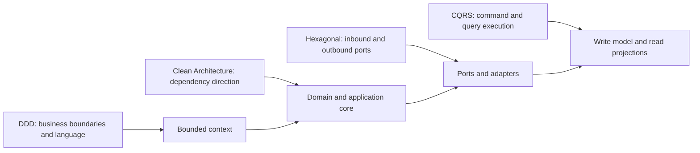
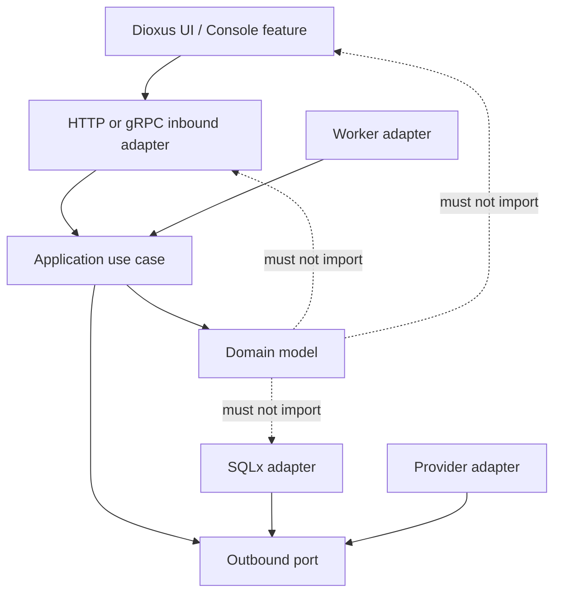
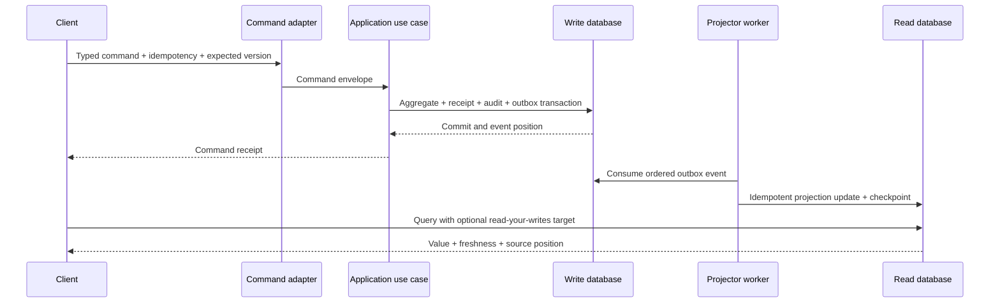

# ERPX Clean Rebuild Delivery Plan

## Purpose

This document is the non-normative implementation plan for rebuilding ERPX
from the accepted future-state requirements in [Plan](../Plan/README.md). It
combines Domain-Driven Design, Clean Architecture, Hexagonal Architecture, and
CQRS as one enforceable architecture rather than four competing structures.

The rebuild is a clean, in-place replacement of the current application model.
It replaces routes, internal HTTP interfaces, protobuf contracts, integration
events, domain models, persistence schemas, migrations, server/worker
composition, and user experience. It retains Rust, Dioxus, PostgreSQL, SQLx,
MinIO, Ollama, and the accepted holding/branch
data-plane topology.

## Locked decisions

| Decision | Selected baseline |
|---|---|
| Delivery approach | In-place rebuild on the current working tree; do not merge until the complete replacement passes its gates |
| Existing data | Clean schema generation; no migration of current application data |
| Existing dirty work | Preserve Plan documents, Pencil designs, images, and audits; overlapping code/tooling changes may be replaced |
| Architecture | DDD + Clean Architecture + Hexagonal Architecture + CQRS |
| Write model | Normalized context-owned PostgreSQL tables |
| Read model | Physically separate disposable PostgreSQL projections |
| Runtime identity | Reuse each aggregate's opaque UUID v4 as `RecordRef.id` |
| Item Directory | Two-tier federated projection with opaque control-plane routing |
| Route grammar | Singular `/<module>/<record>/:id`; remove `/workspaces` |
| Stable copied link | `/reference/item/:id` |
| Compatibility | Atomic hard cutover; no legacy UI, BFF, protobuf, or event compatibility |
| HTTP commands | Resource routes plus explicit `/commands/<command>` transitions |
| Protobuf | Command/Query service pair per bounded context |
| Search | PostgreSQL full-text search per read data plane |
| Collaboration realtime | SSE for server-to-client stream plus typed HTTP commands |
| Comment format | Versioned ERPX block JSON plus accessible plain text |
| Agent runtime | Rust worker and PostgreSQL durable queue/checkpoints |
| AI providers | Ollama and an internal OpenAI-compatible provider adapter |
| E-signature | Provider-neutral port with DocuSign as the first production adapter |
| Notifications | Provider-neutral Email/SMS/Push/Webhook ports; in-app inbox is authoritative |
| Visual design | Full code-first Dioxus redesign with adaptive enterprise density |

## Architecture model

### How the four approaches fit together



The approaches have separate responsibilities:

- DDD decides what a context owns, the ubiquitous language, aggregate
  boundaries, invariants, domain services, policies, and integration facts.
- Clean Architecture imposes the dependency rule: source code dependencies
  always point toward domain/application policy and never toward frameworks.
- Hexagonal Architecture exposes the application through inbound ports and
  reaches databases, providers, clocks, identity, authorization, storage, and
  messages through outbound ports.
- CQRS gives each use case either a command path over the authoritative write
  model or a query path over rebuildable read projections. A request never
  mixes the two models implicitly.

### Dependency rule



Allowed source dependencies:

```text
kernel/value types ← integration contracts
        ↑                    ↑
 context domain          integration mapper
        ↑                    ↑
 context ports ← context application
        ↑                    ↑
 SQLx/provider adapters  HTTP/gRPC/worker adapters
          ↖               ↗
             composition root
```

Mandatory restrictions:

- A bounded-context core must not depend on SQLx, tonic, prost, Dioxus, HTTP,
  filesystem, environment variables, another context core, or a composition
  root.
- Domain code may depend only on the minimal kernel and its own domain types.
  Protobuf and cross-context integration-contract types are mapped to internal
  value objects before invoking domain behavior.
- Application code orchestrates domain behavior and ports. It must not contain
  SQL, transport messages, provider SDK types, or UI state.
- Port traits belong to the consuming context. An adapter implements the port;
  a provider or source context does not dictate the consumer's internal model.
- Adapters may depend inward on context ports/application types. Inner layers
  never depend outward on adapters.
- Only an application composition root constructs concrete adapters.
- Cross-context behavior uses versioned integration events or typed command
  handoffs. It never imports another context's repository or aggregate.
- The integration-contract crate depends only on the kernel. It must not import
  context cores. Context integration mappers may depend on the contract and the
  target context's application API, but domain modules must not import those
  mappers.
- The shared kernel contains identity, scope, money/time primitives, command
  envelopes, and validation only. Business rules do not enter the shared
  kernel.

### Standard bounded-context layout

Every one of the 31 contexts uses this shape:

```text
crates/contexts/<context>/
├── src/
│   ├── domain/
│   │   ├── aggregates.rs
│   │   ├── entities.rs
│   │   ├── value_objects.rs
│   │   ├── policies.rs
│   │   ├── events.rs
│   │   └── errors.rs
│   ├── application/
│   │   ├── commands.rs
│   │   ├── command_handlers.rs
│   │   ├── queries.rs
│   │   ├── query_handlers.rs
│   │   └── services.rs
│   ├── ports/
│   │   ├── inbound.rs
│   │   ├── write_repository.rs
│   │   ├── read_repository.rs
│   │   ├── authorization.rs
│   │   ├── clock.rs
│   │   └── providers.rs
│   ├── integration/
│   │   ├── inbound_facts.rs
│   │   ├── outbound_events.rs
│   │   └── handoffs.rs
│   └── lib.rs
└── tests/
    └── architecture.rs
```

The paired adapter and delivery crates are:

```text
crates/adapters/<context>-sqlx/
crates/console-features/<context>/
crates/ui-domains/<context>/
```

New context cores are required for Collaboration, Agent Orchestration,
Manufacturing, Planning, Projects, E-commerce, Talent, Learning, Benefits, and
Field Service.

### DDD rules

- Each command has exactly one aggregate root as its consistency boundary.
- Cross-aggregate invariants that require immediate consistency must be modeled
  as one aggregate or as an explicit domain service operating inside one
  database transaction. They must not be implemented through a query
  projection.
- Cross-context invariants are eventually consistent and use process managers,
  typed handoffs, approvals, reconciliation, and compensating outcomes.
- Internal domain events describe facts inside one context and are not serialized
  as public contracts automatically.
- Integration events are deliberately mapped from accepted domain outcomes,
  versioned, minimized, classified, and placed in the atomic outbox.
- Aggregate state changes only through named domain methods. Public mutable
  fields and CRUD-style state assignment are forbidden.
- Business lifecycle state is a typed enum with an explicit transition table;
  unknown or retired values fail closed.
- Value objects own validation for money, currency, quantity, tax, date ranges,
  identifiers, names, classification, and organizational scope.
- Domain errors express business meaning. Adapters map them to transport or
  provider failure types at the boundary.

### Clean Architecture use-case rules

Each application command handler follows one deterministic sequence:

1. Validate command envelope and bounded input shape.
2. Authorize realm, role, organization, record, field, purpose, and required
   fresh-MFA/approval context through an outbound authorization port.
3. Reserve or replay the idempotency receipt by key and payload digest.
4. Load the authoritative aggregate and verify expected version.
5. Invoke domain behavior.
6. Persist normalized aggregate changes, command receipt, immutable audit, and
   integration events in one unit of work.
7. Return a typed receipt containing the new aggregate version and committed
   event positions.

Each application query handler follows this sequence:

1. Validate query envelope, scope, pagination, filter, and consistency request.
2. Authorize before selecting index, result, snippet, facet, count, or detail.
3. Query a read repository only.
4. Return value plus source position, freshness, lag, and degraded state.
5. Never fall back to the write database.

### Hexagonal ports

Inbound ports:

- context command handlers;
- context query handlers;
- collaboration stream subscription;
- provider callback intake;
- projection/event consumption; and
- operational data-plane commands.

Outbound ports:

- write repository and command unit of work;
- read repository;
- authorization and active-scope decision;
- clock and identifier generator;
- outbox/event publisher;
- object storage and malware scanning;
- provider connector and callback verification;
- cryptography/secret reference resolution;
- notification delivery;
- AI model/tool invocation; and
- audit/evidence sink.

Every outbound port defines typed timeout, retryability, idempotency,
classification, redaction, and reconciliation behavior. A generic
`anyhow::Error`, raw JSON provider response, or string-only error must not cross
into the application/domain core.

### CQRS execution and consistency



- Write and read databases are physically separate for every routed data plane.
- Sequence numbers are local to their source data plane; an event position
  therefore contains data-plane identity, partition, sequence, and event ID.
- Projection consumers are idempotent by event ID and ordered by owner
  partition. A detected gap blocks publication for that partition.
- Read-your-writes may wait up to the bounded policy limit for a receipt's
  target position. Timeout returns a typed not-ready response rather than
  reading the write store.
- Rebuild creates a new projection generation, verifies counts/positions/domain
  invariants, and atomically activates it. The previous generation remains
  available for bounded rollback.
- Process managers are durable application components driven by integration
  events. They store correlation, causation, step receipts, timeout, retry, and
  compensation state but never become business authority.

### Architecture enforcement

Extend `cargo xtask architecture` so it rejects:

- framework imports in context cores;
- dependencies between sibling context crates;
- SQL outside SQLx adapter/migration/test boundaries;
- protobuf/tonic types in domain, application, presenters, and views;
- Dioxus types outside UI/console delivery crates;
- context repositories used by another context;
- command handlers reading projection repositories to enforce invariants;
- query handlers accessing write repositories;
- route strings outside the typed interface catalog;
- direct provider SDK use outside provider adapters;
- raw interactive RSX outside the UI kit; and
- composition-root logic inside domain/application modules.

Every context retains an architecture test that verifies its own manifest,
imports, ports, read/write separation, and integration-contract dependencies.

## Canonical routes and interfaces

### Route grammar

```text
Workspace:   /<module>
Collection:  /<module>/<record>
Detail:      /<module>/<record>/:id
Copied link: /reference/item/:id

List/query:  GET  /api/v1/<module>/<record>
Create:      POST /api/v1/<module>/<record>
Detail:      GET  /api/v1/<module>/<record>/:id
Command:     POST /api/v1/<module>/<record>/:id/commands/<command>
```

All route IDs are lowercase hyphenated UUID v4 values. Tenant, holding,
company, branch, role, support authority, or classification never appears as a
trusted URL parameter. Current session and policy determine effective scope.

There are no compatibility aliases for `/workspaces`, `/api/bff`, or legacy
detail routes. The new release is an atomic hard cutover.

### Workspace roots

```text
/operations       /finance          /sales
/procurement      /inventory        /asset
/maintenance      /quality          /marketing
/people           /pos              /legal
/manufacturing    /planning         /project
/commerce         /talent           /learning
/benefits         /field-service    /ai
```

Shared entry points are `/work`, `/processes`, `/insights`, and `/modules`.

### Record families

| Module | Record slugs |
|---|---|
| `identity` | `principal`, `role`, `grant`, `access-review`, `break-glass-session` |
| `platform` | `tenant`, `data-plane-operation`, `migration`, `provider`, `release` |
| `organization` | `holding`, `company`, `branch`, `sharing-agreement` |
| `commercial` | `subscription`, `entitlement`, `account`, `adjustment` |
| `brand` | `profile`, `asset`, `publication` |
| `customer` | `account`, `authority-grant`, `support-access` |
| `customer-360` | `profile`, `note`, `merge` |
| `support` | `customer-case`, `platform-case`, `incident`, `access-session` |
| `finance` | `journal`, `invoice`, `credit-note`, `debit-note`, `payment`, `reconciliation`, `close-cycle` |
| `sales` | `quote`, `order`, `return`, `fulfillment-handoff` |
| `pos` | `register-session`, `sale`, `refund`, `cash-movement` |
| `procurement` | `requisition`, `rfq`, `purchase-order`, `receipt`, `supplier-return` |
| `inventory` | `document`, `transfer`, `count`, `reservation`, `lot`, `serial` |
| `asset` | `asset`, `transfer`, `depreciation-run`, `disposal` |
| `maintenance` | `plan`, `work-order`, `inspection`, `request` |
| `quality` | `plan`, `inspection`, `nonconformance`, `corrective-action` |
| `operations` | `operation`, `exception`, `case`, `approval-work` |
| `people` | `employee`, `employment`, `leave`, `time-record` |
| `payroll` | `run`, `payslip` |
| `legal` | `contract`, `case`, `matter`, `hold`, `signature-envelope` |
| `marketing` | `campaign`, `content`, `audience-activation`, `consent-purpose` |
| `crm` | `lead`, `opportunity`, `activity`, `forecast` |
| `manufacturing` | `specification`, `routing`, `order`, `batch`, `result` |
| `planning` | `scenario`, `demand-plan`, `supply-plan`, `capacity-plan`, `recommendation` |
| `project` | `project`, `phase`, `item`, `template`, `handoff` |
| `commerce` | `catalog-publication`, `cart`, `order`, `fulfillment-request`, `return` |
| `talent` | `requisition`, `candidate`, `application`, `interview`, `offer`, `review-cycle`, `proposal` |
| `learning` | `course`, `assignment`, `enrollment`, `completion` |
| `benefits` | `plan`, `window`, `election`, `handoff` |
| `field-service` | `agreement`, `request`, `dispatch`, `visit`, `handoff` |
| `collaboration` | `thread`, `moderation-case`, `promotion` |
| `agent` | `definition`, `version`, `assignment`, `delegation-tree`, `session`, `budget-decision` |

### Typed interface catalog

Add a framework-free Rust catalog that is the compile-time source of truth for
context IDs, module/record slugs, route templates, protobuf packages/services,
event namespaces, realm policies, and channel policies. UI, BFF, server, tests,
and descriptor publishers build paths from this catalog.

The 31 contexts each expose one internal `<Context>CommandService` and one
`<Context>QueryService`. Collaboration additionally exposes
`CollaborationStreamService`; the Item Directory exposes
`ReferenceQueryService`; Platform exposes `DataPlaneStreamService`. The result
is 65 active services.

Legacy `IFC-SVC-001..065` entries become Retired and are never reused. New
contracts use `IFC-SVC-101..165` and packages such as `erpx.finance.v1`,
`erpx.collaboration.v1`, and `erpx.agent.v1`.

Integration events use `<context>.<record>.<event>.v1`. Event and command names
come from an approved typed registry; arbitrary strings cannot carry business
authority.

### Core reference contracts

```text
RecordRef
- id: RecordId
- owner_context: ContextId
- record_type: RecordTypeId

RecordVersionRef
- record: RecordRef
- version: u64

ItemDescriptor
- record: RecordRef
- tenant/holding/company/branch scope
- canonical route
- lifecycle state
- authorization-policy reference
- descriptor version
- source data-plane event position
```

`RecordRef` is stable and does not pin a changing aggregate version. Commands,
approvals, anchors, and immutable evidence use `RecordVersionRef` when they must
pin exact state.

## Storage and shared platform behavior

### Clean normalized baseline

Replace the tracked migration history with fresh schema-generation-v2
migrations beginning at `0001` for control-write, control-read, tenant-write,
and tenant-read databases.

Each write database contains shared execution infrastructure plus normalized
context schemas:

```text
erpx_runtime.command_receipt
erpx_runtime.audit_entry
erpx_runtime.outbox_event
erpx_runtime.provider_inbox
erpx_<context>.<aggregate and child tables>
```

Every aggregate root stores an opaque UUID v4, version, organizational scope,
lifecycle state, created/updated timestamps, and context-specific normalized
fields. Child rows use constrained foreign keys and fixed-precision values.
JSONB is permitted only for naturally document-shaped versioned payloads such
as comment blocks, provider manifests, audit details, and event envelopes; it
is not the generic aggregate authority.

The runtime rejects any database whose schema-generation manifest is not v2.
Bootstrap creates new databases/profiles and never deletes old databases.

### Item Directory and search

- Control-read stores UUID-to-data-plane routing envelopes only.
- Tenant/branch read databases store item descriptors and authorized search
  documents.
- Holding read databases receive scoped descendant projections under ADR-013.
- PostgreSQL `tsvector` and GIN indexes provide federated search.
- Authorization occurs before index selection, match, snippet, facet, count,
  descriptor, backlink, and record open.
- Resolver success returns `303 See Other` with `Cache-Control: no-store`.
- Absent and denied results are neutral and enumeration resistant.
- Stale/unavailable directories return explicit degraded results and never
  infer from cached protected descriptors.

### Collaboration

Collaboration owns normalized thread, audience, comment, revision, mention,
reference, reaction, follow, draft, moderation, and promotion state in the
anchor record's data plane.

- A thread cannot exist without a first-class record anchor.
- `CommentDocument` is versioned ERPX block JSON with a required plain-text
  projection.
- SSE carries durable thread events and ephemeral typing/presence; typed HTTP
  commands create all changes.
- Human mentions notify. Agent mentions create durable assignments.
- Mention events are append-only and token deletion does not withdraw prior
  effects.
- Cross-scope inboxes store opaque identities and routing state, not comment
  body/title/preview.
- Attachments use tenant-scoped MinIO keys, digest verification, malware scan,
  quarantine, and short-lived authorization.
- Moderation preserves encrypted original evidence behind legal/moderator
  authority.
- Text, reactions, and natural-language approval have no business authority.
  Typed action cards call owner-context commands after current authorization.

### Agent Orchestration

Agent Orchestration owns definitions, approved versions, assignments,
delegation edges, private sessions, checkpoints, provider invocations, budget
reservations, actual usage, cancellation, and provenance.

- Rust workers claim PostgreSQL work using bounded leases and durable
  checkpoints.
- Root invocation is only `@agent`, Assign, or Run; there are no proactive
  schedules/event triggers.
- Model/provider/tool/policy/context versions are pinned at assignment creation.
- Effective scope is the intersection of initiating principal, agent manifest,
  record/field, organization, purpose, provider, classification, and tool
  policies.
- Delegation enforces depth, hops, fan-out, duration, concurrency, budget, and
  cycle checks.
- Layered budgets reserve and reconcile tenant, workspace, agent, principal,
  and root-tree usage.
- Ollama is local-first; external calls use the internal OpenAI-compatible
  adapter after tenant allow-list, DPA, residency, classification, and use-case
  approval.
- Business changes are proposals expressed as action cards. Agents never call
  write repositories or owner-context mutation adapters directly.

### Projects

Projects uses an adjacency-list authoritative hierarchy and a replaceable
closure projection for ancestry/descendant queries. Hierarchy commands reject
self-parenting and cycles before commit.

Cross-project dependencies store independent proposal and endpoint acceptance
versions. Schedule/status impact begins only after both owners accept the same
relation version. Revoke/cancel outcomes reconcile both sides.

Finance, Legal, Operations, Assets, Sales, Procurement, and other business
changes use typed handoff ports with idempotency, approval, correlation, and
accepted/rejected reconciliation.

### Provider decisions

- Stripe remains the payment/commercial provider adapter.
- Ollama and an OpenAI-compatible adapter provide AI inference.
- DocuSign is the first e-signature production adapter behind a provider-neutral
  port.
- Notifications expose provider-neutral Email/SMS/Push/Webhook adapters with
  deterministic signed acceptance adapters; the in-app inbox is authoritative.
- LDAP, AD DS, and UCS remain directory adapters.
- MinIO remains object storage.

## Delivery sequence

### Phase 0 — Controlled rebuild baseline

- Create the rebuild branch from the current dirty working tree.
- Preserve Plan, Pencil, images, and audits; allow overlapping application and
  tooling code to be replaced.
- Add FSD-006 for the unified resource namespace, combined architecture, clean
  schema generation, and hard cutover.
- Move the requirements baseline to 2.0.0 while preserving stable requirement
  IDs.
- Update route/interface catalogs, E2E paths, traceability, evidence, and the
  requirements validator.

Gate: the new plan, decisions, route registry, context registry, service
registry, data-plane model, and architecture rules are internally consistent
before runtime code changes begin.

### Phase 1 — Kernel, catalog, and execution foundation

- Rewrite the kernel around typed identities, scope, actor attribution,
  classification, command/query envelopes, event positions, errors, and
  validation.
- Add the typed interface catalog.
- Rewrite CQRS receipts, unit of work, audit, outbox, projection generation,
  checkpoints, retry, dead letter, and read-your-writes contracts.
- Extend architecture scans for DDD/Clean/Hexagonal/CQRS rules.
- Remove broad legacy domain/application/infrastructure facades after all new
  callers use context cores and adapters.

Gate: a reference context proves the full command and query paths with no
framework dependency in its core.

### Phase 2 — Clean database generation and bootstrap

- Replace old migration directories with generation-v2 normalized schemas.
- Implement fresh bootstrap for control and holding pairs plus optional branch
  pairs.
- Implement RLS, secret-reference routing, schema-manifest rejection, backup
  inventory, and non-destructive old-database retention.
- Verify migration on disposable PostgreSQL instances for all four database
  roles.

Gate: clean install, restart, provisioning, branch isolation, backup inventory,
and schema mismatch denial pass.

### Phase 3 — Identity and platform authority

Implement Identity & Access, Platform Administration, Organization,
Commercial, and Brand through the standard context/adapter/interface/UI shape.
Complete realms, JML, expiring roles, access review, SoD, fresh MFA, break
glass, directories, tenant/holding/company/branch hierarchy, provider
connectors, and data-plane routing.

Gate: E2E-01, 02, 03, 16, 18, and 26.

### Phase 4 — Universal records and interfaces

- Replace all protobuf contracts with the 65-service context catalog.
- Replace UI/BFF routes with the singular resource grammar.
- Publish descriptors from every implemented aggregate's atomic outbox.
- Implement the two-tier Item Directory, authorized resolver, PostgreSQL FTS,
  backlinks, rebuild, route changes, and deletion propagation.
- Register future-context record families behind unavailable feature states,
  never fake runtime availability.

Gate: E2E-13, 23, 50, 51, 52, and 68.

### Phase 5 — Shared enterprise services

Implement approvals, Enterprise Home, notifications, e-signatures, distributed
master/reference data, reports/exports, governed imports, controlled
extensions, privacy, audit, and secure product assurance through explicit ports
and projections.

Gate: E2E-20 through 25, 27, 29, and applicable security/privacy paths.

### Phase 6 — Current business contexts

Deliver the current contexts in reconciled vertical waves:

1. Customer Authority, Customer 360, Support.
2. Marketing, CRM, Sales, Finance.
3. Procurement, Inventory, POS.
4. Assets, Maintenance, Quality, Operations.
5. People & Payroll, Legal.

Every vertical includes normalized aggregates, domain/application tests, ports,
SQLx adapters, events, projection, interfaces, collection/detail routes,
authorization, audit, observability, comments/references, and evidence.

Gate: E2E-04 through 12, 19, 20, 41, and 42 as applicable.

### Phase 7 — Collaboration and AI

- Implement Collaboration context, SSE streaming, comments, human/group/agent
  mentions, references, retention, moderation, external threads, promotion,
  and action cards.
- Implement Agent Orchestration registry, assignments, delegation, pools,
  budgets, private sessions, provider policy, provenance, recovery, and the
  floating launcher.
- Integrate comments and launcher into every authorized detail page rather
  than limiting them to the AI workspace.

Gate: E2E-28, 45 through 63, and 67.

### Phase 8 — Enterprise contexts

1. Projects and cross-domain handoffs.
2. Manufacturing and Planning.
3. E-commerce.
4. Recruiting & Talent.
5. Learning and Benefits.
6. Field Service.

Gate: E2E-32 through 40 and 64 through 66.

### Phase 9 — Full Dioxus redesign

- Rewrite design tokens and shared components in the UI kit.
- Implement adaptive enterprise density: desktop data grids/command bars and
  mobile cards/bottom actions with a user density preference.
- Build a new shell, workspace navigation, collection/detail template, record
  header, activity/reference rail, approval/action-card experience, comment
  editor, moderation surfaces, AI launcher, and explicit state components.
- Complete English/Thai, keyboard, screen-reader, focus, reduced-motion,
  responsive, and safe-redaction behavior.
- Certify Commerce and Talent as responsive Web-only and the other 19
  workspaces on Web/Desktop/iOS/Android.
- Offline remains read-only and visibly stale; it cannot queue mutations,
  comments, mentions, references, or AI work.

Gate: E2E-17, 36, 37, 57, and 60 plus the complete workspace/channel matrix.

### Phase 10 — Regulation, resilience, and release

- Implement Thailand and regulated-sector overlays from versioned official
  sources without hard-coded rates or automatic-compliance claims.
- Complete redacted telemetry, readiness, worker/queue state, projection lag,
  provider reconciliation, incident response, backups, PITR, restore,
  customer-hosted equivalence, portability, exit, and deletion evidence.
- Promote one signed artifact through internal and canary gates, then perform
  the atomic hard cutover.
- Do not delete or alter old databases during release.

Gate: E2E-14, 15, 16, 19, 30, 31, and 41 through 44; all 68 scenarios pass in
production-like topology.

## Verification and evidence

### Test layers

| Layer | Mandatory proof |
|---|---|
| Domain | Aggregate transition tables, invalid transitions, value-object invariants, money/quantity/time properties |
| Application | Authorization order, idempotency replay/conflict, expected version, typed port interactions, unit-of-work outcome |
| Ports | Consumer-owned semantics, timeout/retry/reconciliation behavior, no framework/provider leakage |
| SQLx | Normalized constraints, RLS, transaction atomicity, write/read separation, secret exclusion |
| Projection | Duplicate, ordering, gap, poison, retry, dead letter, rebuild, replacement activation, deletion propagation |
| Contract | Exactly 65 active new services, retired legacy IDs, package ownership, required fields, unknown-value denial |
| HTTP/routes | Complete catalog, UUID parsing, no legacy paths, no hidden metadata, safe redirect and command behavior |
| Worker/process manager | Durable lease/checkpoint, restart, retry bounds, cancellation race, compensation and reconciliation |
| Collaboration | Revision, tombstone, mention snapshots, retention/hold, SSE reconnect, moderation and external isolation |
| Agent | Scope intersection, injection defense, provider policy, budgets, delegation cycle, retry/cancel and no direct mutation |
| UI | Loading, empty, denied, restricted, stale, degraded, conflict, retryable, terminal and success states on required channels |
| Operations | Backup/restore/PITR, projection SLO, migration/release rehearsal, customer-hosted and exit evidence |

### Required commands

Small checkpoint:

```bash
cargo xtask check-affected --dry-run
cargo xtask check-affected
```

Related vertical slice:

```bash
cargo xtask test-affected --dry-run
cargo xtask test-affected
```

Final documentation and application gates:

```bash
python3 Plan/tools/validate_requirements.py
git diff --check
cargo xtask verify
cargo xtask verify-platforms
```

`verify-platforms` remains a manual Desktop/Mobile certification milestone.
Keep Dioxus hot reload active while editing UI and leave ERPX development
services running on port 3004 at handoff.

### Final acceptance

- All 644 normative requirements have accepted `EVD-*` evidence.
- All 31 contexts pass architecture, lifecycle, persistence, contract, and
  acceptance checks.
- All 21 workspaces meet their channel policy.
- All 68 E2E scenarios pass.
- Projection lag is at most 60 seconds.
- RPO is at most 24 hours and RTO is at most 4 hours.
- A verified backup is at most 25 hours old.
- PITR rehearsal is at most 31 days old.
- No Critical/High security, privacy, tenant isolation, financial
  reconciliation, data-loss, or recovery defect remains.
- No legacy UI route, BFF path, protobuf service, event contract, or old schema
  generation is accepted by the new runtime.

## Assumptions

- The current data is non-production and does not require migration.
- Existing databases are retained outside the new runtime; no destructive reset
  is implied.
- Plan documents, Pencil designs, images, and audit evidence remain available
  even though the implementation becomes code-first.
- The new internal API is not a public developer API and provides no customer
  API keys.
- AI agents have independent identities and no business authority.
- There is no standalone chat, proactive agent subscription, implicit
  natural-language mutation, multi-author CRDT editing, or offline write queue.
- Web is the primary implementation baseline; final acceptance still follows
  the declared four-channel matrix.
- Requirements documents remain English; product UI is English and Thai.
