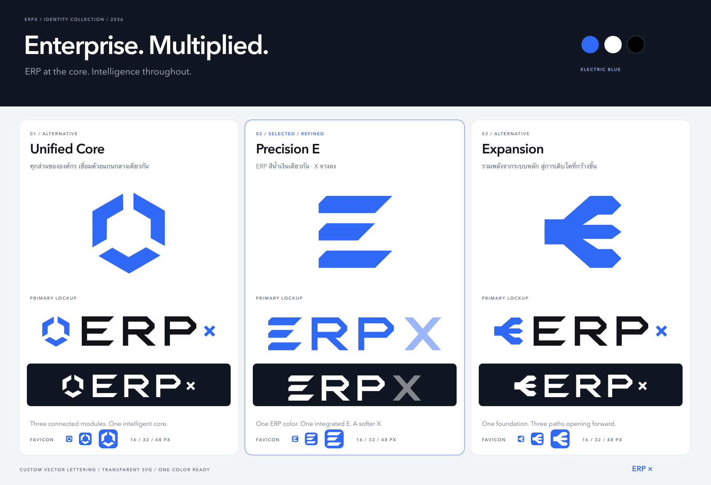

# ERPX — Future Identity

ชุดโลโก้ต้นฉบับ 3 แนวทางสำหรับ ERP ที่นำ AI มาใช้ทั่วทั้งองค์กร ออกแบบให้ **ERP เป็นพระเอก** ผู้ใช้เลือก **Precision E** โดยใช้สัญลักษณ์ E เป็นตัวแรกของคำว่า ERPX แล้วต่อด้วย RPX ให้ E, R และ P ใช้สีน้ำเงินเดียวกัน และปรับ X ให้สูงเท่า ERP ที่ความทึบ 48% เพื่อให้มี contrast รองลงมา ส่วน Unified Core และ Expansion เก็บรูปแบบเครื่องหมายคูณเล็กตามแบบแรก ชื่อแบรนด์และข้อความสำหรับโปรแกรมอ่านหน้าจอคือ **ERPX**



เปิด `index.html` ในเบราว์เซอร์เพื่อดูโลโก้รุ่นสี ดำ และขาว ดาวน์โหลดแต่ละไฟล์ หรือเปิดตัวอย่างการใช้ของแต่ละแนวทาง ชุดรวมอยู่ใน `erpx-future-logo-kit.zip` และชุดเฉพาะแบบที่เลือกอยู่ใน `precision-e-logo-kit.zip`

**ชุดพร้อมใช้ SVG ล้วน:** `precision-e-svg-kit.zip` มีโลโก้เต็ม 3 รุ่น, E เดี่ยว 3 รุ่น และ favicon SVG รวม 7 ไฟล์ ดูรายละเอียดที่ `precision-e/README.md`

## เลือกแนวทาง

| โฟลเดอร์ | แนวทาง | ความหมายและบุคลิก |
| --- | --- | --- |
| `unified-core/` | **01 · Unified Core** | โมดูลสามชิ้นโอบพื้นที่กลางร่วมกัน แทนทีม ข้อมูล และการทำงานที่ประสานผ่านระบบหลักและ AI ให้ความรู้สึกเป็นระบบและสมดุล |
| `precision-e/` | **02 · Precision E — แบบที่เลือก** | แถบเรขาคณิตสามชั้นแทนตัว E ใน ERPX โดยตรง ใช้ ERP สีน้ำเงินเดียวกัน และใช้ X เต็มความสูงที่ลดความเข้มสี |
| `expansion/` | **03 · Expansion** | ทางเดินสามแนวเริ่มจากฐานเดียวแล้วแยกไปสู่ปลายลูกศรด้านขวา สื่อถึงศักยภาพองค์กรที่ขยายจากระบบงานร่วมกัน |

ทั้งสามแบบใช้ตัวอักษรที่วาดเป็นเวกเตอร์ขึ้นใหม่ สัดส่วนกว้างและมุมตัดสัมพันธ์กับสัญลักษณ์ Precision E ใช้รูปทรง E เดี่ยวเดียวกันใน wordmark โดยขยายอย่างรักษาสัดส่วนให้สูง 100 หน่วย ตามด้วย RP และ X สูงเท่ากัน X กว้าง 112 หน่วย ใช้ค่า opacity 0.48 ร่วมกับสีตัวอักษรหลักในแต่ละรุ่น จึงเห็นเป็นสีเทาบนพื้นขาวและสีขาวจางบนพื้นเข้ม อีกสองแบบยังใช้เครื่องหมายคูณสูงประมาณ 38% ของ ERP ตามแบบแรก

## ไฟล์ของแต่ละแนวทาง

| ไฟล์ | การใช้งาน |
| --- | --- |
| `logo.svg`, `logo.png` | โลโก้แนวนอน รุ่นสี สำหรับพื้นขาวหรือพื้นอ่อน; Precision E ใช้ ERP สีน้ำเงินเดียวกัน และ X จางลง |
| `logo-black.svg`, `logo-black.png` | โลโก้ฐานสีดำ เหมาะกับหัวเอกสารและงานพิมพ์; Precision E ใช้ X ความทึบ 48% |
| `logo-white.svg`, `logo-white.png` | โลโก้ฐานสีขาว สำหรับพื้นเข้ม; Precision E ใช้ X ความทึบ 48% |
| `mark.svg`, `mark.png` | สัญลักษณ์เดี่ยวสีน้ำเงิน |
| `mark-black.svg`, `mark-black.png` | สัญลักษณ์เดี่ยวสีดำล้วน |
| `mark-white.svg`, `mark-white.png` | สัญลักษณ์เดี่ยวสีขาวล้วน |
| `favicon.svg` | สัญลักษณ์สีขาวบนพื้นน้ำเงินมุมมน เหมาะกับแท็บเบราว์เซอร์ทั้งธีมสว่างและมืด |
| `favicon.ico` | ICO รวมภาพ 16, 32 และ 48 px แบบ 32-bit พร้อม alpha |
| `icon-16.png`, `icon-32.png`, `icon-48.png` | favicon PNG ตามขนาดจริง |
| `icon-180.png` | สำหรับ Apple touch icon |
| `icon-192.png`, `icon-512.png` | ไอคอนเว็บหรือแอปทั่วไป; ไม่ใช่ชุด maskable icon |
| `in-context.svg`, `in-context.png` | ภาพจำลองบนหัวเว็บไซต์ แท็บเบราว์เซอร์ และรายงานขาวดำ |

โลโก้และสัญลักษณ์ทุกเวอร์ชันมีพื้นโปร่งใส ยกเว้น favicon ซึ่งมีพื้นน้ำเงินภายในกรอบมุมมนและมุมด้านนอกโปร่งใส PNG โลโก้ Precision E มีขนาด 1172 × 320 px (viewBox 586 × 160); อีกสองแบบมีขนาด 1312 × 320 px PNG สัญลักษณ์มีขนาด 512 × 512 px เลือก SVG เป็นหลักสำหรับเว็บและเอกสารที่รองรับเวกเตอร์

`wordmark.svg` ที่รากชุดงานเป็นต้นฉบับตัวอักษรของสองแนวทางเดิม ขนาด viewBox 464 × 100 ส่วน `precision-e/wordmark.svg` เป็น wordmark ของแบบที่เลือก ขนาด viewBox 536 × 100 ทุกไฟล์ใช้เส้นทางเวกเตอร์โดยตรง ไม่มีการใช้ฟอนต์สำเร็จรูปหรือภาพ bitmap ฝังในโลโก้

## สีและระยะเว้น

| สี | ค่า | บทบาท |
| --- | --- | --- |
| Electric Blue | `#2F69F5` | สัญลักษณ์และพื้น favicon; เครื่องหมายคูณในสองแบบเดิม |
| Ink | `#111318` | ตัวอักษร ERP ในรุ่นสี; X ของ Precision E ใช้สีนี้ที่ opacity 48% |
| Black | `#000000` | งานพิมพ์สีเดียว |
| White | `#FFFFFF` | โลโก้บนพื้นเข้ม |

- เว้นที่ว่างจากขอบรูปทรงที่มองเห็นอย่างน้อย **1/4 ของความสูงตัว ERP** รอบโลโก้ หรือ **1/4 ของความกว้างสัญลักษณ์ที่มองเห็น** รอบสัญลักษณ์เดี่ยว ระยะนี้นับรวมขอบโปร่งใสที่มีในไฟล์ได้
- โลโก้เต็มแนะนำกว้างอย่างน้อย **128 CSS px** บนจอ และ **32 mm** ในงานพิมพ์ หากพื้นที่เล็กกว่านี้ ให้ใช้สัญลักษณ์เดี่ยว
- favicon ใช้ไฟล์ไอคอนที่จัดพื้นและระยะไว้แล้ว ขนาดต่ำสุด **16 × 16 px**
- ใช้รุ่นสีบนพื้นอ่อน รุ่นขาวบนพื้นเข้ม และรุ่นดำสำหรับงานพิมพ์ขาวดำ รักษาสัดส่วนเดิมและสีของแต่ละรุ่น
- ไม่เติมเงา เส้นขอบ เอฟเฟกต์เรืองแสง หรือยืดเฉพาะแกน เพราะทำให้รูปทรงและช่องว่างที่ปรับไว้เปลี่ยนไป

ตัวอย่าง HTML สำหรับเว็บไซต์ทั่วไป เมื่อคัดลอกไฟล์ที่เลือกเข้าโฟลเดอร์ assets ของเว็บไซต์แล้ว:

```html

<link rel="icon" href="/assets/erpx/favicon.svg" type="image/svg+xml">
<link rel="icon" href="/assets/erpx/favicon.ico" sizes="16x16 32x32 48x48">
<link rel="apple-touch-icon" href="/assets/erpx/icon-180.png">
```

## ภาพตรวจและการสร้างไฟล์ใหม่

- `comparison.png` / `comparison.svg`: เปรียบเทียบ 3 แบบ พร้อมรุ่นสีและขาว
- `size-check.png` / `size-check.svg`: favicon ขนาดจริงและภาพขยายจากพิกเซลที่เรนเดอร์แล้ว รวมโลโก้เต็มที่ 128 และ 256 px; เปิดที่ 100% เพื่อประเมินขนาดจริง
- `index.html`: แกลเลอรีในเครื่อง รองรับจอเล็กและเปิดภาพตัวอย่างของแต่ละแนวทาง
- `VERIFICATION.md`: ผลตรวจไฟล์และการแสดงผล
- `precision-e/preview.png` / `precision-e/preview.svg`: โลโก้ที่ใช้สัญลักษณ์ E ในคำว่า ERPX พร้อม E เดี่ยวและ favicon

แก้ต้นฉบับ `wordmark.svg`, `precision-e/wordmark.svg` หรือ `mark.svg` ในโฟลเดอร์แต่ละแบบ แล้วรันจากรากโปรเจกต์ด้วย Bun 1.2.17:

```sh
bun Designed/branding/erpx-future/generate.mjs
```

สคริปต์ใช้ `sharp` ที่ติดตั้งอยู่ในโปรเจกต์ เขียนเฉพาะไฟล์ในชุดนี้ และรักษาต้นฉบับเวกเตอร์ทั้งห้าไฟล์ไว้ SVG ของโลโก้ทั้งหมดไม่พึ่งพาฟอนต์ ภาพภายนอก JavaScript หรือ CSS จากเว็บไซต์ ส่วนข้อความประกอบบนแผ่นตัวอย่างใช้ฟอนต์ระบบ Avenir Next / Thonburi / Arial; PNG ตัวอย่างเรนเดอร์ข้อความไว้เรียบร้อยแล้ว

สร้าง ZIP ใหม่หลังตรวจภาพและไฟล์เสร็จ โดยรันในโฟลเดอร์ชุดงาน:

```sh
zip -q -r erpx-future-logo-kit.zip README.md VERIFICATION.md generate.mjs index.html wordmark.svg comparison.svg comparison.png size-check.svg size-check.png unified-core precision-e expansion
```

ภาพเว็บและรายงานใช้ข้อมูลตัวอย่างเพื่อแสดงการวางแบรนด์ ชุดนี้เป็นไฟล์ออกแบบที่แยกจากแบรนด์ปัจจุบันของแอป ไม่ได้เปลี่ยน favicon ของระบบจริง การจัดแบรนด์เอกสารธุรกิจ ธีม API หรือหน้าจอที่ใช้งานอยู่
