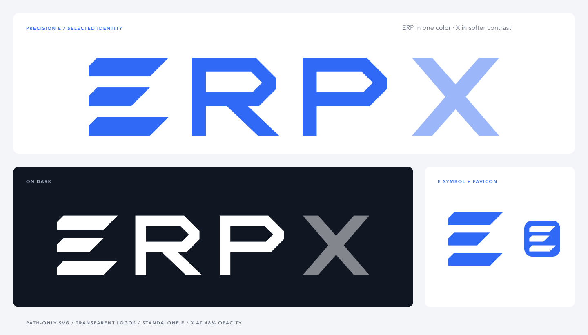

# ERPX — Precision E

แบบที่เลือก: **ใช้สัญลักษณ์ E สามแถบเป็นตัว E ตัวแรกของคำว่า ERPX แล้วต่อด้วย RPX** ทั้งคำเป็นเวกเตอร์ชุดเดียว ไม่มี E ตัวพิมพ์ซ้ำหรือสัญลักษณ์เพิ่มด้านหน้า โดย **E, R และ P ใช้ Electric Blue สีเดียวกันเสมอ** ส่วน X ใช้สีเดียวกันที่ลดความทึบเหลือ 48%

**X สูงเท่า ERP** ที่ 100 หน่วย กว้าง 112 หน่วย และใช้ **opacity 48%** เพื่อให้น้ำหนักสีรองลงมา ทั้งสี่ตัวอักษรใช้เส้นฐานเดียวกัน X ยังสื่อถึง multiplier ขององค์กร



- `logo.svg` / `logo.png`: E, R และ P ใช้ Electric Blue `#2F69F5` สีเดียวกัน ส่วน X ใช้สีเดียวกันที่ลดความทึบเหลือ 48% เหมาะกับพื้นขาวหรือพื้นอ่อน
- `logo-white.svg` / `logo-white.png`: สำหรับพื้นเข้ม; X ขาวที่ความทึบ 48%
- `logo-black.svg` / `logo-black.png`: สำหรับเอกสารขาวดำ; X ใช้ระดับสีเทาจากความทึบ 48% เหมาะกับงานพิมพ์ที่รองรับระดับเทา
- `mark.svg` และรุ่น `-black`, `-white`: สัญลักษณ์เดี่ยว
- `favicon.svg`, `favicon.ico`, `icon-16.png`, `icon-32.png`, `icon-48.png`: ชุด favicon
- `icon-180.png`, `icon-192.png`, `icon-512.png`: ไอคอนขนาดใหญ่
- `wordmark.svg`: ต้นฉบับตัวอักษร ERPX สำหรับแก้ไขเวกเตอร์
- `in-context.png`: ตัวอย่างบนหัวเว็บและหัวรายงาน

โลโก้ SVG ใช้ viewBox 586 × 160; PNG ขนาด 1172 × 320 px ทุกเวอร์ชันเป็นพื้นโปร่งใส รักษาอัตราส่วนเดิม เช่น วางที่ความสูง 40 px จะกว้าง 146.5 px แนะนำความกว้างอย่างน้อย 128 px หรือ 32 mm สำหรับงานพิมพ์ เว้นที่ว่างอย่างน้อย 1/4 ของความสูง ERP รอบรูปทรงที่มองเห็น

X ใช้ความโปร่งใสจริง สีที่มองเห็นจึงสัมพันธ์กับพื้นหลัง รุ่นสีใช้ ERP สีน้ำเงินทั้งหมด รุ่นดำใช้ ERP สีดำทั้งหมด และรุ่นขาวใช้ ERP สีขาวทั้งหมด เลือกรุ่นสีหรือดำบนพื้นอ่อน และรุ่นขาวบนพื้นเข้ม

## ชุด SVG ล้วน

`../precision-e-svg-kit.zip` รวมไฟล์ SVG สำหรับใช้งานจริง 7 ไฟล์ โดยตั้งชื่อให้นำไปใช้ได้ทันที:

| ชื่อใน ZIP | ใช้สำหรับ |
| --- | --- |
| `erpx-logo.svg` | โลโก้เต็มรุ่นสี พื้นโปร่งใส สำหรับเว็บและหัวกระดาษ |
| `erpx-logo-black.svg` | โลโก้เต็มรุ่นดำ สำหรับหัวกระดาษขาวดำ; X ยังจาง 48% |
| `erpx-logo-white.svg` | โลโก้เต็มรุ่นขาว สำหรับพื้นเข้ม; X ยังจาง 48% |
| `erpx-e.svg` | E สัญลักษณ์เดี่ยวสีน้ำเงิน พื้นโปร่งใส |
| `erpx-e-black.svg` | E เดี่ยวสีดำ พื้นโปร่งใส |
| `erpx-e-white.svg` | E เดี่ยวสีขาว พื้นโปร่งใส |
| `favicon.svg` | E สีขาวบนกรอบน้ำเงินมุมมน สำหรับแท็บเบราว์เซอร์ |

ทุกไฟล์เป็นเวกเตอร์จริง ไม่มีฟอนต์หรือรูป bitmap ฝังอยู่ ปรับขนาดได้โดยไม่เสียความคมชัด เช่น:

```html

<link rel="icon" href="/assets/favicon.svg" type="image/svg+xml">
```
