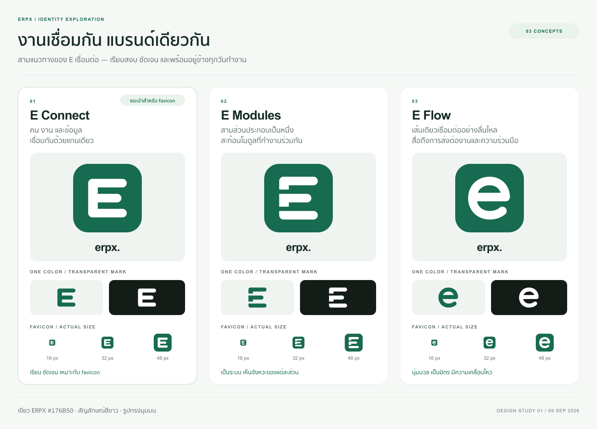

# ERPX — E เชื่อมต่อ / ตัวอย่างไอคอน 3 แบบ

ออกแบบวันที่ 9 กันยายน 2026 สำหรับเลือกทิศทางแบรนด์ก่อนนำไปติดตั้งในแอป



## แนวคิด

| แบบ | รูปทรงและความหมาย | ลักษณะเมื่อใช้งาน |
| --- | --- | --- |
| **01 · E Connect** | แขนสามเส้นร่วมแกนเดียว สื่อถึงคน งาน และข้อมูลที่เชื่อมกัน | ตัวเลือกแนะนำ: รูปทรง E ชัดเจนที่สุดเมื่อย่อเป็น favicon |
| **02 · E Modules** | ชิ้นส่วนสามชิ้นเรียงตามแนวเชื่อมร่วมกัน เป็นตัว E | สื่อถึงระบบที่ประกอบจากหลายโมดูล มีช่องว่างแบ่งส่วนชัดเจน |
| **03 · E Flow** | เส้นหนาต่อเนื่องโค้งเป็นตัว e ปลายมน | นุ่มนวลและเป็นมิตร สื่อถึงการส่งต่องานอย่างต่อเนื่อง |

ใช้สีเขียว **#176B50** จาก `--brand` ในแอป และสัญลักษณ์สีขาว **#FFFFFF** บนพื้นสี่เหลี่ยมมุมมน ทั้งสามแบบใช้พื้นที่ 512×512 และรัศมีมุมพื้น 112 หน่วย

## ดูภาพตัวอย่าง

- [ภาพเปรียบเทียบทั้งสามแบบ](comparison.png)
- [ภาพจำลองแท็บเบราว์เซอร์ ล็อกอิน และ sidebar](in-context.png)
- [ตรวจขนาดจริงและภาพขยายพิกเซล](size-check.png)

เปิดภาพที่ **100%** เพื่อดู favicon ขนาดจริง 16 / 32 / 48 พิกเซล ภาพตัวอย่างอาจถูกย่อโดยโปรแกรมแสดงภาพ

ภาพจำลองอ้างอิงข้อความ `erpx.` สี และขนาดจาก UI ปัจจุบัน: ล็อกอิน 33 px และ sidebar 31 px ใช้ Arial ในภาพตัวอย่างแทน Geist ของแอป; ตัวอักษรนี้ไม่ได้เป็นไฟล์ wordmark ใหม่ ตัวสัญลักษณ์ SVG ไม่มีการพึ่งพาฟอนต์

## ไฟล์ในแต่ละโฟลเดอร์

โฟลเดอร์: `e-connect/`, `e-modules/`, `e-flow/`

| ไฟล์ | การใช้งาน |
| --- | --- |
| `icon.svg` | ต้นฉบับแก้ไขได้ สัญลักษณ์ขาวบนพื้นเขียว มุมด้านนอกโปร่งใส |
| `icon-512.png` | ภาพไอคอน 512×512 พร้อมพื้นเขียว |
| `icon-16.png`, `icon-32.png`, `icon-48.png` | PNG ที่เรนเดอร์จาก SVG แยกตามขนาดสำหรับ favicon |
| `favicon.ico` | ไฟล์เดียวบรรจุ 16×16, 32×32 และ 48×48 แบบ 32-bit พร้อม alpha และ transparency mask |
| `mark.svg`, `mark-512.png` | สัญลักษณ์สีเขียวล้วนบนพื้นโปร่งใส เหมาะกับพื้นสว่าง |
| `mark-white.svg`, `mark-white-512.png` | สัญลักษณ์สีขาวล้วนบนพื้นโปร่งใส เหมาะกับพื้นเข้ม |

ภาพเปรียบเทียบทั้งสามแผ่นมีต้นฉบับ `.svg` คู่กับ `.png` และฝังภาพ favicon ไว้ภายใน จึงเปิดได้โดยไม่ต้องโหลดภาพจากภายนอก

## ผลการตรวจ

- ตรวจภาพทั้งสามแผ่นด้วยสายตา: ข้อความภาษาไทยแสดงครบ ไม่มีข้อความหรือรูปทรงถูกตัด
- ตรวจ favicon ขนาด 16 และ 32 px ทั้งพื้นสว่างและมืด พร้อมภาพขยายแบบ nearest-neighbor
- ช่องว่างระหว่างแขนของตัวอักษรยังแยกกันที่ 16 และ 32 px ตรวจซ้ำจากพิกเซลบริเวณกลางตัวอักษร
- เปิด ICO ด้วย Pillow ซึ่งเป็นตัวถอดรหัสอิสระจากตัวสร้าง พบครบทั้งสามขนาด และแต่ละเฟรมตรงกับ PNG ของขนาดนั้นทุกพิกเซล
- ตรวจขนาด PNG, โครงสร้าง SVG, alpha บนพื้นโปร่งใส, สีของเวอร์ชันสีเดียว และระยะขอบของสัญลักษณ์ครบทั้งสามแบบ
- ขอบเขตรอบนี้เป็นไฟล์ออกแบบเท่านั้น ยังไม่ได้เปลี่ยน `src/app/favicon.ico`, โลโก้ในแอป หรือ metadata

## สร้างไฟล์ส่งออกใหม่

แก้ `icon.svg` ของแบบที่ต้องการ แล้วรันจากรากโปรเจกต์:

```sh
bun Designed/branding/erpx-icons/generate.mjs
```

ใช้ Bun 1.2.17 และ `sharp` ที่มีอยู่ใน dependency tree ของโปรเจกต์แล้ว สคริปต์เขียนเฉพาะไฟล์ส่งออกในโฟลเดอร์นี้ ไม่แก้ต้นฉบับไอคอนทั้งสาม ฟอนต์ในภาพประกอบใช้ Arial และ Sukhumvit Set / Thonburi จาก macOS; หากใช้เครื่องอื่นควรติดตั้งฟอนต์เหล่านี้เพื่อให้การจัดวางเหมือนกัน

ไฟล์ ZIP เป็นชุดสำหรับส่งมอบ ณ เวลาที่สร้าง ไม่ถูกอัปเดตโดยสคริปต์ส่งออกภาพ
