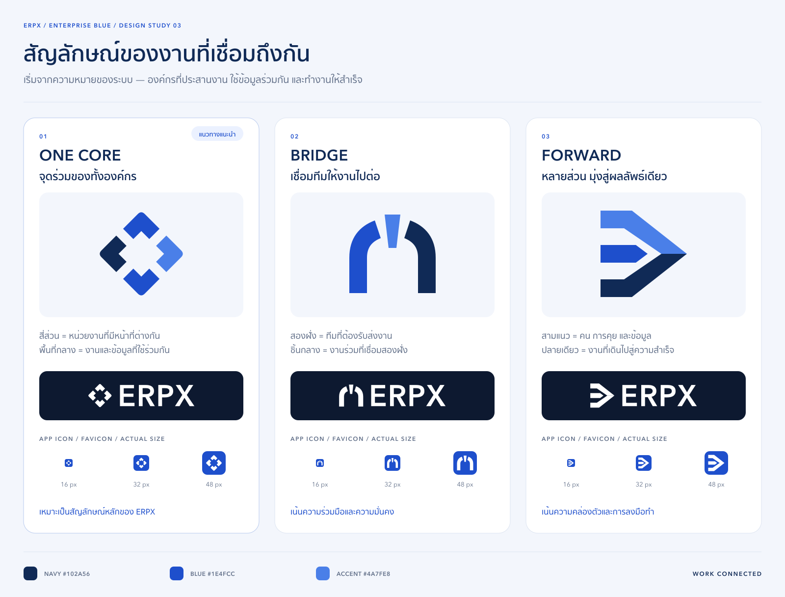

# ERPX — Enterprise Blue / สัญลักษณ์ที่เริ่มจากความหมาย

ตัวอย่างออกแบบรอบที่ 3: ใช้น้ำเงินแนวองค์กรและสัญลักษณ์อิสระจากตัวอักษร ตามข้อเสนอแนะให้มีความหมายมากกว่าการวาง E หรือ ERPX ในไอคอน



## แนวคิดจากโปรเจกต์

จุดตั้งต้นคือการทำงานร่วมกันหลายทีม การสนทนาที่ต่อยอดเป็นงาน และข้อมูล/หลักฐานที่ยังติดตามได้ตลอดการส่งต่อ อ้างอิง `docs/contracts/next/workplace-ux.md`, `docs/production-plan.md` และ `docs/contracts/next/workplace-ux.md`

| แบบ | ความหมายของรูปทรง | บุคลิก |
| --- | --- | --- |
| **01 · One Core — แนะนำ** | ส่วนประกอบสี่ชิ้นมีหน้าที่ของตัวเองและล้อมพื้นที่กลางร่วมกัน สื่อถึงหน่วยงานที่ทำงานบนข้อมูลและพื้นที่ทำงานเดียวกัน | เป็นระบบ สมดุล เหมาะกับภาพรวมของ ERPX |
| **02 · Bridge** | สองฝั่งของสะพานแทนทีมที่ต้องรับส่งงาน ชิ้นกลางอ้างอิงหินหลักของซุ้ม สื่อถึงงานร่วมที่เชื่อมสองฝั่ง | ร่วมมือ มั่นคง และเชื่อถือได้ |
| **03 · Forward** | เส้นทางสามแนวแทนคน การสนทนา และข้อมูล รวมทิศทางไปยังปลายเดียวกัน | คล่องตัว เน้นการลงมือและผลลัพธ์ |

ชื่อเหล่านี้เป็นชื่อแนวทางออกแบบ สัญลักษณ์สามารถใช้เดี่ยว ๆ โดยไม่ต้องมีข้อความ ส่วนโลโก้แนวนอนจับคู่กับคำว่า ERPX ตัวพิมพ์ใหญ่ในรูปแบบเรียบอ่านง่าย

## สี

| บทบาท | สี |
| --- | --- |
| น้ำเงินหลัก / พื้น app icon | `#1E4FCC` |
| น้ำเงินเข้ม / ตัวอักษร | `#102A56` |
| น้ำเงินเสริม / ส่วนประกอบ | `#4A7FE8` |
| สัญลักษณ์บนพื้นเข้ม | `#FFFFFF` |

ภาพหลักใช้สีน้ำเงินหลายระดับช่วยแยกส่วนประกอบ ส่วน favicon ใช้สัญลักษณ์ขาวบนพื้นน้ำเงินเดียวกันทั้งสามแบบ เพื่อให้เทียบรูปทรงที่ขนาดเล็กได้โดยตรง

## ไฟล์ส่งมอบ

แต่ละโฟลเดอร์ `one-core/`, `bridge/`, `forward/` มี:

| ไฟล์ | รายละเอียด |
| --- | --- |
| `mark.svg`, `mark-512.png` | ต้นฉบับสัญลักษณ์สีน้ำเงินหลายระดับ พื้นโปร่งใส 512×512 |
| `mark-mono.svg`, `mark-mono-512.png` | สัญลักษณ์สีน้ำเงินล้วน พื้นโปร่งใส |
| `mark-white.svg`, `mark-white-512.png` | สัญลักษณ์สีขาวล้วน พื้นโปร่งใส |
| `icon.svg`, `icon-512.png` | ไอคอนสีขาวบนพื้นน้ำเงินมุมมน 512×512 |
| `icon-16.png`, `icon-32.png`, `icon-48.png` | ภาพ favicon ที่เรนเดอร์จากเวกเตอร์โดยตรงในแต่ละขนาด |
| `favicon.ico` | ICO บรรจุ PNG แบบ 32-bit พร้อม alpha ขนาด 16 / 32 / 48 px |
| `logo.svg`, `logo.png` | สัญลักษณ์คู่กับ ERPX แนวนอน พื้นโปร่งใส 860×256 |
| `logo-white.svg`, `logo-white.png` | โลโก้แนวนอนสีขาวสำหรับพื้นเข้ม |

`wordmark.svg` ระดับบนเป็นเส้นเวกเตอร์ของ ERPX จาก Avenir Next Demi Bold ใช้ร่วมกันในทั้งสามแนวทาง ไฟล์โลโก้ส่งออกไม่มีการพึ่งพาฟอนต์หรือรูปภาพจากภายนอก

## ภาพสำหรับเลือกแบบ

- [เปรียบเทียบรูปทรงและความหมาย](comparison.png)
- [ภาพจำลองบนแท็บเบราว์เซอร์และส่วนหัวแอป](in-context.png)
- [ตรวจ favicon ขนาดจริงและภาพขยายพิกเซล](size-check.png)

เปิดภาพที่ **100%** เพื่อดูขนาดจริง แผ่นภาพแต่ละชุดมีไฟล์ SVG คู่กับ PNG ภาพในบริบทเป็นภาพจำลองแบรนด์สีน้ำเงิน ไม่ได้เปลี่ยนธีม โลโก้ หรือ favicon ในแอปจริง

## การตรวจและสร้างใหม่

ตรวจภาพเปรียบเทียบ ภาพในบริบท และภาพขยาย favicon ด้วยสายตา พร้อมตรวจขนาด PNG, alpha, ระยะขอบ, สีของเวอร์ชันสีเดียว และอ่าน ICO ด้วย Pillow เพื่อเทียบกับ PNG แต่ละขนาดทุกพิกเซล

แก้ `mark.svg` ของแบบที่ต้องการ หรือ `wordmark.svg` ระดับบน แล้วรันจากรากโปรเจกต์:

```sh
bun Designed/branding/erpx-icons/enterprise-blue/generate.mjs
```

สคริปต์ใช้ Bun 1.2.17 และ sharp ใน dependency tree ปัจจุบัน เขียนไฟล์ส่งออกเฉพาะภายในโฟลเดอร์นี้ ไม่เขียนทับต้นฉบับ `mark.svg` หรือ `wordmark.svg` ข้อความบนแผ่นเปรียบเทียบใช้ฟอนต์ Avenir Next และ Sukhumvit Set / Thonburi จาก macOS; ตัวสัญลักษณ์และ wordmark ถูกวาดเป็นเวกเตอร์แล้ว

ไฟล์ ZIP เป็นชุดส่งมอบที่แพ็กแยกหลังการตรวจ ไม่ถูกสร้างใหม่โดยสคริปต์ส่งออกภาพ
