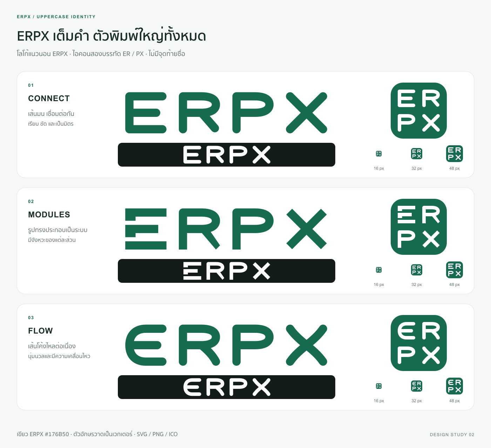

# ERPX — ตัวพิมพ์ใหญ่เต็มคำ

เวอร์ชันที่ 2 ตามคำขอให้ใช้ **ERPX** ครบทั้งสี่ตัวและเป็นตัวพิมพ์ใหญ่ทั้งหมด ไม่มีจุดท้ายชื่อ



## รูปแบบ

- **โลโก้แนวนอน:** ERPX อ่านจากซ้ายไปขวา ตัวอักษรทั้งสี่วาดเป็นเวกเตอร์ ไม่พึ่งฟอนต์
- **ไอคอนสี่เหลี่ยมและ favicon:** ER บรรทัดบน / PX บรรทัดล่าง ช่วยให้ตัวอักษรเต็มคำมีพื้นที่เพียงพอเมื่อย่อ
- **Connect:** เส้นหนาปลายมน รูปทรงชัดเจน
- **Modules:** รูปทรงเรขาคณิต แบ่งตัว E เป็นส่วนประกอบ
- **Flow:** ตัว E พิมพ์ใหญ่มีเส้นโค้ง และ X โค้งต่อเนื่อง

สีเขียว #176B50 และสีขาว #FFFFFF; พื้นไอคอนมีมุมมนตามชุดก่อนหน้า

## ไฟล์ในแต่ละแบบ

ดูใน `connect/`, `modules/` และ `flow/`

| ไฟล์ | รายละเอียด |
| --- | --- |
| `wordmark.svg`, `wordmark.png` | ERPX แนวนอนสีเขียว พื้นโปร่งใส 1024×256 |
| `wordmark-white.svg`, `wordmark-white.png` | ERPX แนวนอนสีขาว พื้นโปร่งใส 1024×256 |
| `icon.svg`, `icon-512.png` | ไอคอน ER / PX สีขาวบนพื้นเขียว 512×512 |
| `icon-16.png`, `icon-32.png`, `icon-48.png` | favicon PNG เรนเดอร์จากเวกเตอร์โดยตรงในแต่ละขนาด |
| `favicon.ico` | ICO บรรจุ PNG 32-bit พร้อม alpha ขนาด 16 / 32 / 48 px |
| `mark.svg`, `mark-512.png` | ER / PX สีเขียวบนพื้นโปร่งใส 512×512 |
| `mark-white.svg`, `mark-white-512.png` | ER / PX สีขาวบนพื้นโปร่งใส 512×512 |

## ภาพสำหรับเลือกแบบ

- [เปรียบเทียบโลโก้และไอคอน](comparison.png)
- [ภาพจำลองตำแหน่งในแอป](in-context.png)
- [ดู favicon ขนาดจริงและภาพขยายพิกเซล](size-check.png)

เปิดภาพที่ 100% เมื่อต้องการดูขนาดจริง ไฟล์ SVG ของภาพประกอบอยู่คู่กับ PNG และฝังภาพ favicon ไว้ภายในแล้ว

## การสร้างใหม่และขอบเขต

```sh
bun Designed/branding/erpx-icons/uppercase/generate.mjs
```

ใช้ Bun 1.2.17 และ sharp จาก dependency tree ปัจจุบัน รูปทรงตัวอักษรใน `generate.mjs` เป็นแหล่งต้นฉบับ การสร้างใหม่จะเขียนทับ SVG/PNG/ICO ภายในโฟลเดอร์นี้ ฟอนต์ Arial และ Sukhumvit Set / Thonburi ใช้เฉพาะข้อความประกอบบนแผ่นเปรียบเทียบ

รอบนี้ยังเป็นตัวอย่างออกแบบ ไม่มีการติดตั้งหรือเปลี่ยน favicon ในแอป ชุดไอคอน E จากเวอร์ชันก่อนยังอยู่ในโฟลเดอร์ระดับบน

ตรวจขนาดไฟล์และความโปร่งใส อ่าน ICO กลับด้วย Pillow และเทียบเฟรมกับ PNG ทุกพิกเซล พร้อมตรวจภาพที่ขนาด 16 / 32 px และภาพจำลองทั้งสามแผ่นด้วยสายตา
