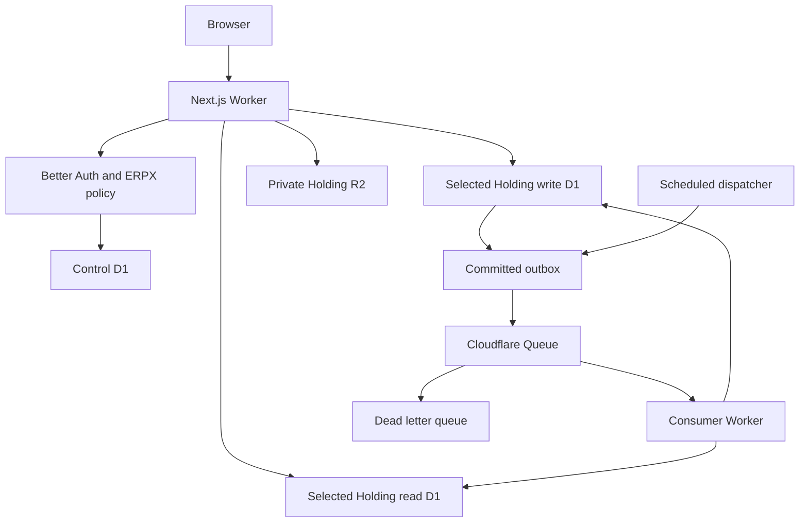

# ERPX mockup to Cloudflare full stack

Date: 2026-09-06. Status: accepted and in implementation. Architecture decision: [ADR-022](../adr/ADR-022-cloudflare-runtime.md).

The preserved `Designed/mockup/` remains the interaction and capability reference. The authoritative application is Next.js 16.3.4 on Cloudflare Workers through OpenNext, managed with Bun 1.2.17. D1 replaces PostgreSQL, R2 replaces MinIO, and Queues plus scheduled Workers replace the persistent local worker. Company and Branch remain distinct inside each Holding.

## Delivery goal

The first reviewable milestone is a deployed, authenticated workplace where Mali submits a persisted leave request with private evidence and Nisa approves it through a separate session. The server must reject self approval, stale decisions, expired assignments, cross Holding identifiers, and unauthorized files. Finance monthly close is the first production oriented vertical built on that foundation.

The complete program still covers all 31 modules and 171 mockup capability groups. A rendered page does not complete a capability: owner state, server policy, lifecycle transitions, retries, evidence, tests, contracts, and traceability must also ship.

## Runtime boundaries

The application Worker owns pages and HTTP requests. Owner domain services own business behavior. The jobs Worker imports only services approved for background use. Bun installs packages and invokes tooling; deployed code executes in the Workers runtime.

Development uses `erpx-dev` and `erpx-jobs-dev`, control write/read D1 databases, write/read pairs for opaque Holdings `h001` and `h002`, one private R2 bucket per Holding, a backup bucket, an events queue, and a dead letter queue. Read databases are rebuildable application projections, not automatic replicas.

Named Wrangler environments repeat every non inheritable D1, R2, Queue, trigger, and assets binding. Provisioning is idempotent: it lists and reuses exact ERPX development resources, creates missing resources, and records D1 identifiers in Wrangler configuration. It never deletes or resets remote data.

## Commands

| Command | Result |
|---|---|
| `bun run dev` | Next.js UI development on port 3100 |
| `bun run preview` | OpenNext build and local Workers runtime |
| `bun run cf:provision:dev` | Reconcile named Cloudflare development resources |
| `bun run cf:typegen` | Generate binding types |
| `bun run cf:doctor` | Check authentication and repository prerequisites |
| `bun run db:migrate:dev` | Apply reviewed remote development migrations |
| `bun run db:seed:dev` | Reconcile synthetic development fixtures |
| `bun run deploy:dev` | Build and deploy the Next.js Worker |
| `bun run deploy:jobs:dev` | Deploy the queue and scheduled Worker |
| `bun run test:integration` | Run tests inside isolated Workers storage |
| `bun run test:e2e:dev` | Run independent browser journeys against development |

Local tests and preview use local Cloudflare state. They do not silently write to shared development resources. Secrets are supplied through Wrangler secrets and never committed.

## Shared foundation

Better Auth owns accounts and secure sessions in the control D1 database. ERPX owns Holding memberships, expiring assignments, scope, permissions, separation of duties, and access evidence. Each protected query, lookup, command, and download resolves its assignment and enforces Company and Branch placement on the server. Role changes never change principal identity.

Holding write databases own organization data, typed business aggregates, command receipts, guarded assertion rows, decision evidence, audit events, outbox events, upload intents, attachment metadata, and owner lifecycle state. Holding read databases contain rebuildable work items, feed/search summaries, and projection checkpoints.

Mutable aggregates carry integer versions. Business instants use UTC epoch values and accounting dates use ISO dates. Posted financial entries and audit evidence are append only. Money enters APIs as canonical decimal strings, is calculated with exact decimal or BigInt logic, and is persisted in checked integer minor units with currency, scale, FX source, and rounding evidence. Large totals leave APIs as strings.

Every mutation follows one protocol:

1. Resolve session, Holding, assignment, and permission.
2. Validate the payload, expected version, review evidence, and idempotency key.
3. Prepare authoritative inputs before the mutation.
4. Execute one bounded D1 batch containing guards and writes.
5. Mark the guarded aggregate with the unique command identifier.
6. insert a constrained assertion row whose `CHECK` fails unless the expected final state exists.
7. Commit the owner change, command receipt, decision evidence, audit, and outbox together.
8. Return the authoritative version and next responsibility.

A repeated key with identical operation and payload returns the receipt. Reuse with different input returns `409`. After an unknown network outcome, clients inspect the original receipt and keep the same command identifier.

## Files and background work

The first attachment policy permits ten files per collection, ten MiB per file, and JPEG, PNG, WebP, PDF, or CSV. An authorized intent reserves a slot. The Worker enforces actual byte count, media signature, checksum, a unique staging key, and an immutable revision key. Finalization writes D1 metadata; reconciliation handles any crash between D1 and R2. Downloads recheck owner record visibility, use private no store responses, and support bounded byte ranges. Unlinking does not destroy retained evidence.

The scheduled dispatcher claims bounded unpublished outbox rows and sends them to the queue. Consumers use processing receipts, owner versions, and an atomic target D1 batch. Duplicate delivery is harmless; out of order gaps trigger reconciliation. Exhausted work moves to the dead letter queue. Source decisions and failed handoff preparation remain separately visible and retryable.

## Workplace migration

App Router destinations are `/holdings/{holding}/home`, `/work`, `/modules`, `/modules/{module}/{section}`, `/records/{module}/{recordId}`, `/tasks/{module}/{recordId}`, `/learn`, and `/inbox`, with platform operations under `/platform`. The migration preserves three visible module sections plus More, single column task views, approver summaries, explicit consequential reviews, a mobile action bar, URL based filters, navigation restoration, dark mode, keyboard access, captions, and reduced motion.

Server Components perform initial authorized reads. Client Components handle forms, editors, dialogs, boards, upload progress, and media controls. Authenticated business responses start request rendered with no shared cache. Public UI assets ship with the Worker; private evidence is served only by authorized routes.

## Delivery sequence and gates

| Phase | Work | Gate |
|---|---|---|
| P0 | Mockup inventory, pinned tooling, OpenNext compatibility, decisions | Authenticated Worker reads D1 and private R2 |
| P1 | Dev resources, bindings, migrations, seed reconciliation, CI | Fresh setup is repeatable and preserves data |
| P2 | Auth, assignments, guarded commands, audit, outbox, uploads, minimal masters | Independent Holdings/users pass isolation, concurrency, retry, and file tests |
| P3 | Workplace shell, shared task/record UI, leave workflow, notifications | Mali submits evidence; Nisa independently approves after reload |
| P4 | Finance F1 chart/opening, F2 journals, F3 AP/AR, F4 banking, F5 reports, F6 close/reopen | Deployed month close reconciles and survives races, replay, and restore |
| P5 | Revenue, supply, service, and hiring preparation journeys | Each owner handoff is explicit, evidenced, idempotent, and retryable |
| P6 | Remaining groups across all 31 modules | Every tracked capability meets the shared completion rules |
| P7 | Upgrade, limits, permission, replay, restore, accessibility rehearsal | Release candidate passes operator and business reconciliation gates |

P6 coverage remains: identity/access, organization, platform administration, collaboration, people/payroll, finance, customer authority, customer 360, CRM, sales, procurement, inventory, projects, planning, support, quality, assets, maintenance, operations, field service, POS, ecommerce, manufacturing, legal, talent, learning, benefits, marketing, brand, commercial, and agent. Stories and Shorts remain in scope; Stories remain until archived.

## Finance acceptance

Finance implements chart import and verified opening balances; exact journal drafts, review, posting, FX and reversals; AP/AR allocation and settlement; bank CSV deduplication and human matching; trial balance, financial statements, aging and revaluation; then period freeze, independent close, controlled reopen and restore evidence.

Acceptance uses two companies, a fifty account chart, twenty mixed currency journals, direct and PO linked invoices, one hundred bank rows, reconciled statements and aging, and independent close/reopen. Posting checks period state in the same batch. Beginning close sets `closing` and blocks new postings. Posted journals are immutable. Real bank transfer execution remains behind a separately configured provider adapter.

## Verification and completion

Required test layers are pure domain tests, Workers integration tests for D1/R2/Queues, remote integration against development, Playwright with separate sessions, business reconciliation, and recovery rehearsal. Mandatory failures include simultaneous approval, stale review, expired assignment, self approval after role change, posting versus close, zero row guards, later batch failure, lost responses, duplicate/out of order events, projector interruption, failed handoff, oversized/interrupted/double uploads, revoked access, legal hold, cross Holding guessing, and restored metadata with a missing object.

Observability exposes redacted application/auth/D1/R2 failures, queue backlog and dead letters, dispatcher heartbeat, projection lag, failed handoffs, and backup/restore results. Logs contain correlation, command, and event identifiers without credentials, tokens, file URLs, or sensitive payloads.

A capability is done only when the intended mockup interaction works, D1 persists the owner state, server policy and lifecycle rules hold, R2 evidence is private and recoverable, concurrency and retry outcomes are deterministic, background work survives replay, business tests pass, and contracts plus traceability describe the shipped behavior.

## Current implementation checkpoint

P0, the local portion of P1, and the first P3 collaboration slice are implemented. The repository has a Bun lockfile, OpenNext/Wrangler configs, generated binding types, six D1 migration tracks, synthetic seed reconciliation, Better Auth sessions, Holding scoped assignments, guarded leave submission and independent approval, audit/outbox writes, a Queue consumer/scheduled dispatcher, private R2 upload/download routes, the 31 module workplace shell, and Workers integration tests. The workplace account menu supports up to five password-verified device accounts through Better Auth multi-session. The active account can select from its own unexpired D1 assignments; the server ignores stale, revoked, expired, and cross-account assignment cookies.

The workplace now has a server-rendered Holding/Branch-scoped social feed backed by D1. Users can publish team or authorized record updates, organize them with hashtags, comment, appreciate, follow posts, filter the feed, and publish Stories that remain available until their author archives them. Each mutation uses an idempotency receipt; post, comment, and Story publication also records audit and outbox evidence. Home shows a scoped feed preview and mobile navigation exposes Updates. Thread attachments, typed people mentions, topic/person follows, moderation tools, notification projection, and media-backed Stories remain later collaboration batches.

A universal Holding record workbench now provides persisted seeded records across all 31 modules and every rendered capability section. It implements optimistic field edits, a shared review lifecycle, assignment/module enforcement, typed record references and backlinks, and evidence-pinned development-provider field suggestions with explicit apply/reject and version-conflict handling. These shared records make every module inspectable and interactive, but they do not replace the owner-specific lifecycle, idempotency, projection, reconciliation, attachment, or provider work required before an individual capability can be marked complete.

Development seed reconciliation gives both Mali and Nisa Platform Admin, Holding Owner, Holding People Manager, Bangkok Employee, Bangkok Finance Preparer, and Bangkok People Department Manager assignments. Holding Owner exposes the full 31-module catalog; narrower roles intentionally retain restricted module lists so role switching exercises access changes.

Local `next build` and OpenNext build pass. A workerd preview has completed real Mali and Nisa sign in, guarded submission, independent approval, and private R2 upload. Remote resource creation, secrets, deployment, and remote browser acceptance require an authenticated Cloudflare account and remain the next P1 operation.

## Finance implementation checkpoint — 2026-09-06

The first finance slice is implemented in the Next.js branch. Holding write migrations `0009_finance_core.sql` through `0013_finance_asset_currency.sql` own charts, accounts, periods, journals and lines, parties, invoices, payments and allocations, bank statements and transactions, tax codes and returns, assets, budgets, expenses, accruals, revenue contracts, leases, loans, intercompany transactions, and consolidation workspaces. `src/server/finance.ts` owns exact decimal-to-minor-unit conversion, balanced double-entry validation, FX conversion, period gates, idempotent command receipts, append-only audit/outbox evidence, posting and reversal, AP/AR aging, bank reconciliation, configurable tax setup, and finance master creation.

The catch-all route at `/api/v1/holdings/{holdingSlug}/finance/{...path}` exposes chart/account import, period lifecycle, journal draft/post/reverse, trial balance and statements, party/invoice/payment creation, bank statement import and human reconciliation, tax codes, assets, budgets, expenses, leases, loans, and revenue contracts. The synthetic local seed contains an IFRS chart, control accounts, an open September 2026 period, and demo customer/supplier records. Generic workspace records remain presentation fixtures; posted finance tables are authoritative and cannot be edited through the generic workbench.

Remaining before full production launch are schedule execution engines (depreciation, accrual/revenue recognition, lease and loan schedules), allocations and settlement posting, tax calculation/return generation, consolidation posting/eliminations, payment-file generation and confirmation import, finance-specific evidence policy, background projections, IFRS disclosure packs, and the complete multi-company business acceptance and recovery rehearsal.
