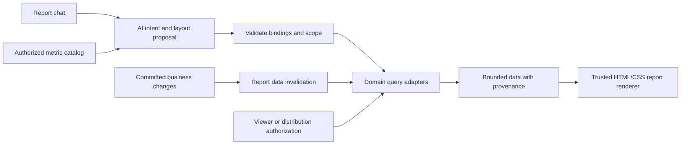

# Executive — AI Live Canvas

Status: core implementation delivered on 2026-09-18. See [implementation and acceptance](../testing/executive-canvas-2026-09-18.md) for verified behavior, adapter coverage and remaining scope. This document retains the broader intended design; individual proposals below are not all delivered. It extends the existing AI assistant work with an English presentation policy.

## 1. Product decision

Add **Executive** to the sidebar with one feature: **AI Live Canvas**. A user describes an analysis in chat, previews the generated result, and drags it onto a saved report. Each report behaves like a small interactive website with its own layout, sections, charts, tables, filters, and live API-backed data.

Reports are private to their creator by default. C-level status permits report creation; it does not reveal other executives' private reports. An owner can share a report, or a selected subset of its widgets, with named executives or employees.

The initial experience includes the complete journey: create, generate, drag, edit, save, reopen, refresh, share, and revoke. More module adapters can be added without creating more Executive features.

## 2. Baseline before this implementation

| Area | Current evidence | Planned change |
| --- | --- | --- |
| AI provider | The previous acceptance record verifies OpenCode Go, `muse-spark-1.3-contributor`, through the application. | Reuse the Company's selected provider, encrypted credentials, model snapshots, and usage accounting. |
| Work assistant | Page-scoped history, permission-controlled cross-page history, workflow guides, and a small set of authorized record adapters exist. | Add report-specific authoring context and structured widget proposals. Keep the ordinary assistant's existing access boundaries. |
| Language | `src/lib/ai/workspace-assistant.ts` contains Thai suggestion prompts; the server currently instructs the model to answer in the user's language. The public organization page also displays a saved Thai answer. | Apply an English presentation policy to existing AI surfaces and the new Executive experience. |
| Navigation | The live sidebar has grouped apps, saved pins, All apps, and search; there is no Executive entry. | Add a directly visible Executive app, a search destination, and the correct mobile entry without replacing existing pins. |
| Seniority | Current Company levels are 1: CEO, 2: Executive / Director, and 3–6: management through staff. Seniority and access assignments are distinct. | Provision an approved Executive access package for eligible people; enforce its effective permission on the server. |
| Reporting | Domain reports exist, but several list readers are paginated or capped. There is no saved Executive report canvas. | Build exact aggregate adapters, report persistence, layout revisions, sharing, and live refresh. Never calculate a Company total from a page of records. |
| Background work | PostgreSQL jobs, transactional outbox events, authority revisions, and optional Redis caches exist. | Extend them for durable generation, report invalidation, and bounded query caching. A cross-client report event stream is new work. |

Source evidence: [AI acceptance](../testing/ai-workspace-2026-09-18.md), [staff-level requirements](2026-09-14-spending-approval-requirements.md), [navigation](../../src/lib/workplace-navigation.ts), [assistant service](../../src/server/workspace-assistant.ts), and [job runtime](../../src/server/runtime/jobs.ts).

## 3. Navigation and screen layout

- Sidebar: **Executive**. Inside it: **AI Live Canvas** only.
- `/holdings/[holdingSlug]/executive`: report library with **My reports**, **Shared with me**, search, and **New report**. These are views of the same feature.
- `/holdings/[holdingSlug]/executive/reports/[reportId]`: editor or viewer according to access.
- An eligible author sees Executive directly in the sidebar. An employee with an active share sees the same entry leading to Shared with me, with no creation controls. Other employees see neither the entry nor private report metadata.
- Register breadcrumbs, app search, route access, keyboard navigation, and mobile navigation together. Preserve saved navigation preferences.

```text
ERPX sidebar | Report name · Private · Saved · Data updated 09:42
             | Date range · Branch · Currency · Refresh · Share · Present
             | ---------------------------------------------------------
             | Responsive report canvas             | AI chat
             | [Revenue] [Open receivables]          | Describe an analysis
             | [Revenue trend                ]      | [Generated preview]
             | [Exceptions] [Orders by branch]      | Drag to canvas / Add
             | [Narrative and source links   ]      | Refine selected widget
```

The canvas takes most of the screen. Chat docks on either side, collapses, or floats and can be repositioned. On mobile it becomes a sheet; widgets stack in a saved reading order. Presentation mode hides editing tools while retaining filters and freshness indicators. Provide Move before/after, Move to section, and size presets as click/tap alternatives to dragging, plus keyboard support. This follows the distinction in [WCAG dragging movements](https://www.w3.org/WAI/WCAG22/Understanding/dragging-movements.html): keyboard support alone does not satisfy the single-pointer alternative requirement.

## 4. Chat-to-widget workflow

1. **Describe:** “Create a weekly operating report with revenue, overdue invoices, staffing, and hotel occupancy. Use a dark theme and compare branches.”
2. **Resolve intent:** AI identifies metrics, date semantics, authorized scope, comparison, and preferred design. It asks only for ambiguity that changes the result, such as booked revenue versus collected cash.
3. **Preview:** The conversation returns a rendered widget or a set of widgets, with its sources, scope, metric definition, freshness, and unavailable-data notices.
4. **Place:** Drag a preview onto the canvas. Show a clear insertion target, collision handling, and a placement preview. Provide **Add to canvas** and keyboard placement as equivalent actions.
5. **Arrange:** Move, resize, duplicate, group into sections or tabs, change reading order, or remove. Responsive layouts save independently for desktop and mobile. Moving a widget does not call AI or refetch unchanged data.
6. **Refine:** Select a widget and say “Compare with last month,” “Show a table instead,” or “Make this span the full width.” Highlight the affected widget and show the proposed change before applying it.
7. **Save:** Autosave layout changes with visible saving/saved/error states, undo/redo, and optimistic version checks. Generated replacements remain proposals until applied. Saved report revisions can be restored.
8. **Use:** Reopening preserves the design and requests current data. Filters update the affected widgets; clicking a result can filter another widget or open an authorized source record.
9. **Share:** Select named recipients, visible widgets, allowed filter bounds, access level, and optional expiry. Preview what each recipient can see before saving the grant.

Generating an entire report and generating one additional widget use the same mechanism. Chat history is private to its author and is not included when the report is shared. Collaborators use their own report-scoped AI conversation.

## 5. Dynamic design and AI integration

| Capability | User experience | Implementation boundary |
| --- | --- | --- |
| Suggestions | Relevant prompts from the current report, selected widget, and available metric catalog. | Suggestions cannot reveal inaccessible dataset names or private reports. |
| Generation | KPI cards, trends, comparisons, tables, rankings, timelines, funnels, progress indicators, exceptions, and narrative sections. | A validated report definition binds each result to real metrics and dimensions. |
| Website composition | AI chooses page structure, sections, tabs, grid/flex arrangements, typography, colors, spacing, and responsive behavior. | Render HTML/CSS from a validated component and style model; this is not restricted to one fixed dashboard template. |
| Autofill | Infer titles, descriptions, filters, chart types, comparison periods, and refresh settings from the request. | Show inferred choices and allow direct editing. Do not invent missing business facts. |
| Extraction | An authorized uploaded brief or sample report supplies a draft structure, desired KPIs, or targets. | Reuse approved upload/document handling. Extracted targets remain labeled draft values with evidence until accepted; they never become measured actuals. |
| Refinement | “Explain this spike,” “Group by branch,” “Add a drill-down,” or “Apply this style to the report.” | Query current authorized evidence; preview definition changes and keep unrelated widgets intact. |
| Explanation | Describe a metric, formula, date basis, source, and relevant handbook policy. | Cite source definitions or published guidance; show uncertainty and data gaps. |
| Insights | Summarize material changes and suggest follow-up questions. | Separate observed change from a proposed explanation. Predictions require a separate explicit specification; do not invent forecasts. |
| Live operation | Widgets fetch new data without regenerating their design. | App-owned runtime fetches authorized ERPX APIs; the model has no browser credentials or arbitrary network tool. |

The generated report is an interactive HTML/CSS experience backed by application JavaScript and APIs. The model produces the design and data bindings; it does not receive permission to execute arbitrary JavaScript, SQL, or URLs. This keeps substantial design freedom while retaining enforceable data access.

If a future release introduces literal HTML/CSS templates, compile a supported, sanitized subset into the same validated model. Do not inject provider HTML into the ERPX application DOM. Arbitrary generated scripts are outside this plan.

## 6. Executive eligibility and permissions

Proposed default mapping: **Level 1 CEO and Level 2 Executive / Director**, plus an explicitly authorized Holding owner. Level 2 currently includes directors, so this mapping must be visible in Company setup; it is not a hidden interpretation of a job title. Every eligible person should be included in the access rollout, not only Finance roles.

Use an **Executive Author** access package, delivered through the existing reviewed role/group/policy system. The Company setup must show eligible people who lack an effective grant and provision them through the existing review workflow. Promotion creates an eligibility candidate; demotion, expiry, suspension, and departure invalidate the applicable grant. Do not silently add new permissions to unrelated custom roles.

Runtime access requires both current eligibility and the selected effective Executive assignment, with an explicit owner exception for Holding owners who have no employee Engagement. Never union inactive assignments. A Platform administrator gains no customer report access by virtue of Platform authority.

Proposed permissions: `executive.access`, `executive.report.create`, `executive.report.edit`, `executive.report.share`, and `executive.data.distribute`. Source metrics retain their domain-specific read and classification rules. Distribution is limited by a reviewed source policy, not by report ownership alone.

| Actor | Create reports | Read someone else's private report | Shared report | Modify or reshare |
| --- | --- | --- | --- | --- |
| Eligible C-level / CEO with effective Executive access | Yes | No | Named grant required | Own reports; another report only with an explicit editor grant. Resharing stays with its owner. |
| Holding owner | Yes | No automatic content access | Named grant required | Own reports; any exceptional recovery is a separate audited operation. |
| Employee below Executive eligibility | No | No | Only the granted report/widget view | View and permitted filters only. |
| Unshared employee or external user | No | No | No | No |

Entering Executive does not provide blanket access to payroll details, private messages, secrets, or every Company in a Holding. The first release uses the current Company and authorized Branch/Department scope. Holding-wide consolidation requires an explicit approved scope, compatible metric definitions, currency rules, and source policies; selecting a Holding is not sufficient.

## 7. Private ownership and useful sharing

Every new report has one owner and an empty recipient list. Other C-level users cannot discover its title, thumbnails, data, prompts, or existence through search or guessed URLs. Store recipients as stable principals linked to the relevant Company, not matching email strings.

Support two explicit data access modes:

| Share mode | What the recipient sees | Suitable use |
| --- | --- | --- |
| **Use recipient access** | Each widget queries within the recipient's current source permissions and shows its actual scope. | Sharing a reusable report structure with another executive. |
| **Share selected report data** | A named grant permits the exact approved widget outputs, locked scope, dimensions, and bounded filters. It grants no access to source modules. | Giving an employee a live operational report without granting Finance or Executive authoring access. |

The sharing dialog must explain whether values can differ between recipients. Default to recipient access; offer selected report data when the recipient needs a bounded published view and the owner has distribution permission for every included dataset. Both modes belong to the first complete sharing release.

Selected report data is a deliberate, scoped disclosure. Refresh it through a server-side distribution contract tied to an approved definition and the publisher's current authority. Never pass owner tokens to the viewer. Recheck publisher authority, recipient membership, grant expiry, classification policy, and locked query bounds on every data read and refresh. Filter manipulation, exports, breakdowns, and small-cohort queries must not reveal data outside that contract.

Pin shared data to an approved report revision. Cosmetic changes may be republished safely; a new dataset, field, broader filter, or altered disclosure scope requires an explicit updated share definition. Do not automatically publish newly generated widgets to existing recipients. With recipient-access sharing, every definition change is still checked against each viewer's permissions.

Only eligible executives can receive an editor grant. An editor can propose changes but cannot expand a distribution contract or recipient list. Employees receive view access. Raw source drill-down always requires the viewer's own source permission.

Treat generated narrative, report titles, annotations, thumbnails, hidden fields, and saved previews as potentially sensitive data too. Rebinding a chart to the recipient's permissions does not sanitize text generated from the owner's data. Record content provenance, include derived text in distribution review, and regenerate recipient-access summaries from recipient-authorized inputs. Never deliver hidden owner data in HTML or client payloads. Extraction evidence and private prompts remain outside the share unless explicitly included under a valid distribution policy.

Revocation stops subsequent reads, live streams, refreshes, and cached responses. Revalidate existing open pages and clear inaccessible content. Content already seen or captured cannot be recalled. Ownership transfer, if needed for a departing executive, must be explicit and preserve source and share restrictions; it must not automatically expose every former owner's private report.

## 8. Data and refresh architecture



Separate **report design revision**, **query definition revision**, and **data refresh run**. Data changes do not rewrite the design. AI narrative stores the data revision it describes; when underlying data changes, mark the narrative as needing an update instead of presenting it as a current explanation.

Each metric adapter defines its identifier, formula, date basis, grain, dimensions, units, currency, scope, classification, source authorization, allowed filters, drill-down policy, query cost, and freshness signal. Resolve joins only through declared relationships to prevent double counting. Use exact monetary arithmetic and distinguish booked revenue, invoiced amounts, collected payments, cancellations, and reversals.

All query requests use validated metric identifiers and typed parameters. No provider-supplied SQL. Server aggregation must operate on the full authorized dataset; detail tables paginate separately. Show empty, unavailable, partial, stale, and failed states distinctly. Unsupported metrics are reported as unavailable, never filled with sample numbers.

| Source group | Initial useful metrics | Required checks |
| --- | --- | --- |
| Finance | Posted revenue, receivables/payables aging, collection trends, expenses | Ledger basis, period, currency, reversals, and Finance read/distribution rules |
| Sales and purchasing | Order values, fulfillment, supplier/customer trends | Order status, cancellations, invoicing overlap, and permitted branches |
| Inventory | Stock levels, movements, shortages, count variances | Warehouse scope, units, reservations, and valuation definition |
| People | Headcount, staffing, approved leave and overtime summaries | Effective dates, worker type, HR restrictions, and small-cohort privacy |
| Work and projects | Open work, overdue tasks, approval delays, completion trends | Workflow stage, owner/team scope, and exact counts |
| POS | Net sales, refunds, payment mix, outlet performance | Sale completion, refunds, settlement versus sales, and POS reporting rights |
| PMS | Occupancy, room revenue, arrivals/departures, open guest balances | Property scope, business date, cancellations, and PMS reporting rights |
| Calendar and routines | Planned capacity, operational commitments, scheduled completion | Published/approved state, timezone, and personal-event privacy |

Build the catalog incrementally, starting with Finance and Work to validate the end-to-end path, then cover the other implemented domains. Audit the module registry and record support or an explicit unavailability reason for every remaining module. Preview modules do not become live data sources merely because they appear in navigation.

For live refresh, extend the existing outbox projection with dataset revision signals; do not introduce a competing consumer that steals events from existing projectors. Use an authenticated report event stream to signal invalidation, then refetch authorized data. Support replay after reconnect, bounded retention, full resync after a gap, a periodic reconciliation check, and polling fallback.

Prefer a fetch-based stream compatible with the existing selected-work-context headers. Reauthorize stream establishment, reconnect, revision delivery, and authority changes. Send invalidation identifiers rather than raw business rows on the event channel. Stop streams and clear report state on Company, Holding, assignment, or account changes.

Proposed acceptance target: covered source changes appear within 5 seconds on a connected, active report under the agreed test load; a 15-second fallback poll applies while streaming is unavailable. These are targets to measure, not claims about the current app. Show the last successful refresh, per-source freshness, reconnecting/stale state, **Pause live updates**, and a manual Refresh button. Preserve focus and selection during updates. Pause unnecessary refresh work in hidden tabs.

Multiplex invalidations through one application-owned stream rather than one connection per widget. Establish a cursor-bound snapshot/subscription sequence, ignore duplicate or older revisions, and refetch after an expired replay cursor. Verify proxy flushing and reconnect through the public hostname. These requirements account for the transport behavior documented by [WHATWG server-sent events](https://html.spec.whatwg.org/multipage/server-sent-events.html); a connection alone does not provide durable replay or current authorization.

Cache by tenant, Company, current authority or distribution-contract revision, metric definition, scope, filters, and source revision. Deduplicate identical queries across widgets. Bound execution time, date ranges, result sizes, concurrent generation, and refresh frequency. An authorization failure must never fall back to a previously cached owner's result.

## 9. Durable generation and saved state

Use the current PostgreSQL job runtime for generation and substantial revisions. Store a request before calling the provider, return a job identifier, show progress, allow cancellation, and recover after process restarts. Revalidate authority and the provider snapshot before persisting a result. Treat document contents, record text, prior messages, and model output as untrusted input.

Proposed records:

| Record | Purpose |
| --- | --- |
| Executive report | Owner, tenant/Company scope, title, lifecycle, current design revision |
| Report revision | Immutable layout, appearance, sections, filter definitions, and widget references |
| Widget definition | Stable widget identity, validated rendering definition, metric bindings, and query revision |
| Private report conversation | Author, selected assignment/scope, report context, messages, and proposed changes |
| Generation job | Idempotency, state, authority snapshot, provider/model revision, attempts, and usage |
| Refresh run | Data version, source watermarks, completeness, timing, and safe error details |
| Report share | Named recipient, view/editor rights, mode, expiry, revocation, and permitted revision |
| Distribution contract | Approved output projection, query bounds, source distribution policy, and publisher authority |

Use existing command receipts, auditing, optimistic versions, and source/provider guards. Idempotency prevents repeated placement or generation from duplicating results. Track provider attempts and shared AI quota accurately, including interrupted requests; retries must not silently bypass accounting. Refreshing data does not consume an AI generation allowance. An explicit narrative update does.

Proposed API family: `/api/v1/holdings/[holdingSlug]/executive` with report collection/detail, revisions, generation jobs, validated data queries, events, and named shares. The server derives scope and authority; request-supplied IDs never establish access.

## 10. English-only migration

- Replace Thai product-owned suggestion prompts in the existing work assistant. Audit AI settings, Learn, request preparation, expense extraction, generic suggestions, loading states, errors, confirmations, and fallback text.
- Replace the assistant's current “reply in the user's language” behavior with English answers, follow-up prompts, explanations, generated report titles, labels, and summaries. It may understand multilingual requests and source documents.
- Keep extracted merchant names, people names, document identifiers, quoted evidence, and user-authored business data faithful to their sources. Product language cleanup must not rewrite business evidence.
- Provide an English display revision for previous AI-authored Thai answers when they are reopened and still authorized. Preserve the original and provenance for audit; do not delete history or silently modify prior business proposals. Label unavailable translation clearly in English and count model-backed translation usage.
- Translate the prior Thai AI architecture research document into English while preserving citations and the distinction between proposals and delivered work. Historical acceptance records must retain the fact that earlier Thai responses were tested.
- Add targeted checks for Thai product strings and tests that a Thai input still yields English product output. Permit genuine source values through explicit exemptions instead of a blanket ban on Thai Unicode in all data.

## 11. Delivery sequence

| Stage | Deliverable | Completion gate |
| --- | --- | --- |
| 1. English and access foundation | English AI presentation, Executive permissions/eligibility, sidebar and library, private report persistence | Existing AI remains usable; all eligible test users can obtain effective access; private reports remain undiscoverable to peers. |
| 2. Complete authoring slice | Report-scoped chat, real Finance/Work queries, generated previews, drag/add, resize, refinement, autosave, restore | A real prompt produces a usable report that can be edited and reopened without losing design or fabricating values. |
| 3. Live data and durable work | Job recovery, revision-driven refresh, filters, drill-down, stale states, provider/quota handling | Business changes update covered widgets; reconnect and restart tests pass; data refresh works while AI is unavailable. |
| 4. Named sharing | C-level collaboration, employee viewers, both sharing modes, recipient preview, expiry/revocation | Employee can see an intentionally shared live view without source-module access; cannot escape its bounds or see private chat. |
| 5. Broader data and design | Remaining live-domain adapters, richer website composition, document-to-report drafts, responsive polish | Capability coverage is explicit; all supported metrics reconcile to source calculations and all generated layouts remain usable. |
| 6. Acceptance and rollout | Role matrix, security, source accuracy, accessibility, mobile/desktop, load checks and operational documentation | Complete requested workflow verified through the public authenticated app, with local/public health checks and development kept available. |

Stage 2 is an internal implementation checkpoint, not completion of the user's full request. The release must include live operation and useful private sharing before being presented as the requested Executive feature.

## 12. Acceptance scenarios

1. A CEO and each configured Level 2 Executive/Director can enter from the sidebar using an effective Executive assignment. Missing grants have a clear Company setup path.
2. Two executives create reports; neither sees the other's title, thumbnail, conversation, or data until explicitly shared.
3. A prompt generates a preview from actual data. Dragging it and using Add to canvas create equivalent widgets. Dragging, resizing, undo, reload, and mobile reflow preserve their settings.
4. Keyboard and touch users can place, move, reorder, and resize widgets without a drag gesture. Focus and announcements remain understandable.
5. A widget-specific refinement changes only its intended definition. A failed generation leaves the saved report intact.
6. Committed source changes update the right data without additional model calls. A prior narrative becomes visibly outdated until refreshed.
7. Counts exceed the existing list-page limits and still match exact authorized database totals. Currency, timezone, reversals, and join duplication cases reconcile.
8. An employee receives a selected live report view, can use only its permitted filters, and cannot query extra columns, raw records, another Company, or the author's chat.
9. A C-level recipient with narrower source access sees the correct scoped result or a clear unavailable state; no owner-cache leakage occurs.
10. Revocation, expiry, demotion, account suspension, and publisher loss of data authority stop new reads and invalidate open views, streams, and caches.
11. A definition change that expands a shared dataset does not silently broaden an existing distribution contract.
12. Malicious source text or model output cannot run scripts, choose an arbitrary API URL, exfiltrate data, alter permissions, or submit a business transaction.
13. A model timeout, invalid response, quota limit, worker restart, event gap, and concurrent editor conflict all produce recoverable English states.
14. AI and Executive product copy is English. Multilingual source evidence remains accurate and is not mistaken for untranslated interface text.
15. Real desktop/mobile browser checks cover empty, loading, ready, stale, partial, forbidden, and failed states. Verify local/public health and leave development on port 3100; keep production port 3101 unchanged.

## 13. Implementation touchpoints

- Navigation and shell: `src/lib/workplace-navigation.ts`, navigation preferences/context, sidebar icons/search, and Holding layout.
- Access: permission definitions, reviewed role revisions, Company eligibility setup, source classification/distribution policy, and request-time authority checks.
- New feature: `src/app/holdings/[holdingSlug]/executive/`, `src/components/executive/`, `src/lib/executive/`, `src/server/executive/`, and matching API routes.
- AI: existing provider/transport services, shared quota integration, assistant language policy, document extraction, and a new report-generation worker.
- Data: explicit module metric adapters, exact queries, new report/share/revision tables, outbox projection signals, and authority-aware caches.
- Tests: domain and API isolation, exact calculations, sharing/distribution, generation recovery, stream revocation/reconnect, English presentation, and browser journeys.

Use a new migration after the latest applied migration at implementation time; never rewrite applied migration `0051_workspace_assistant.sql`. Read the installed Next.js guides for the routes/components used before writing application code.

Supporting technical research: [generated views, live delivery, and accessible interaction](2026-09-18-executive-canvas-research.md).
