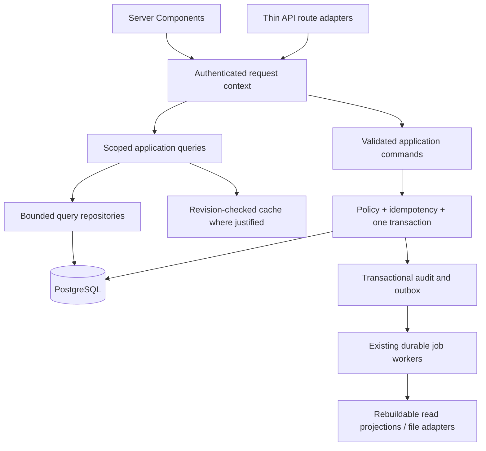

# ERPX — แผน production ปัจจุบัน

ปรับปรุง 2026-10-02 · scope `thai-social-workplace-all-business` · **ยังไม่อนุมัติเปิดใช้จริง**

เอกสารนี้เป็นแผน active ฉบับเดียว ใช้แก้ไฟล์นี้ต่อเนื่อง ไม่สร้างแผนรายวันที่แข่งขันกัน ขอบเขตใหม่คือประสบการณ์ทำงานสำหรับทุกกลุ่มธุรกิจที่ ERPX รองรับ โดยเปิดใช้ทีละ flow เมื่อผ่านเกณฑ์ของ flow นั้น แผนโรงแรมไทยด้านล่างยังเป็นแทร็กตรวจรับธุรกิจเฉพาะ ไม่ใช่ขอบเขตทั้งหมดของผลิตภัณฑ์ วันที่ 1–10 ด้านล่างเป็น **10 วันทำงานสำหรับ checkpoint** ไม่ใช่กำหนดเปิดจริง ยังไม่มีโรงแรมและผู้ตรวจเงินเดือนไทยที่ระบุชื่อและรับงานแล้ว

## PMS วันนี้ · Finance · นำเข้ายอดยกมา — 2026-09-30

**สถานะ: รอตรวจรับใน development; Owner ประสานและตรวจรับรอบซ้อมก่อนตามที่ผู้ใช้เลือก** หน้า `/acme/acme-co/holding` รวมโรงแรมที่เปิดได้ตามสิทธิ์ปัจจุบัน ไม่เลือกโรงแรมแรกแทนผู้ใช้ มีงานทีม/งานของฉัน/ส่งเวร/ภาพรวมบริษัท การ์ดใช้รหัสต้นทางเดียวกับ Work และเปิดหน้ารายการพร้อมเลือกงานนั้น รองรับไทย/อังกฤษ ธีมสว่าง/มืด/ตามระบบ และมือถือคอลัมน์เดียว Feed ใช้ Social เดิมของ ERPX รวมประกาศ ความเห็น การกล่าวถึง ขอบคุณทีม และส่งเวรที่ผู้รับยืนยันรับทราบได้ โพสต์ที่ผูก `pms_record` ตรวจสิทธิ์รายการทั้งข้อความและลิงก์ตามบทบาทที่เลือกและ assignment สด; ผู้รับต้องเปิดทุกงานที่แนบได้ เหตุการณ์หลัง commit ใช้ outbox เดิม มี receipt กันซ้ำ รวมเหตุการณ์ห้อง/วัน และส่งผลตรวจกลับผู้บันทึกผ่าน notification เดิม

Finance มี `/holdings/{holdingSlug}/finance/hotels` เปรียบเทียบลูกหนี้ เงินล่วงหน้า เงินประกันกับ GL ที่ posted พร้อมเงินโอนรอตรวจ หลักฐานธนาคาร เอกสาร PMS/Finance และสมุดรายวันต้นฉบับ Front แสดงผลตรวจเงินโอน/แก้ค่าบริการ/คืนเงินและให้แคชเชียร์บันทึกคืนเงินที่อนุมัติแล้วตามสิทธิ์เดิม การตรวจธนาคาร อนุมัติคืนเงิน แก้ค่าบริการ และยอดยกมายังคงแยกผู้อนุมัติจากผู้ทำรายการ

นำเข้าห้อง ประเภทห้อง ราคา ผู้เข้าพักและการจองที่ยังเปิดผ่าน JSON preview ที่ `/holdings/{holdingSlug}/pms/import?property={id}` มีรายงานแถวผิดและยอดรวม ไม่เขียนรายการโรงแรมระหว่าง preview ต้องใช้วันที่ธุรกิจที่เปิดอยู่และ version ที่ยังตรง Finance อีกคนอนุมัติยอดยกมาที่ตรงสมุดรายวันเปิดยอด THB ซึ่ง posted โดยอิสระ ลูกหนี้อ้าง invoice ยอดยกมาต้นฉบับ เงินล่วงหน้า/เงินประกันอ้าง GL เดิม การ apply เป็น transaction ทั้งชุดและ retry ด้วย key เดิมได้ ไม่ลงรายได้หรือรับเงินย้อนหลังซ้ำ ราคาคืนก่อนวันตัดระบบคงอยู่ในยอดยกมา รอบนี้รับได้สูงสุด 500 การจองต่อชุด; ยังไม่มีตัวแปลง CSV หรือ import แบบ commit ทีละแถว

หลักฐานและขอบเขตตรวจ: [ผลตรวจ PMS/Finance](testing/evidence/2026-09-30-pms-today-finance.md) บันทึก integration ทั้งระบบ 1,660 tests ผ่าน/5 skipped และชุด PMS/Social/Handover หลังแก้ล่าสุด 96 tests ผ่าน; typecheck, lint (0 errors/4 warnings เดิม) และ isolated release build ผ่าน; integration ครอบคลุมจองห้องสุดท้ายพร้อมกัน idempotency/version สิทธิ์ถูกถอน ธนาคารซ้ำ คืนเงินบางส่วน worker ทำต่อ รวมทั้ง shared feed/handover และยอดยกมาตรวจ GL ผ่านการรับเงินและ Night Audit สองวัน Browser ใช้ session Owner ปกติบน [PMS development](https://dev-pms.jesadakorn.com/acme/acme-co/holding) และ [Finance development](https://console-dev-erpx.jesadakorn.com/holdings/acme/finance/hotels): ตรวจ Today desktop/mobile ไทย/อังกฤษ ธีมสว่าง/มืด ตารางบริษัท ส่งเวรที่ไม่มีงาน และ preview สมมติที่มีแถวผิดซึ่งยังไม่ apply ดูรายละเอียด API ใน [PMS contract](contracts/next/pms.md)

**ข้อค้างก่อนเปิดข้อมูลจริง:** ยังไม่ได้รับไฟล์บริษัทจริงและวันตัดระบบจริง หรือการรับรองยอด/ผังบัญชี/ภาษี/บัญชีธนาคาร/เอกสารโดยผู้รับผิดชอบ การเลือก Owner สำหรับรอบซ้อมไม่ยกเลิก independent approval ยังต้องซ้อม browser หลายบทบาทและงานแนบรูปหลังผ่าน global attachment gate ตาม [attachment rollout](../ops/macos/attachment-rollout.md) ปัจจุบัน gate ปิด แม้ scanner/preview/jobs พร้อมและ health 200; audit แบบอ่านอย่างเดียวรอบนี้พบ ownership/unavailable/cross-Company/missing ledger/quota delta เป็นศูนย์ แต่ Holding h001 ยังมี orphan objects 271 รายการและยังไม่ทำ frozen checksum final pass การตรวจนี้ไม่เปิด gate แทน final reconciliation Development health ที่เคย `CLAMAV_DEFINITIONS_STALE` แก้ด้วย FreshClam และ reload scanner จริง ไม่ลดมาตรการสแกน งานจำกัด development ไม่ deploy/private-production migration และไม่เข้าถึง staging

## บัญชีไทยตั้งแต่เอกสารถึงปิดปี — 2026-09-30

เป้าหมายคือแกนบัญชีร่วมทุกธุรกิจ ตั้งแต่เอกสารจริงถึงปิดปีสำหรับบริษัทที่ผ่านการประเมิน TFRS for NPAEs ฝ่ายบัญชีภายในจัดทำ ผู้ตรวจอีกคนลงบัญชี และคนยื่นภาษี/งบผ่านช่องทางทางการ สถานะปัจจุบันคือ **foundation และ VAT บางเส้นทางใน development; แผนทั้งชุดยังไม่เสร็จและไม่ผ่านตรวจรับ production** รายละเอียดพฤติกรรมอยู่ใน [สัญญา Finance](contracts/next/finance.md#thai-accounting-development-foundation--2026-09-30), [ผลค้นจากแหล่งทางการ](testing/thai-accounting-research-2026-09-30.md) และ [หลักฐาน implementation](testing/evidence/2026-09-30-thai-accounting-foundation.md) และ [หลักฐาน flow แก้ VAT](testing/evidence/2026-09-30-vat-correction-lifecycle.md)

| ระยะ | ทำแล้วใน development | งานที่ต้องทำให้ครบและเกณฑ์รับงาน |
| --- | --- | --- |
| 1 — ความถูกต้องและเริ่มบริษัท | เลือกสมุดตามกฎหมายด้วยโปรไฟล์ที่ตรวจแยกคน; สร้างสมุด/งวดแรก; ป้องกัน import เปลี่ยนความหมายบัญชีเดิม; Financial Event/posted evidence; AR/AP ตามวันบัญชี รับชำระ คืนและกลับรายการ; ยกเลิกการเตรียมปิดงวดแล้วเตรียมใหม่; ชุด manual/opening 100 ร่าง/1,000 บรรทัดลงครบหรือไม่เปลี่ยนเลย | เริ่มบริษัทว่างหลายบทบาทครบข้อมูลนิติบุคคล/สาขา/VAT ผู้รับผิดชอบ กฎและยอดเปิดค้าง; ย้ายหลักฐานเก่าที่ขาด journal ระบุวัน; เปรียบเทียบยอดกับ expected results ที่นักบัญชีรับรอง; issued/restated historical report versions |
| 2 — เอกสารและภาษี | ทะเบียน VAT จาก posted THB invoice/Commerce return และ tax-account GL; วันเอกสาร/บัญชี/VAT/เดือนใช้สิทธิแยกกัน; ตรวจอิสระ; ภ.พ.30 preparation snapshots/CSV ที่กู้คืนได้; แทนชุดเตรียม/อ้างแบบเดิม/บันทึกหลักฐานคนยื่น; กันปิดงวดเมื่อเอกสารภาษีรอตรวจหรือ VAT ไม่ตรง GL; แทน TaxEntry ที่รับรองแล้วพร้อมใบคืนทั้งชุด เก็บใบเดิม/ไฟล์เดิม ตรวจอิสระ และกันชุดยื่น/ปิดงวดที่ข้อมูลเปลี่ยน | เอกสารหลายบรรทัดและกฎบัญชีกลางที่มีผลตามวัน; สินค้า/บริการ/มัดจำ/แบ่งชำระและ tax point หลายส่วน; inclusive/exclusive VAT/FX; คู่ค้า/สาขาตามวันออก เลขเอกสารและ PDF ไทย; WHT ทั้งรับ/จ่ายและ 50 ทวิ; เครดิตยกมา แบบเพิ่มเติมจริง หนี้/ชำระภาษีและกำหนดยื่น; ภ.ง.ด.1/1ก/3/53 RD V2.0 ผ่าน SWC และชุดตัวเลข ภ.พ.36/ภ.ง.ด.54 |
| 3 — ธนาคารและต้นทุน | คง payment/reconciliation/FX owner flows เดิม; statement เดือนเงียบ; การคืน paid invoice รักษายอด refund control; batch accounting ยังจำกัด manual/opening | รับผลเงินจริงที่ต่างแผนเข้าคิวข้อยกเว้น; accounting/tax/approval/receipt transaction เดียว; import statement และหนึ่งต่อหลาย/หลายต่อหลาย ค่าธรรมเนียม ดอกเบี้ย โอน ยอดสุทธิผู้ให้บริการและค้างกระทบยอด; approved source adapters ของ Commerce/PMS/POS/บริการ/โครงการ/เงินเดือน/ผลิต; วัตถุดิบ/WIP/สำเร็จรูป/สูญเสียตรง GL และไม่บันทึกเงินเดือนซ้ำ |
| 4 — งบและปิดปี | รายงาน category summary ใช้สมุดและช่วงวันที่ชัด; P&L ตามช่วงและ B/S ยกยอดสะสมพร้อมกำไรยังไม่ปิด; fixture ปิดเดือนต่อกันสองงวดและยกเลิก/เตรียมใหม่ | สินทรัพย์/ค่าเสื่อม/จำหน่ายและ adjusting lifecycles; งบ NPAEs ครบชุด หมายเหตุและเปรียบเทียบ; accounting-to-tax profit ขาดทุน เครดิต WHT ค่าเสื่อมภาษี ภ.ง.ด.50/51; audit pack/รายการผู้สอบ/วันประชุม/รุ่นงบที่ยื่น; workbook/PDF เพื่อเตรียม DBD และ official template validation; โอนกำไรโดยยังเรียก P&L ปีเก่าได้; ซ้อมปิดปีหนึ่งรอบจริง |

รอบแก้ VAT นี้มีจุดหยุดชัดเจน: จบการเตรียม/ตรวจอิสระ/ประวัติรายการแทนที่ของ THB invoice และ Commerce return พร้อมคงชุดที่ส่งออกหรือบันทึกยื่นแล้ว ตรวจทะเบียน/GL/close stale ผ่าน integration และหน้าจอ development รวม typecheck/lint/isolated build ไม่ขยายไป WHT การออกเอกสารไทย การยื่นจริงหรือปิดปี ผลซ้อมเป็นข้อมูลสมมติและยังไม่ยกระดับ readiness หรืออนุมัติ production

ทุกคิวต้องแสดงผู้รับผิดชอบ งานถัดไป กำหนดและเหตุที่ติดขัด เป้าหมายหน้าจอไทยคือ งานวันนี้ ลูกหนี้ เจ้าหนี้ เงินสดและธนาคาร บัญชี ภาษี สินทรัพย์ ปิดงวด รายงาน และพื้นที่ขั้นสูงสำหรับตั้งค่า/เครื่องคำนวณ ขณะนี้หน้าควบคุมใหม่ใช้ไทย แต่ Finance เดิมยังแปลและจัด flow ไม่ครบ แบบฟอร์มต้องมีรายการสินค้า/บริการและหมวดค้นหาได้ กฎที่ตรวจแล้วเติมบัญชี/ภาษีและแสดงเดบิตเครดิต การแก้บัญชีต้องเก็บเหตุผล พร้อม import หลายรายการ ร่าง คัดลอก และ drill-through ถึงหลักฐาน

โปรไฟล์ THB/current tax/moving average/straight line เป็นค่าเลือกของผลิตภัณฑ์ที่บริษัทต้องตรวจนโยบาย ไม่อนุมานคุณสมบัติ NPAEs จาก SME หรือประเภทธุรกิจ งบหลักต้องมีฐานะการเงิน กำไรขาดทุน การเปลี่ยนแปลงส่วนของเจ้าของ หมายเหตุและเปรียบเทียบ กระแสเงินสดเพิ่มเป็นรายงานบริหารได้ ต้องรักษารุ่นที่ออกแล้วพร้อมเส้นทาง restatement ที่ถูกต้อง

การย้ายใช้ยอดยกมา รายการเปิดค้าง สต็อก สินทรัพย์ เครดิตภาษีและงบเปรียบเทียบที่ตรวจแล้ว ตรวจรายการซ้ำข้ามสมุด ประวัติขาดหลักฐานต้องบอกข้อจำกัดและกันปิดงวด ไม่ปรับข้อมูลทดแทนวันที่ย้อนหลังโดยไม่มีเหตุการณ์อ้างอิง เงินเดือนรับเฉพาะชุดที่ตรวจรับ/import ที่ตรวจแล้ว; ข้อจำกัด production ของ adapter เงินเดือนเดิมยังคงอยู่ นโยบายเก็บเอกสารต้องรองรับข้อกฎหมายและ hold ก่อนเปิดใช้จริง

ก่อนรับแต่ละ flow ต้องผ่าน integration และ browser หลายบทบาทจริงบน public development console รวม desktop ไทย/import/batch/PDF ไทย พร้อม typecheck/lint/isolated build ชุดทดสอบต้องครอบคลุมขาย/บริการ/มัดจำ/แบ่งจ่าย/WHT/ใบรับรองค้าง คืนบางส่วน/ทั้งหมด/คืนเงิน/ข้ามเดือน quiet statement และรายการธนาคารทุกกลุ่ม ต้นทุนผลิต/สินทรัพย์/เงินเดือน ข้อมูลเปลี่ยนหลังเตรียม กดซ้ำ/concurrent/worker ล้ม/ถอนสิทธิ์/ข้ามบริษัท ภาษีทุกประเภทที่เปิดใช้ แบบเพิ่มเติมและเงินชำระ และ **ปิดสองเดือนต่อเนื่องพร้อมซ้อมปิดปี** โดยทะเบียนย่อยตรง GL และค้างธนาคารเป็นรายการที่ตรวจรับแล้ว การทดสอบ developer fixtures สองเดือนที่ผ่านยังไม่แทนเกณฑ์นี้

งานต่อยอดหลัง flow หลักผ่าน: e-Tax ที่ลงทะเบียนถูกต้อง การเชื่อมธนาคาร/ยื่นภายนอก OCR ตรวจเอกสารซ้ำ/ผิดปกติ cash forecast งบประมาณ กำไรรายสาขา/โครงการ บัญชีกลุ่มหรือ TFRS เต็ม เปิด production หรือทำ staging ต้องมีขอบเขตอนุมัติแยก ไม่ได้อนุมัติจาก implementation รอบนี้

## Finance workspace redesign Goal — 2026-10-02

ขอบเขตรอบนี้คือ refactor หน้าการเงินทั้งหมดและ submenu ให้เป็น **Today / Documents / Cash / Accounting / Reports** ด้วยภาษาอังกฤษสม่ำเสมอ ย้าย Setup ไป Finance settings และย้าย Hotel accounting, Supplier batches, Refunds และ calculations ไปเครื่องมือในงานที่เกี่ยวข้อง รายละเอียดตาม [Finance contract](contracts/next/finance.md#coordinated-finance-presentation--2026-10-02) URL เดิม สิทธิ์ ผู้อนุมัติอิสระ รุ่นคำสั่งและหลักฐานยังเป็นเงื่อนไขของคำสั่งเจ้าของเดิม หน้าตาเปิดพร้อมกันด้วย `ERPX_FINANCE_WORKSPACE_V2` และย้อนกลับด้วย flag เดียว

AI เตรียมงานอัตโนมัติเฉพาะ Company policy ที่ผู้มีสิทธิ์เปิดเอง: OCR ใบเสร็จผ่าน pipeline เดิม, coding/posting review, collection/payment drafts, bank-match candidates ที่ตรงเงื่อนไข, tax/close evidence และ report explanations ข้อเสนอเก็บ source version/hash, provider revision, policy revision, ผลลัพธ์และเหตุผลของคน พร้อม durable PostgreSQL jobs, leases, โควตาที่ใช้ร่วมกันและการตรวจสิทธิ์ใหม่ คนยังเป็นผู้บันทึก draft/อนุมัติ/ลงบัญชี/จ่าย/กระทบยอด/ปิดงวด/ยื่นหรือส่งภายนอก ไม่มีการเปิด policy ให้บริษัทแทนผู้ใช้

เกณฑ์จบรอบ: core flow ใช้เองได้เมื่อ AI ปิด, ตรวจทุกพื้นที่และ URL เก่าผ่าน authenticated public development, ขนาด 390/768/1440, light/dark และ keyboard, typecheck/lint/isolated release build, integration ของ version/replay/roles/Company scope, multi-currency/VAT/close, provider failure/stale evidence/withdrawn access/quota/worker recovery และ health 200 ของ dev local/public กับ private production ต้องยังมี dev บน 3100 และ PostgreSQL 5432 เมื่อจบงาน

รอบนี้ไม่เปลี่ยน scope ตรวจรับบัญชีไทยและเกณฑ์เปิดใช้จริงด้านล่าง ไม่อ้างความครบถ้วนของ WHT/50-tawi, งบ statutory เต็มชุดหรือการรับรอง official filing และไม่ deploy production/เข้า staging การเปลี่ยนภาษา Finance เป็นอังกฤษรอบนี้ใช้แทนความต้องการหน้าจอ Finance ภาษาไทยในแผนเดิม แต่รักษาชื่อหลักฐานและแบบกฎหมายต้นฉบับ

สถานะ: **Goal refactor เสร็จใน development** เปิด `ERPX_FINANCE_WORKSPACE_V2=1` พร้อมกันแล้ว; migrations 0919/0920 ผ่านทั้งสาม development Holding tracks ด้วย migration role เดิม และ dev jobs ที่ใช้ Node/Bun รุ่น pinned ถูกแทนแบบ graceful เพื่อใช้โค้ด AI ใหม่ Company policy ยังปิดตามค่าเริ่มต้น ไม่มีการเปิดให้บริษัทแทนผู้ใช้

ผลตรวจ: full integration **234 files / 1,835 tests ผ่าน** (2 files / 3 tests skip ตามเงื่อนไขเดิม) และรอบเพิ่ม payment-history pagination/Company scope พร้อม AI/navigation **33 tests ผ่าน** Typecheck, lint (0 errors; 4 warnings เดิม), `git diff --check` และ isolated release build `2026-10-01T21-32-44-960Z` ผ่าน Authenticated public development ตรวจ owner/preparer/approver/Treasury/auditor, 390/768/1440, light/dark, keyboard focus/table scrolling, legacy ledger redirect พร้อม chart/filter, forms/details, USD/THB/foreign-currency context, selected-period reports และ bank-match blockers

Cash เก็บ payment records ที่ค้นหาและแบ่งหน้าได้ใน disclosure แยกจากคิวงาน พร้อมลิงก์ allocations ไปเอกสารต้นทาง ทั้ง expense workflow เดิมและใหม่ใช้ Finance chrome เดียวกัน Claim ที่ยกเลิกก่อนกรอกยอดแสดง Not provided โดยไม่แปลงยอดว่างเป็นศูนย์ หน้าพิมพ์จากธีมมืดใช้สีเอกสารอ่านได้ เต็มความกว้าง และซ่อนคำสั่ง/ข้อมูลมอบหมายภายใน ภาพ desktop/phone/print และ browser-checks JSON เก็บใน ignored `.scratch/dev/finance-redesign-2026-10-02/`

Health local development/public development/private production ได้ **200 ทั้งสามจุด** และ authenticated Finance Today เปิดได้ Dev 3100, jobs และ PostgreSQL 5432 ยังทำงาน คืน role holding owner/theme dark และ viewport เดิมแล้ว ระหว่าง compile/ทดสอบมี dev memory restart/pool timeout และ cancelled-claim render failure ที่เก็บในรอบตรวจ; ตรวจกลับหลัง recovery/แก้ไขแล้ว ข้อมูล Company Acme ยังไม่มี Accounting Profile ที่ตรวจรับอิสระ ดังนั้น public VAT/statutory package ยังถูก gate ตามเดิม (VAT/close domain fixtures ผ่าน integration) รอบนี้ไม่ยืนยันผล AI provider จริงจากข้อมูลการเงินบริษัท เพราะยังไม่ได้เปิด policy และไม่ใช่การรับรอง WCAG/ภาษี/งบ statutory หรือ production release

## Hotel + Restaurant first-time setup — 2026-09-30

**Milestone: ready for rehearsal in development; production activation remains gated.** The seven-step guide at `/holdings/{holdingSlug}/hospitality/setup` reuses the selected existing company and branch, derives progress from saved records, and links each blocker to Finance, Commerce, PMS, POS or access management. POS/PMS settings link back to the guide and retain Advanced settings.

Restaurant quick setup extends `settings.bootstrap` with `mode` and `registerName`; omitting mode retains retail behavior. PMS `accounting.bootstrap` requires Finance write plus PMS accounting preparation access, explicit tax review, a THB chart, distinct mappings and a separate-person approval. Accounting remains frozen after financial activity. Room ranges, nightly prices, table rows and menu/recipe rows use owner commands, current versions and recoverable command keys. Setup readiness is separate from production activation and room-charge transaction eligibility.

`bun run seed:hospitality:local` is restricted to loopback PostgreSQL on 5432 and exclusively `erpx_dev_*` manifests. It adds **Hospitality Setup Practice Demo** (organization/access ready; POS/PMS empty) and **Riverside Lantern Hotel & Kitchen Demo** (clean rehearsal and populated scenario branches). Accounts and staff have deterministic IDs; operational examples use deterministic command keys and saved receipts. A private write-ahead seed journal resumes interrupted commands, preserves successful steps/user changes, and stores credentials and direct development-console links under ignored `.scratch/dev/hospitality/`. The seed drains only its own specific PMS job IDs; no payment providers or external messaging are used. Opening ingredient inventory uses independently approved and posted stock counts.

The separately authorized `bun run seed:hospitality:acme:local` adds rehearsal data to existing development Acme/Bangkok. It preserves Teest and its original room, approves its existing account setup with a separate fictional Finance user, adds eight inspected rooms and rates, opens it and advances its old business date through six owner Night Audits. Acme Practice Restaurant has six tables, six menu items/recipes, eight stock products and independently approved/posted kitchen stock. Existing Acme Commerce/POS remains USD and PMS remains THB: both daily applications are open, but room charging and combined guide completion still require currency alignment. Private replay state and fictional staff credentials are under `.scratch/dev/hospitality-acme/`; no external payment or messaging is enabled.

Validation evidence: [implementation checks](testing/evidence/2026-09-30-hospitality-setup.md) record 89 passing focused tests, seed replay/count preservation, balanced journals and authenticated desktop/mobile inspection. Focused POS/PMS/setup integration tests cover independent approval, accounting freeze, permissions, scope, room-charge replay, stock and settlement controls. The seed includes a completed quiet-day Night Audit and a rejected day-close attempt with reviewable blockers. The sample tax and USD/THB rates are fictional rehearsal values requiring Finance review for real use. Final local/public development and private production health checks returned 200; the authenticated setup page passed English desktop and Thai mobile inspection. The detached workspace development server remains available on 3100. Staging was not accessed.

## Backend/API architecture and development performance — 2026-09-30

**Status: query-reader pilots and development-loop measurements implemented; overall latency acceptance still open.** The user requested implementation of the performance plan after the one-time project cache cleanup. Work is restricted to development at `https://console-dev-erpx.jesadakorn.com/` / port `3100`. Staging access, verification, deployment, migration and service changes require an explicit user instruction under [AGENTS.md](../AGENTS.md). This track adds no release approval and changes no existing business acceptance criteria. The source audit, retained failures and implementation evidence are in [backend performance research](testing/backend-performance-2026-09-30.md#implementation-checkpoint--2026-09-30).

### Backend architecture

Keep the existing Next.js / Node.js modular monolith and PostgreSQL transaction authority. Refactor one measured slow journey at a time. Server-rendered pages call the same application query functions as HTTP adapters directly; they do not fetch their own API over HTTP. Client components and external clients continue using the current `/api/v1` contracts.

Organize new or extracted code by the existing domain owner: identity/access; organization/people; work/approvals; finance; commerce/inventory/procurement; hospitality/PMS/POS; collaboration/CRM/support; files/integrations. A pilot module can use `src/server/<domain>/{queries,commands,policy,repository,contracts}.ts`; split into folders only as size warrants. Retain old service exports as compatibility adapters during migration. Do not move all 340 server files merely to impose a folder pattern.

| Boundary | Responsibility and performance rule |
| --- | --- |
| HTTP adapter | Resolve current context, validate parameters and Origin, call one use case, map the existing `{data}` / `{error:{code,message}}` response. Preserve existing status codes, permissions, URLs and mutation receipts. Extract direct route SQL gradually. |
| Query use case | Return a minimal page/section DTO. Apply authorized Holding, Company, branch/department and record scope before pagination; bound date windows and payloads; batch authorized workflow/authority enrichment. |
| Command use case | Recheck current policy/assignment/context revision inside the existing transactional boundary. Preserve optimistic versions, idempotency, serializable retry, financial/stock invariants and atomic audit/outbox. Commands do not rely on cached authorization. |
| Repository | Explicit SQL with bounded predicates, deterministic ordering and stable cursors. Use query plans to justify indexes; independent read concurrency must fit a shared pool budget. Never parallelize statements on a single leased command connection to simulate throughput. |
| Cache | Keep request memoization distinct from persistent caches. Preserve existing tenant/database/actor/role/assignment/scope/IAM/revision fences, commit invalidation, time-based eligibility and fresh-read fallback. Existing private/no-store HTTP contracts stay intact; no broad user-response or CDN caching. |
| Worker | Use existing outbox leases, retry/dead-letter and idempotent handling for slow projection, document and integration work. Expose progress and authorized result reads. Do not move transactional approvals, posting or checkout invariants into eventual jobs. |

### Findings and measurement boundary

The initial source audit found 183 API files and 340 server files. Existing request-local session/context memoization, IAM batching, scoped Work cache and durable jobs already solve parts of the problem. The September 17/22 reports are historical evidence, not current benchmark results, and their old hostname mappings are obsolete.

The initial candidates were PMS whole-property JSON reads and serial workspace assembly; Work's complete multi-source snapshot before a 30-row page; per-row expense authority enrichment; whole-Holding organization reads; and serial shared-shell dependencies. The pilots below demonstrate specific fixture query/payload costs and reductions. They do not establish every cause of the user's browser or HMR delays; complete Work source materialization, the initial People graph and PMS reservation/calendar client reads remain. The current development default is provisionally webpack/8 GiB, supported by the new comparison and operational evidence rather than historical Turbopack timings.

Measure three separate paths: cold compilation after restart/cache reset, warm authenticated application work, and public network/browser delivery. Record complete samples, including errors and outliers. Health/login timings cannot establish PMS/People/Work performance. Later checks used normal signed-in Console sessions for Work, People and PMS settings; Front verification uses API/tests under the user's current scope. No authentication bypass or cookie logging was introduced.

### Execution sequence

| Phase | Concrete work | Completion evidence |
| --- | --- | --- |
| 0 — Baseline | Profile Today/Work, People, PMS and the user's slowest journey. Record cold and warm response/body times, navigation/hydration, SQL count/time, pool wait, payload bytes, event-loop/memory and cache hit/bypass. Correlate sanitized request spans using existing read metrics. | At least 20 warm and 3 cold samples per selected journey, documented account/role/data volume and local versus public results. Anonymous probes reported separately. |
| 1 — Development loop | Run a controlled webpack/Turbopack comparison on this pinned version with the same source, data and route order, separately for retained caches and cold caches. Inspect heavy import graphs, source compilation, heap/GC pressure and HMR. Compare the temporary 8 GiB dev heap budget against the default with the same warm workload; do not infer a fix from process RSS alone. Lazy-load editor/report dependencies where measurements justify it. | Stable navigation and HMR; no chunk/auth regressions; record startup, first compile and edit-to-visible-update times. Adopt a bundler or permanent heap-budget change only after evidence. Routine cache deletion is not a performance strategy. |
| 2 — First bounded read | Pilot PMS dashboard/date-window/calendar reads, or the user's measured slowest route if it ranks higher. Separate section reads, editor options and selected-record detail from the full command aggregate. Batch expense/work authority reads where relevant. | Authorized field/action parity and payload bounds; query-count improvement at representative volume; no records disappear through filtering after paging. Existing locked command behavior remains covered. |
| 3 — Shared shell and Work | Build one request-local shell DTO, parallelize independent reads within pool capacity, and stream optional sections. Add bounded source summary readers, separate Work counts from paged items, and use a projection only if its freshness/action requirements can be met. | Measure median/p95 and pool-wait reduction; parity for actor/role/company changes, revoked authority, approval visibility, cache miss/outage, concurrent writes and incomplete sources. Current permissions still determine every action. |
| 4 — API/module extraction | Migrate the successful pilot behind existing routes, standardize reusable validation/error mapping where contracts permit, and move direct SQL into policy-scoped repositories. Extend the pattern to People/Expenses/POS based on ranking. | Contract compatibility, route integration checks and representative browser journeys pass. Old wrappers are removed only after all callers migrate. |
| 5 — SQL/cache/worker tuning | Inspect `EXPLAIN (ANALYZE, BUFFERS)` for selected read statements on representative development data; add only justified indexes with separate migration review. Budget aggregate connections across web/jobs/Holdings. Tune scoped caching and heavy asynchronous work last. | Read latency improves without write/lock regressions, cross-tenant access or freshness failures. No staging/production deployment is implied. |

Provisional targets, to confirm after phase 0: warm local page-response median ≤1 s; public navigation median ≤1.5 s; warm ordinary read API p95 ≤500 ms; at least 50% fewer queries or transferred bytes for the selected inefficient pilot at the same data volume. These are goals, not current pass claims. Set endpoint-specific p95/compile/HMR targets from the recorded baseline rather than treating report/export operations like ordinary reads. Cache reset will make first compilation colder and cannot by itself demonstrate a speed improvement.

### Implementation checkpoint

Work's task source now evaluates the same approval/actions state from already-authorized list rows without reading full task detail, attachment lists or delegation audit history again. On an unchanged isolated fixture of 12 completed tasks with attachments/delegation history, **20 original and 20 optimized warm rounds** retained identical Work rows and zero failures: SQL driver calls fell **61 → 25 (59.02%)**, median **19.54 → 6.11 ms**, and p95 **21.44 → 6.65 ms**. This passes the query-reduction threshold for that source fixture; it does not establish full Work/page/API latency. [Raw evidence and reproduction](testing/backend-performance-2026-09-30.md#work-task-query-and-page-projection)

The separate Work page/count projection keeps complete existing-snapshot action totals, source relationships, legacy filtering and the 30-row list/API contract, including pre-existing source caps such as the task reader's 250-row limit. It does not claim an unbounded database count or remove all-source initial materialization. Shared task detail and command behavior remain compatible. Cache fences cover delegation start/expiry without writes, with current permissions and transaction checks preserved. Targeted Work/pagination/cache suites passed 71 tests plus scoped lint; overall latency, fast HMR and live browser Company/role-switch acceptance remain open.

People detail now resolves only the selected directory record after fresh Holding/Company/role/assignment/principal checks, with directory SQL extracted into its domain repository. A fixed ordinary-user Profile fixture retained identical **280-byte** responses across **20 paired sequential service rounds**, with **6 → 2 SQL driver calls (66.67%)**. The latest median was **0.963 → 0.686 ms**, p95 **1.550 → 1.426 ms**, with all startup/outlier observations retained; an earlier reported p95 regressed and its overwritten raw comparison cannot support a latency claim. Initial People now reads Archived only when opened and the private arrangement graph only for authorized structure managers: single-observation fixtures show **12 → 10 calls** for Company HR and **12 → 6** for scoped HR. Full public diagram/search/count data and existing API defaults/privacy remain compatible; the initial Holding graph is still complete. No command/transaction/cache/index change is implied by these query improvements. [People evidence, limits and reproduction](testing/backend-performance-2026-09-30.md#people-selected-detail-and-opened-sections)

Optional People HR/editor/payroll/lifecycle/branding/roster panels are now dynamically loaded, retaining initial graph/draft and permission/prop contracts. The observed development main chunk fell **40.1%**; production manifest initial code was **1,646,712 → 1,334,318 raw bytes (18.97%)**, 23 → 17 chunks. Concurrent non-import differences between production snapshots prevent a frozen causal comparison, and smaller emitted files do not establish browser CPU/navigation improvement. The late six-file People suite passed 20 tests. [Panel/chunk and browser limitations](testing/backend-performance-2026-09-30.md#people-selected-detail-and-opened-sections)

PMS opt-in dashboard/calendar/date-window/detail query models preserve the workspace envelope and complete default API. Dashboard SSR/polling now use the bounded model in ERP and Front; the global reservation/calendar UI retains complete default reads. On the same fixture of 200 historical folio entries, **20 paired service rounds** measured **8 → 6 SQL calls**, **127,086 → 2,219 serialized bytes (98.25% lower)**, median **1.638 → 0.751 ms**, p95 **1.972 → 0.917 ms**, and no failures. Calendar windows are exclusive and bounded to 93 days; commands reject narrowed locked state and retain accounting, approval, idempotency/version and audit/outbox behavior. Bounded calendar/detail readiness now uses transactional setup facts that never leave the server; Front detail checks visibility after ownership redaction and returns 404 for hidden targets. Final read-model/existing PMS verification passed **42 tests**. [PMS evidence and limits](testing/backend-performance-2026-09-30.md#pms-dashboard-calendar-and-selected-detail)

SQL measurements now observe raw PostgreSQL/Drizzle/auth and transaction-control driver calls once and aggregate nested scopes into their ancestors. A multi-statement dispatch counts once, and a span includes only work awaited inside it. RSC phase timings are not a complete browser/request benchmark. [Measurement boundary](testing/backend-performance-2026-09-30.md#sql-timing-and-scope)

The aligned webpack/Turbopack × 4/8 GiB comparison completed **three cold local rounds and 20 warm rounds per local/public origin/target**, retaining **1,204 validated HTTP attempts / zero selected failures** on a fixed source snapshot and matching paged Work/dashboard PMS selectors. Public first-hit cold timings were not collected. Live data/background CPU/traffic were not isolated. Selected local HTTP-document medians were below one second and warm read-API p95 below 500 ms; those observations are not a general API/browser-navigation pass. Corrected webpack8 public Work p95 **2,524.5 ms / max 8,216.3 ms** remains retained. PMS root streamed-redirect 200 shells are excluded. [Full variant tables and retained errors](testing/backend-performance-2026-09-30.md#aligned-four-variant-http-comparison)

Final targeted verification passed **145 tests in 18 files, with zero failures or skips** (Work 71, People 20, PMS 42, request/SQL metrics 10, Redis 2). It covers existing transaction/replay/stale-version/concurrent-booking cases, new reader/privacy/count/readiness parity, cache time/commit fences, and real Redis client failure/recovery through an owned ephemeral proxy without stopping Redis. Separate finite one/five/ten-reader bursts retained all **720 attempts**: an aged 4 GiB worker reached Next's 80%-heap restart threshold and two public Work requests returned 502; the fresh 8 GiB repeat had 360/360 HTTP200 and no observed restart. At concurrency ten, 8 GiB public People p95 was **518.7 ms**, and first-hit Work delays remain. These are finite single-user bursts, not sustained multi-user capacity, long-session memory stability or exhaustive live approval/company/role-switch acceptance. [Precise tested boundaries](testing/backend-performance-2026-09-30.md#tested-policy-and-transaction-boundaries), [finite bursts and browser evidence](testing/backend-performance-2026-09-30.md#authenticated-browser-and-finite-read-bursts)

All invalid/interrupted experiments remain separate: source-change/timeout, custom-output manifest failures, ENOSPC with unrecoverable missing durations, interruption after Turbo4, and the supplemental unpaged Work invocation. The initial scanner-configuration 503 was recovered without disabling scanner safeguards. [Retained experimental failures](testing/backend-performance-2026-09-30.md#retained-invalid-interrupted-and-supplemental-experiments)

The provisional launcher default is **webpack / 8 GiB old space** for operational headroom; explicit bundler/4 GiB overrides and existing `NODE_OPTIONS` remain honored. Webpack route HMR passed three edit/restore cycles in 7.6–8.3 s where Turbo route edits timed out; a final 8 GiB component edit/restore preserved navigation start and exact source, but client event windows remained about 7.8 s. No fastest-bundler or long-session reliability claim is made. Normal-session browser reloads retain all **85 attempts / 83 captures / nine unverified control probes**; they do not prove the public navigation target. [HMR and launcher decision](testing/backend-performance-2026-09-30.md#development-hmr-and-selected-launcher-defaults)

Final typecheck and chosen-launcher isolated build passed; full lint had 0 errors/3 pre-existing warnings, and scoped launcher lint had no warnings. Release `.runtime/releases/2026-09-30T08-28-31-629Z` matches all 1,366 checked source/script/config files; no deployment occurred. Fresh normal-session Work/People/PMS settings behavior checks passed. Subsequent health rechecks were local dev **200 / 14.9 ms**, public dev **200 / 156.1 ms**, private production **200 / 4.4 ms**; PostgreSQL5432 was accepting connections. The detached pinned-toolchain webpack/8 GiB listener remained on3100 after startup returned. Overall browser/HMR latency, sustained memory/pool capacity and complete live approval/scope acceptance remain open. [Final verification and availability](testing/backend-performance-2026-09-30.md#final-verification-and-remaining-acceptance)

### Cache cleanup and operational evidence

The one-time cleanup removes only generated development output/cache (`.next/dev`, `.next/cache`) and ignored TypeScript incremental caches (`tsconfig.tsbuildinfo`, `tests/tsconfig.tsbuildinfo`) while the verified ERPX development process is stopped. Restart the pinned Node 24.20.0 / Bun 1.2.17 launcher with the existing `--webpack` flag and keep detached PID/log records under `.scratch/dev/`. Do not delete dependencies, `.env` files, durable files, database data, runtime releases, fixture data or logs; do not flush/reconfigure shared Redis. Process restart also discards in-memory development caches. The existing revision-fenced Redis entries expire normally.

Cleanup and final development health observations are recorded in the dated research/evidence note. Public failures must be reported separately from loopback performance; do not mark this refactor implemented or performance targets passed from a healthy `/api/health` response alone.

## แทร็กสกุลเงิน Manual ทั่ว ERPX

[ADR-038](adr/ADR-038-company-manual-currency-and-money-snapshots.md) ล็อก transaction, functional และ display currency, USD default, เรตที่ Finance approver ยืนยัน และ snapshot ที่แก้ย้อนหลังไม่ได้ ตอนนี้มีแค็ตตาล็อก ISO, preference แยกคน/บริษัท, UI เลือกสกุลเงินร่วม ERP/Front, API แปลงจำนวนเงิน, ประวัติเรต, และ snapshot บางจุดใน Finance/POS/PMS/Payroll แล้ว ข้อมูลบัญชีเดิมยังใช้ functional currency เดิม

**สถานะ: ยังไม่เปิดใช้ multi-currency พร้อมกันทุกโมดูล.** ก่อนยกเลิกสถานะนี้ต้องย้ายทุก write path ที่รับหรือรวมเงินให้ใช้จำนวนเต็มหน่วยย่อยและ snapshot เรตแบบเดียวกัน โดยเฉพาะ Commerce, Expenses, Procurement, Sales, Reports, POS/PMS ราคาแม่ USD และการคืนเงิน, รวมถึง Payroll เงินสัญญาและยอด THB ตามกฎไทย ต้องทดสอบบัญชี/ช่องทางชำระเงินจริง เอกสารพิมพ์ การแก้เรตย้อนหลัง และผลรวมที่แปลงทีละรายการ แล้วตรวจ browser และ integration กับ staging release เดียวกัน ห้ามตีความการเห็น dropdown ว่าระบบลงบัญชีได้ทุกสกุลเงิน

## ขอบเขตใหม่: Today และ journey ของทุกฝ่าย

หน้าหลักเดียวชื่อ **Today** รวม Home และ Work ให้ตอบได้ทันทีว่า วันนี้ต้องทำอะไร ทีมกำลังทำอะไร และจะเริ่มเรื่องใหม่อย่างไร หัวหน้า Today ต้องสั้นและเห็นเนื้อหา Feed ในจอแรก เดสก์ท็อปใช้ Feed เป็นคอลัมน์หลัก และแถบขวาเรียง Needs you → Start something → My day โดยการ์ดสูงตามเนื้อหา เมื่อพื้นที่เนื้อหาต่ำกว่า 1,020px ให้ใช้คอลัมน์เดียวพร้อมสรุป Needs you และทางเปิด Plan my day ขนาดสั้นก่อน Feed; ปุ่ม Start ใน navigation เปิดทางเริ่มงานบนจอแคบ มุมมอง Feed, My actions, Tracking และ Team ใช้ Work adapters แสดงรายการจากต้นทางจริง ไม่สร้าง task สำเนาของคำขอซื้อ เบิกเงิน ลา หรือธุรกรรมอื่น รายการหนึ่งมีสถานะและคำสั่งเดียวกันทั้ง Today และแอปเจ้าของเรื่อง `/work` เดิมยังเปิด deep link ได้ระหว่างย้ายทางเข้า

เมนูหลักคือ Today, Calendar, Messages และ Apps พร้อม Search และ Start ที่เข้าถึงง่ายบนมือถือ เอา Operations ซึ่งกว้างเกินไปออก และให้ Projects & Routines กับแอปเจ้าของงานเป็นทางเข้ารายละเอียด ลดทางลัดซ้ำข้างหน้า ข้อมูลหน้าจอใช้ English และปี ค.ศ. เสมอ แม้ข้อความและเอกสารต้นฉบับเป็นภาษาไทย กฎไทยแยกจากภาษา UI โดยมี version และวันที่มีผลสำหรับกฎประเทศ นโยบายบริษัท และข้อยกเว้นที่ได้รับอนุญาต

| ระยะ | ขอบเขตที่ต้องตรวจรับ |
| --- | --- |
| 1 — Inventory และต้นแบบ | ทุก route/action ระบุผู้เริ่ม เจ้าของรายการ ผู้รับช่วง ผลสำเร็จ และทางแก้เมื่อผิดปกติ; ทดลอง Buy, Leave, Plan และ Post บนมือถือ/desktop กับผู้ใช้ใหม่ |
| 2 — พื้นฐานร่วม | Today, navigation, งานทั่วไปที่ไม่บังคับ deadline/approver, daily plan แยกจาก deadline/roster/attendance, audience ใหม่ทุกโพสต์, canonical form, AI guided intake flow แรก และ manual fallback |
| 3 — งานข้ามฝ่าย | Purchasing, Expense/Finance, Inventory, People, Projects, CRM/Support จบข้ามฝ่าย รวมส่งคืนแก้ ยกเลิก เปลี่ยนผู้รับผิดชอบ ทำบางส่วน และหลักฐานไม่ครบ |
| 4 — งานเฉพาะธุรกิจ | POS/restaurant, Hotel, Manufacturing, Maintenance, Field Service, E-commerce, Legal และฝ่ายสนับสนุน ผ่านการส่งต่อและผลกระทบเงิน/สต็อก/ความรับผิดชอบของแต่ละสาย |
| 5 — เปิดใช้อย่างควบคุม | Payroll ไทยที่ผู้เชี่ยวชาญตรวจ expected results อิสระ, Web Push แบบ opt-in, AI adapters สำหรับ flow ที่เปิด, คู่มือ/ข้อมูลตัวอย่าง, การติดตามและ rollback |

Social รองรับ Update, Plan, Blocker, Handover, Announcement, replies, mentions, Thanks และการเชื่อมรายการจริง ผู้โพสต์เลือก audience ใหม่ก่อนทุกการเผยแพร่และเห็น audience บนการ์ด การอ่าน กด Thanks หรือเลื่อนแผนไม่เปลี่ยนสถานะงาน โพสต์ที่แก้มีประวัติ และหากต้องขยายผู้ชมให้ถอนและเผยแพร่ใหม่ ข้อมูลค่าจ้าง สุขภาพ ธนาคาร เรื่องร้องเรียน วันลาและเอกสารส่วนตัวไม่เปิดเผยเพียงเพราะมี audience; post, comment, attachment, source preview, Search และ AI ตรวจสิทธิ์ต้นทางปัจจุบันเสมอ

ทุก flow เติมข้อมูลที่รู้แล้ว ถามเฉพาะที่ผู้เริ่มตอบได้ และแสดงช่องเฉพาะฝ่ายเมื่อส่งถึงฝ่ายนั้น AI คืน intent, draft, missing fields, sources และ actions ที่ทำได้ พร้อมร่างฟอร์มแก้ไขได้ แต่ไม่เดาราคา สิทธิ์ลา ผู้อนุมัติ หรือกฎภาษี และไม่สั่ง Publish/Submit/Approve/Post/Pay เอง ธุรกรรมที่ต้องแยกหน้าที่คง review อิสระ; งานทั่วไปสร้างและปิดเองได้ Daily update สมัครใจ เว้นแต่ handover/checklist ที่ทีมกำหนด ความสนุกมาจากการร่วมมือและการขอบคุณ ไม่จัดอันดับคนจากคะแนนหรือจำนวนโพสต์

**เกณฑ์ร่วมก่อนเปิดแต่ละ flow:** ผู้ใช้ใหม่อย่างน้อย 90% ทำงานตัวแทนสำเร็จโดยไม่มีคนบอกเมนู; Buy, Leave, Expense, Plan และ Post หาเจอภายในสองการกดจาก Today; ผู้ใช้บอกได้ว่าโพสต์ให้ใครเห็น งานอยู่กับใคร และต้องทำอะไรต่อ; พนักงาน หัวหน้า ผู้เชี่ยวชาญ และพนักงานกะผ่านมือถือ/desktop; refresh, กดซ้ำ, หลายแท็บ, เน็ตหลุด และ source version เก่าไม่ทำรายการซ้ำหรือทำร่างหาย; เปลี่ยนสิทธิ์/บริษัทแล้วข้อมูลไม่รั่ว; approval และบัญชีรักษาหลักฐาน version การแยกหน้าที่และการย้อนรายการ; AI คลุมเครือ/อ่านเอกสารผิด/เจอคำสั่งซ่อนยังมี manual path; วัดเวลา อัตราทำสำเร็จ งานค้างและการถามซ้ำ ไม่ใช้เวลาอยู่ในแอปหรือจำนวนโพสต์เป็นเป้าหมาย เป้าหมายคุณภาพ UI คือ WCAG 2.2 AA

**เกณฑ์เลย์เอาต์ Today:** ในสถานะเริ่มต้นที่ 1440×900 และ 390×844 เห็นหัวโพสต์/ประกาศแรกหรือ empty state โดยไม่เลื่อน; ตรวจ 320, 390, 768, 1024 และ 1440px กับ sidebar เต็ม/ย่อและ light/dark โดยไม่มี horizontal overflow; แถบขวาคงอยู่เมื่อเปลี่ยน Today view; สรุปจอแคบแสดงจำนวนงานระหว่างโหลด/ข้อมูลไม่ครบโดยไม่แสดงศูนย์ผิด และ `#plan`, `#compose`, `#handover` เปิดส่วนที่ถูกต้องพร้อมลำดับ keyboard/focus ที่อ่านตามหน้า

สถานะ implementation 2026-09-26: แกน Today/navigation, canonical Buy/Expense/Task, งานทั่วไปที่ไม่บังคับ deadline/review, daily plan, social audience/replies/revisions, ร่าง Handover จากงานจริงพร้อมยืนยันรับช่วง, guided intake แบบยืนยันก่อนใช้ร่าง, direct Support สำหรับบทบาท Support/Sales/owner และ Web Push แบบ opt-in มีโค้ดและการทดสอบเฉพาะแล้ว ตรวจหน้า Today, Handover และ Push Settings ที่ปิดอยู่บน dev ด้วย browser จริง **ยังไม่ใช่ผลตรวจรับทุกบทบาทหรือทุก flow** Push ยังไม่เปิดเพราะไม่มี VAPID/data keys; Front public dev origins ยังไม่ตอบสำหรับ browser QA. รายการ payroll ใน [สัญญาปัจจุบัน](contracts/next/payroll-core.md) ยังห้าม production calculation จน engine deterministic และชุด expected results ที่ผู้เชี่ยวชาญรับรองผ่าน Product owner ยืนยันว่ายังไม่มีผู้ตรวจรับ จึงคง gate นี้ไว้ ห้ามตีความการมีหน้าเว็บหรือ UAT เก่าว่า flow ใหม่ผ่านแล้ว

บัญชี journey และ route/action ที่ใช้ตรวจช่องว่างของทุกฝ่ายอยู่ใน [workplace journey inventory](journeys/2026-09-26-workplace-journey-inventory.md) โดยแยกเส้นทางที่มีจริงออกจากผลตรวจรับผู้ใช้จริง

## แทร็กข้ามระบบ: ไฟล์แนบและเอกสารหลักฐาน

ทุก workflow จริงในระยะ 1–4 ใช้ File Source, File Set และ File Link ชุดเดียวตาม [attachment contract](contracts/next/attachments.md) และ [ADR-036](adr/ADR-036-canonical-file-sources-and-policy-bound-links.md). Record documents เพิ่ม revision ได้ก่อน freeze; หลักฐานที่ผูกกับ submit, receipt, inspection, decision หรือ completion แล้วแก้หรือลบไม่ได้. Projection เช่น Today, report, stock balance และ ledger แสดง authorized source link เท่านั้น ไม่รับไฟล์เป็นเจ้าของเอง.

งานนี้พัฒนาภายใต้ `ERPX_ATTACHMENTS_V2` ที่ปิดไว้ และเป็นข้อยกเว้นจากการเปิดทีละ flow: Purchasing, Inventory, Sales, Finance/POS/PMS, Leave/People, Assets/Maintenance/Field Service, Manufacturing/Planning, Projects/Support, Legal/Admin และ authenticated portals ต้องผ่าน registry, permission, lifecycle, browser และ migration matrix พร้อมกันจึงเปิด gate ครั้งเดียว. ต้นฉบับทุกไฟล์เป็น private และ quarantine จน scanner ผ่าน; public product/storefront/marketing media ต้องเป็น derivative ที่อนุมัติพร้อม alt text และ revision.

Release gate ต้องมี `clamd`/signature updater ที่ healthy, signature ไม่เกิน 24 ชั่วโมง, legacy scan backlog เป็นศูนย์, owner/Company/purpose ของไฟล์เดิมครบหรือถูก quarantine อย่างชัดเจน และ object/checksum/quota reconciliation ผ่าน. Rollback ปิด reserve/bind ใหม่แต่คง clean bound reads และประวัติทั้งหมด; ห้ามลบหรือ downgrade หลักฐานเพื่อย้อน release.

## แทร็กแยก: Calendar และ staff Inbox

Calendar ส่วนตัวและ Inbox สำหรับพนักงานเป็นฐานของ Today และงานส่งมอบแยกจากเกณฑ์เปิดใช้โรงแรมไทย ขอบเขตปัจจุบันคือ Day/Week time grid, นัดหมายทั้งวันและซ้ำ, ผู้เข้าร่วมทุกบัญชีที่ active ใน Company, RSVP, free/busy, reminder ส่วนตัว, Inbox event/delivery ที่ตรวจสิทธิ์แหล่งข้อมูลปัจจุบัน และ notice แบบระบุชื่อหรือ broadcast ตามขอบเขตสิทธิ์ Web Push แบบ opt-in มี slice ในโค้ดและ [contract](contracts/next/web-push.md) แล้ว แต่ยังปิดและรอการตรวจ live browser/origin ในระยะ 5 ดู [Calendar contract](contracts/next/calendar.md), [Messaging/Inbox contract](contracts/next/messaging.md) และ [ADR-033](adr/ADR-033-company-scoped-staff-inbox-events.md).

สถานะ: กำลังพัฒนาและทดสอบแยกจาก pilot; ต้องผ่าน integration, DST/recurrence, current-access pagination, retry/reminder, และ browser สองบัญชีทั้ง desktop/mobile ก่อน cutover. บันทึกผลตรวจจริงและข้อค้างในแทร็กนี้ โดยไม่ยกระดับสถานะ release matrix โรงแรมไทยจากผลของ Inbox.

## แทร็กตรวจรับโรงแรมไทยและสถาปัตยกรรมเดิม

แทร็กโรงแรมไทยส่งมอบหนึ่งแห่งพร้อมร้านอาหาร จัดซื้อ HR เงินเดือนไทย และ AI เปิดชุดนี้เมื่อผ่านเกณฑ์ของแทร็กทั้งหมด บริษัทเดียว สถานประกอบการเดียว THB และกฎหมายไทย รวมพนักงานต่างชาติที่จ้างในประเทศไทย แทร็กนี้อยู่ภายใต้ journey matrix ทุกธุรกิจด้านบน ไม่ตีความจำนวน capabilities ใน catalog เป็นงานก่อนเปิดทั้งหมด

ใช้ Next.js/React/TypeScript, Node.js **24.20.0**, Bun **1.2.17**, PostgreSQL **18.6** และ durable PostgreSQL jobs ตาม [ADR-024](adr/ADR-024-local-postgresql-runtime.md) ไฟล์อัปโหลดและไฟล์ประกอบคอนฟิกผ่าน FileStore: dev ใช้ MinIO เดิมแล้ว ส่วน staging/production ยังรอ cutover จาก local files ตาม [ADR-035](adr/ADR-035-minio-object-and-configuration-boundary.md) คอนฟิกธุรกิจและ metadata อยู่ใน PostgreSQL; Cloudflare Tunnel เป็น ingress; Workers/D1/R2 และ Rust/Dioxus เป็นประวัติ ไม่ใช่ runtime ปัจจุบัน

ระหว่างพัฒนาให้ [public development](https://dev-erpx.jesadakorn.com) ใช้ `127.0.0.1:3100` และ [staging](https://erpx.jesadakorn.com) ใช้ `127.0.0.1:3103` คง private production service บน `3101` และ Tunnel rules อื่นไว้ การผ่าน release gates ไม่เปลี่ยน origin และไม่ใช่คำสั่งให้เปิดใช้งาน ต้องมีคำสั่งเปิดใช้ใหม่จากเจ้าของผลิตภัณฑ์

## เอกสารและความหมายของหลักฐาน

| แหล่ง | หน้าที่ |
| --- | --- |
| [README](../README.md), [TOC](TOC.md) | ทางเข้าและลิงก์ไปแผนนี้ |
| แผนนี้ | scope ลำดับงาน เจ้าของ เกณฑ์จบ หลักฐาน blocker และ checkpoint |
| [Contracts](contracts/next/README.md) | พฤติกรรมและ API ที่มีอยู่จริง; แยก planned จาก implemented |
| [CONTEXT](../CONTEXT.md), [ADR](adr/README.md) | คำศัพท์และเหตุผลการตัดสินใจ |
| [Evidence ledger](status/business-acceptance-evidence.json), `docs/testing/evidence/` | ข้อสังเกตพร้อมขอบเขตและ checksum; ผล subset ไม่รับรองทั้ง capability |
| [187-capability inventory](status/capability-delivery-matrix.md) | ทะเบียนอ้างอิง; จำนวน module/capability อ่านจาก registry ไม่คัดลอกตัวเลขหลายแห่ง |
| [ประวัติแผนและทะเบียนย้าย](archive/planning-2026-09/README.md) | แผนเก่า งานวิจัย รายงานตามเวลา และข้อกำหนดที่นำมาใช้ต่อ |

`Implemented` หมายถึงมี domain behavior ที่ persist แล้ว ไม่ได้แปลว่าผ่าน production หรือ statutory acceptance หน้าจอ CRUD, test file, demo หรือข้อความชื่อ module ไม่ใช่หลักฐานตรวจรับครบเส้นทาง

สถานะงานใช้ **พร้อมทำ / กำลังทำ / รอตรวจรับ / ผ่าน / ติดขัด / เลื่อน** เท่านั้น `ผ่าน` ต้องมีหลักฐานตรงเกณฑ์จบ เจ้าของในตารางเป็นบทบาทรับผิดชอบ ไม่ใช่การอ้างว่ามีบุคคลนั้นลงนามแล้ว

Gate ใช้ **`pending / passed / not_applicable`** แยกจากสถานะงานและ lifecycle `submitted/accepted/revoked` ของ setup; `not_applicable` ต้องมีเหตุผลและอนุญาตเฉพาะ provider inventory gate ที่ไม่ใช้ provider เกณฑ์ release ทุกข้อใน scope นี้จำเป็นทั้งหมดและต้อง `passed`

## Scope และ acceptance matrix

| ID / งาน | เจ้าของส่งมอบ → ผู้ตรวจรับ | เกณฑ์จบก่อนเปิดทั้งชุด | Baseline จากโค้ด / หลักฐาน | สถานะ |
| --- | --- | --- | --- | --- |
| DOC เอกสารและ scope | Engineering → Product owner | แผน active เดียว ลิงก์ใช้ได้ generator ตรงต้นทาง checksum เดิมผ่าน และข้อกำหนดเก่ามีปลายทาง | แผนนี้, [release contract](contracts/next/business-readiness.md), [ทะเบียนย้าย](archive/planning-2026-09/README.md) | กำลังทำ |
| GATE การรับรอง release | Engineering → QA/ผู้ตรวจแต่ละบทบาท | setup/test/business แยกกัน; PostgreSQL เก็บบริษัท scope/build/config/evidence/reviewer; สิทธิ์จริง version idempotency และ invalidate เมื่อเปลี่ยนค่าผ่าน tests | `src/server/release-acceptance.ts`, migration `0304`, `tests/release-acceptance.test.ts` | รอตรวจรับ |
| SCOPE ขอบเขตทุก execution path | Engineering → QA/IT | UI, API, owner services, workers และ AI ใช้ cut เดียวกัน; direct calls และคิวที่ค้างข้าม rollout ไม่หลุด scope รวม payroll | `src/data/production-scope.ts`, `src/server/hospitality-rollout.ts`; ยังต้องปิดข้อยกเว้น payroll และ audit owner/worker ทั้งหมด | กำลังทำ |
| HOTEL โรงแรม | PMS Engineering → ผู้จัดการโรงแรม/Finance | พนักงานจอง ห้อง/ราคา แม่บ้าน check-in folio checkout Night Audit; แก้ผิดได้โดยอนุมัติและบัญชีเชื่อมต้นทาง; browser หลายบัญชีและ reload ถูกต้อง | [PMS contract](contracts/next/pms.md), `src/server/pms.ts`, `tests/pms.test.ts`, [mock E2E acceptance matrix](testing/thai-hotel-v1-mock-e2e.md), [HOTEL-01/02 evidence](testing/evidence/2026-09-28-thai-hotel-v1-hotel.txt), [H002 mock acceptance 15/15](testing/evidence/2026-09-29-thai-hotel-v1-acceptance.txt), [หลักฐานเดิม](testing/hospitality-pilot-implementation-2026-09-23.md) | รอตรวจรับ |
| CRM ลูกค้าและโอกาสขาย | Sales Engineering → Sales/ผู้จัดการโรงแรม | Prospect/Account/Contact และ Guest Link ผ่านการตรวจทาน; lead → Finance customer → ใบเสนอราคา/คำสั่งซื้อ หรือ lead → PMS reservation ที่ยืนยันแล้ว; แสดงการยกเลิก/no-show ภายหลังแยกจากวันที่ปิดดีล; funnel ตาม cohort, transition, conversion, loss reason, overdue, forecast, repeat business และยอดคาดการณ์/จอง/รายได้ posted แยกกัน | CRM/API, migration และ browser หลายบทบาท desktop/mobile พร้อม migration เดิม, ข้าม Company, reload และการนับไม่ซ้ำต้องตรวจครบ; [mock Activities/Marketing E2E](testing/evidence/2026-09-28-crm-marketing-flows.txt) | กำลังทำ |
| MARKETING แหล่งที่มาและรายงาน | Marketing Engineering → Marketing/Finance | ฟอร์มสาธารณะ, การตรวจ/ส่งต่อ, Campaign ID และหลักฐานแหล่งที่มาจากพนักงานหรือการจอง; first touch กับ last touch แยกมุมมอง; ต้นทุนจาก Finance posted ที่เชื่อมชัด; ไม่มีหลักฐาน/ต้นทุนให้แสดงไม่มีข้อมูลแทน ROI | Marketing/API และ browser หลายบทบาท desktop/mobile, attributed/unattributed, posted costs และ reload ต้องตรวจครบ; [mock Activities/Marketing E2E](testing/evidence/2026-09-28-crm-marketing-flows.txt) | กำลังทำ |
| POS ร้านอาหาร | POS Engineering → ผู้จัดการร้าน/Finance | โต๊ะ/เมนู ครัว สต็อก เงินสด โอนที่ตรวจ bank evidence ลงค่าบริการเข้าห้อง คืนเงิน ปิดกะ; ยอดเงินและสต็อกไม่ซ้ำ | [POS contract](contracts/next/pos.md), `src/server/pos-core.ts`, `tests/pos.test.ts`, [H002 mock acceptance](testing/evidence/2026-09-29-thai-hotel-v1-acceptance.txt): POS-01/02 ผ่าน desktop/mobile; stale/wrong-room ถูกปฏิเสธและ room-charge/payment replay ไม่เพิ่ม folio, posting หรือ stock movement | รอตรวจรับ |
| BUY จัดซื้อ | Commerce Engineering → Purchasing/Finance | PR → RFQ เปรียบเทียบ → อนุมัติ PO → partial/full receipt → invoice matching → supplier payment → bank reconciliation; แยกผู้ทำ/อนุมัติ | `src/server/procurement-rfqs.ts`, [supplier payment](testing/supplier-payment-simulation.md), `tests/purchase-to-payment.test.ts`, [H002 mock flow](testing/evidence/2026-09-28-thai-hotel-v1-flows.txt); BUY-01/02 ผ่านจำลอง ไม่ใช่โรงแรมจริง | รอตรวจรับ |
| HR บุคลากร | People Engineering → HR | พนักงาน สัญญาจ้าง หัวหน้า สิทธิ์ กะ เวลา ลา OT เข้า–ออกงาน และ payroll handoff; HR เลือก Position ได้โดยไม่รอ IT ตั้งค่า GPO; ผู้ไม่มีสิทธิ์/ออกงานใช้แหล่งข้อมูลเดิมไม่ได้ | [HR/IT contract](contracts/next/hr-it-technology.md), [People lifecycle](contracts/next/people-lifecycle.md), [Roster](contracts/next/people-roster.md), [Self-service](contracts/next/staff-self-service.md), [H002 mock acceptance](testing/evidence/2026-09-29-thai-hotel-v1-acceptance.txt): HR-01/02 ผ่าน mock; cross-holding และ revoked employee access ถูกปฏิเสธ | รอตรวจรับ |
| HR-DEFAULT ค่าแนะนำ Acme dev | People Engineering → HR | Position มี pay default รายตำแหน่งและ Level มี leave default ราย version; HR ยืนยันต่อ Engagement, ค่าจ้างเป็น draft ให้คนอื่นอนุมัติ, การเปลี่ยน Level กลางปีเริ่มสิทธิวันลาใหม่ 1 มกราคมปีถัดไป; seed ซ้ำไม่ทับค่าที่แก้ | [Payroll](contracts/next/payroll-core.md), [Leave](contracts/next/staff-self-service.md), [seed](local-seed.md); fixture สมมติเฉพาะ Acme dev | รอตรวจรับ |
| PAY เงินเดือนไทย | Payroll Engineering → ผู้เชี่ยวชาญไทย/HR/Finance | deterministic country adapter ตามวันที่มีผล, gross-to-net, ภาษี/สมทบ/ยอดสะสม/ปัดเศษ/สลิป/GL/export/result/documents; independent expected results ครบกลุ่ม | [Payroll contract](contracts/next/payroll-core.md), `src/server/people-payroll.ts: createPayrollRun`, [H002 mock acceptance](testing/evidence/2026-09-29-thai-hotel-v1-acceptance.txt): PAY-01/02 ผ่าน mock รวม review/export/GL/payment reconciliation; live employee payslip ยังล็อกไว้; Thai statutory adapter และ expected results จากผู้เชี่ยวชาญยังขาด; production mode ปฏิเสธ `PAYROLL_ENGINE_UNAVAILABLE` | ติดขัด |
| AI ผู้ช่วยสองเส้นทาง | AI Engineering → Purchasing/ผู้จัดการโรงแรม | ร่าง PR ให้คนยืนยัน และสรุปงานค้างก่อนปิดวันพร้อมแหล่ง/version/ขั้นตอน; provider ตามบริษัท source/access ตรวจซ้ำ quota/manual fallback | [`src/server/request-ai.ts`](../src/server/request-ai.ts) มี PR proposals; [H002 mock acceptance](testing/evidence/2026-09-29-thai-hotel-v1-acceptance.txt): AI-01/02 ผ่าน รวม source invalidation และ manual Night Audit close เมื่อ AI ปิด; provider จริงและ Company acceptance ยังไม่ผ่าน | กำลังทำ |
| BILLING Sandbox Gateway และ usage | Platform Engineering → IT/ผู้ดูแล ERPX/QA | AI ทุกทางผ่าน Gateway, meter ที่รวม active named seat ครั้งเดียวทั้ง Holding, provider statement กระทบยอด, ราคา versioned พร้อม hold ทั้งบิลเมื่อไม่ครบ, Stripe test invoice, สมุดบัญชีทดสอบแยก, browser ทุกบทบาท; ก่อนย้ายลูกค้าเดิมต้องมี shadow สองรอบ, margin และ capacity รวม backup พร้อม rollback staging | [ADR-037](adr/ADR-037-sandbox-ai-gateway-and-rated-holding-billing.md), [Billing contract](contracts/next/billing.md), [staging migration gate](../ops/macos/billing-target-staging-migration.md); 499 บาท/seat และ 2 GB/seat-month ยังเป็นสมมติฐาน Sandbox | รอตรวจรับ |
| MONEY ความถูกต้อง/สิทธิ์ | Domain owners → Finance/IT/QA | self-approval ถูกปฏิเสธ คำสั่งซ้ำ stale input revoked access cross-company bank mismatch และ worker failure/retry ไม่สร้างเงิน/stock ซ้ำ | [H002 mock acceptance](testing/evidence/2026-09-29-thai-hotel-v1-acceptance.txt): flow ของ POS/BUY/PAY ผ่าน command replay, rejection ก่อน business write และ Night Audit worker block → resolve → retry พร้อม invariant ของ folio, stock, invoice และ journal; ยังไม่ใช่การทดสอบเงินจริงหรือ recovery ของ production | รอตรวจรับ |
| RELEASE candidate | Engineering → QA | lint/typecheck/integration/isolated production build ผ่าน; upgrade และ browser หลายบัญชีใน production mode ผ่าน | [H002/release verification](testing/evidence/2026-09-29-thai-hotel-v1-acceptance.txt): lint 0 errors/2 warnings, typecheck, full integration suite (1,465 passed/5 conditional skips), and isolated `deploy:build` passed. Production-mode upgrade/browser checks remain open | กำลังทำ |
| OPS ปฏิบัติการ | IT/Operations → ผู้รับผิดชอบโรงแรม | backup/restore อีกเครื่อง RPO ≤1h RTO ≤4h; rollback และ alert งานล้มเหลวจริง | [Recovery simulation](testing/recovery-simulation.md), [runbook](../ops/macos/README.md); off-machine drill ยังไม่มี | ติดขัด |
| BUSINESS เปิดจริง | Product owner → ผู้จัดการโรงแรม + HR/Payroll + Finance | โรงแรมจริงรับข้อมูลตั้งต้น ปิดวันกระทบยอด 2 วันติด และ payroll เทียบ reference ครบหนึ่งรอบ; ผู้รับผิดชอบลงนามตามหน้าที่ | ยังไม่มีโรงแรม บุคคล และข้อมูลอนุมัติจริง | ติดขัด |

**Checkpoint H002 mock flows 2026-09-29:** ผ่าน **15/15 rows** ของ Hotel v1 mock matrix; เพิ่มจาก baseline 8/15 อีก **7 acceptance rows** (POS-02, HR-01, PAY-02, AI-02, AUTH-01, MONEY-01, UI-01). ดู [ผลรัน, source fingerprints, report digests และ cleanup](testing/evidence/2026-09-29-thai-hotel-v1-acceptance.txt). Capability inventory ยังคง 68/187 เพราะผลนี้เป็นการรับรอง mock flow ของ capabilities ที่อยู่ในทะเบียนแล้ว. ผลนี้ไม่ปิด hotel UAT, payroll statutory/employee payslip, provider, production configuration, release หรือ operations gates.

**Verification 2026-09-29:** `bun run typecheck` ผ่าน, `bun run lint` มี 0 errors/2 warnings, isolated `bun run deploy:build` ผ่าน, และ `bun run test:integration` ผ่าน 195 files (1,465 passed, 5 conditional skips; 2 files skipped). Local/public health ทั้งห้า endpoint ตอบ HTTP 200 หลัง build; dev ยังทำงานที่ 3100 และ H002 simulation ที่ 3102 ถูกทำลายแล้ว. ตรวจหน้า Night Audit ผ่าน public dev/staging URL แล้ว แต่ session/สิทธิ์ Front ไม่พร้อม (H002 ไม่มี workspace สำหรับบัญชี, Acme ต้อง sign-in ที่ Front, staging session หมดอายุ); ไม่ได้ข้าม authentication. ดูรายละเอียดและผล URL ใน [H002/release evidence](testing/evidence/2026-09-29-thai-hotel-v1-acceptance.txt). Production-mode upgrade/browser checks และ release sign-offs ยังคง pending.

**Checkpoint CRM/Marketing 2026-09-25:** migration `0310`/`0311` ใช้กับฐาน dev holding ทั้งสามแล้ว; integration ครอบคลุม legacy lead backfill แยก Account/Contact, Finance customer review, PMS win/cancellation/no-show, repeat stay, posted revenue, campaign touch/cost, public form consent/idempotency และสิทธิ์ข้าม Company (`tests/crm-migration.test.ts`, `tests/crm-marketing-analytics.test.ts`, `tests/public-marketing-form.test.ts`). Typecheck, lint (0 errors; 1 warning เดิม) และ isolated `deploy:build` ผ่าน. Browser dev แสดง CRM/Marketing สำหรับ Holding Owner ทั้ง desktop/mobile หลัง reload; บทบาทพนักงานถูกปฏิเสธหน้า Marketing. Staging ยังไม่มี session ที่ยืนยันตัวตนสำหรับตรวจหน้า และยังไม่มีข้อมูลโรงแรมจริงหรือผู้ตรวจรับ CRM/Marketing จึงไม่ถือว่าผ่านเกณฑ์ release.

รายการที่เลื่อน **เฉพาะแทร็กตรวจรับโรงแรมไทยเดิม** ได้แก่ OTA, public booking, offline POS, card/payment gateway, หลายโรงแรม, Executive canvas และการส่งอีเมล/provider webhook/journey/SMS/chat/loyalty ของ Marketing การกลับเข้าแทร็กโรงแรมต้องปรับผลกระทบและ acceptance ในไฟล์นี้ ส่วน Manufacturing, Marketing, Social และ AI guided intake อยู่ในขอบเขตผลิตภัณฑ์ทุกธุรกิจตามระยะ 2–4 ด้านบนแล้ว แต่ยังต้องผ่านเกณฑ์ของแต่ละ flow ก่อนเปิดใช้ โค้ดหรือหลักฐานเดิมไม่ขยายสถานะตรวจรับโดยอัตโนมัติ

## เงินเดือนไทยและข้อมูลที่ต้องรับ

PAY ครอบคลุมรายเดือน รายวัน รายชั่วโมง พนักงานต่างชาติภายใต้การจ้างในไทย เข้า–ออกกลางงวด โบนัส service charge OT ยอดสะสมระหว่างปี แก้ย้อนหลัง และสิ้นสุดการจ้าง **Contractor ใช้เจ้าหนี้ Finance** กับภาษีตามประเภทการจ่าย ไม่เปลี่ยน Contractor ให้เป็น employee payroll

Country adapter ต้องเป็น deterministic และ pin input digest, rule version, วันที่มีผล, currency scale และ rounding ใช้แหล่งราชการ เช่น [แนวคำนวณภาษีเงินเดือนของกรมสรรพากร](https://www.rd.go.th/3558.html) และตรวจประกาศที่ใช้ในงวดก่อนรับรอง ตรวจเปิดลิงก์นี้วันที่ 2026-09-24: เป็นคำสั่ง ป.96/2543 สำหรับการหักภาษีเงินได้จากการจ้าง ไม่รวมเงินได้ที่นายจ้างจ่ายครั้งเดียวเพราะออกจากงาน จึงยังต้องตรวจแหล่งทางการอื่นและประกาศที่มีผลในงวด; ไม่ใช่การรับรองกฎ/เพดานปัจจุบันครบชุด ห้าม AI คำนวณหรือเลือกกฎภาษี กรณีไม่รองรับต้องหยุดพร้อมเหตุผล ห้ามกรอกศูนย์แทนภาษีที่ยังไม่ทราบ

| ข้อมูล / งานปัจจัยภายนอก | เจ้าของ | เกณฑ์จบ | สถานะ |
| --- | --- | --- | --- |
| ยืนยันโรงแรม บริษัท/สาขา เลขภาษีและผู้รับผิดชอบ | Product owner | ระบุโรงแรมจริงและผู้จัดการ HR/Payroll Finance/IT พร้อมอำนาจลงนาม | ติดขัด |
| ผู้เชี่ยวชาญ payroll ไทย | Product owner / HR | แต่งตั้งผู้ตรวจรับที่ยอมรับชุด expected results และ rule versions ตามงวด | ติดขัด — Product owner ยืนยันว่ายังไม่มีผู้รับรอง; คง production calculation ปิดไว้ |
| Input และ expected results คำนวณอิสระ | HR/Payroll/Finance | ข้อมูลปกปิดตัวตนตามกลุ่มทั้งหมด; รายได้/หัก/สิทธิประโยชน์/ภาษีหักแล้ว/สมทบสะสม/วันทำงาน/OT/วันเริ่มสิ้นสุด; ค่าคาดหมายทุก output ตรวจได้ | ติดขัด |
| Payroll adapter และเอกสารราชการ | Payroll Engineering | calculation, YTD/correction/final-pay, payslip, GL, export และเอกสารภาษี/SSO ผ่านชุดผู้เชี่ยวชาญโดยไม่มี AI | พร้อมทำ |
| รูปแบบธนาคารและการยื่นแบบ | Finance | ตัวอย่างไฟล์และผลรับ/ปฏิเสธที่ผู้รับผิดชอบยืนยัน พร้อม reconciliation | ติดขัด |
| เครื่อง restore และผู้ดูแล | Operations | ระบุเครื่องอีกเครื่อง storage/network access, drill ที่จับเวลาและตรวจ business reconciliation | ติดขัด |

ERPX เตรียมข้อมูลยื่นแบบ/จ่ายและเก็บผลยืนยัน ผู้รับผิดชอบยื่นและโอนเงินจริงภายนอก การคืนเงินโอนและแก้บิลหลัง checkout ต้องมีอนุมัติ หลักฐาน และรายการบัญชีเชื่อมต้นทาง

## ลำดับดำเนินการและ checkpoint

| ช่วง | งาน / เจ้าของ | เกณฑ์จบ | สถานะ |
| --- | --- | --- | --- |
| วันที่ 1–2 | DOC/GATE baseline, scope/acceptance matrix, ขอข้อมูล PAY/BUSINESS — Engineering/Product owner | แผนเดียว baseline จากโค้ดและ blocker ที่ระบุเจ้าของ | กำลังทำ |
| วันที่ 3–4 | GATE/SCOPE, isolated production rehearsal และ gap review HOTEL/POS/BUY/HR — Engineering/QA | replay/version/revocation/config drift/migration tests และ gap list ที่ผูกเส้นทาง | พร้อมทำ |
| วันที่ 5–8 | MONEY → HOTEL/POS/BUY/HR → PAY → AI — Domain owners | จบเส้นทางหนึ่งรวม correction/retry/acceptance ก่อนเริ่มเส้นทางถัดไป | พร้อมทำ |
| วันที่ 9–10 | สาธิตหลายบทบาทและออก checkpoint — QA/Product owner | ระบุผ่าน/ไม่ผ่าน/ติดปัจจัยภายนอกจากหลักฐาน; ประมาณงานที่เหลือโดยไม่แปลงเป็นวันเปิด | พร้อมทำ |
| หลัง checkpoint | ทำรายการเดิมต่อและรับรองกับโรงแรมจริง — ทุก owner | ทุก release gate ผ่านบน build/config/scope เดียวกัน; ได้คำสั่งเปิดใช้ | ติดขัด |

ทุก flow ที่มีผลต่อเงิน สิทธิ์ และข้อมูลต้องผ่านการตรวจรับเฉพาะด้านก่อนเปิดใช้ งานในขอบเขต Today ทุกธุรกิจได้รับการตัดสินใจแล้วตามส่วนแรก; หากขยายเกินขอบเขตนี้จึงปรับ scope version และเกณฑ์ในแผน

## ข้อกำหนดเดิมที่คงใช้

- UI ต้องบอกข้อมูลจริง/preview และ manual fallback ชัด; permission-aware navigation และการซ่อนเมนูไม่แทน owner authorization; scope สืบต่อผ่านลิงก์และคำสั่ง
- Person, Engagement, principal, position, level และ business role เป็นคนละความหมาย ไม่มี ERPX role หรือความอาวุโสที่อนุมานจากชื่อตำแหน่ง; IT อาจผูก GPO กับ Position และงาน Directory จะตามตำแหน่งที่มีผล โดยไม่กั้น HR หรือให้ ERPX role อัตโนมัติ
- HR กำหนด `rosterRequired` ที่ Position โดยค่าเริ่มต้นเป็น backoffice; การเปิดใช้งาน Engagement ยังต้องเลือก Position ตามกฎเดิม ผู้เข้ากะต้องมี assignment อย่างน้อยหนึ่งกะต่อสัปดาห์ที่ทำงานก่อนเผยแพร่ ยกเว้นลาอนุมัติเต็มสัปดาห์ ผู้จัดการ backoffice ยังจัดการ Roster ได้ตามสิทธิ์ แต่ตนเองไม่ต้องมี Open Slot
- Spending readiness ตรวจตาม request: reporting chain ที่ใกล้และมีสิทธิ์, Accounting reviewer ที่แยกจากผู้ทำและ requester, Finance payment พร้อมหลักฐาน, partial payments คงยอดค้าง และ rerouting ต้องตรวจ record/source versions
- Domain owner รับผิดชอบยอดเงิน/stock/ledger lifecycle; generic record CRUD ไม่แทนธุรกรรม Approval, reversal, correction, idempotency, audit/outbox และ private evidence ต้องอยู่ด้วยกัน
- AI เป็นข้อเสนอเท่านั้น ผูก provider/source/config/version ตรวจสิทธิ์ตอนอ่านและก่อน apply; ไม่ submit/approve/post/pay; manual input และ draft ไม่หายเมื่อ provider ล่ม
- Workplace ใช้ keyboard/mobile ได้ รักษา scope, identity และ private evidence; retained contracts อยู่ที่ [workplace UX](contracts/next/workplace-ux.md), [staff work](contracts/next/staff-work.md), [identity](contracts/next/identity-access.md), [HR/IT](contracts/next/hr-it-technology.md), [HR lifecycle](contracts/next/people-lifecycle.md), [Finance](contracts/next/finance.md)
- Security/privacy/accessibility และหลักฐานย้อนหลังยังใช้ต่อ Social ใน Today เป็นขอบเขตระยะ 2 แล้ว ส่วน full catalog, public beta, Executive canvas และ Cloudflare Workers deployment จากแผนเก่าเป็นประวัติหรือเลื่อน ไม่ใช่เกณฑ์เปิดใช้เพิ่มเติม

## ผลรอบ implementation นี้

Baseline commit `e1ab884a`; เริ่มจาก working tree ที่มีงาน Executive/POS/front shell/production ค้างอยู่ก่อนแล้ว รักษางานเดิมไว้ ไม่ถือว่าการทดสอบรวมทั้งหมดเป็นหลักฐานเฉพาะ patch นี้ ผลการตรวจและข้อจำกัดจะอัปเดตในส่วนนี้เมื่อ verification จบ

- Gate generation ใช้ต้นทาง review แยกจาก generated artifacts; รายการว่างยังคง pending ไม่ยกระดับจาก observations
- PostgreSQL release acceptance แยกจาก Company setup; API ใหม่ใต้ business-readiness ใช้สิทธิ์เฉพาะเกณฑ์, independent reviewer, optimistic version, idempotency, immutable evidence/events และ material-configuration invalidation
- Release build ผูก fingerprint ของ source/schema/toolchain/public build configuration; dev ใช้ `unbuilt` และรับรอง production ไม่ได้
- Verification 2026-09-24: migration ใช้กับฐาน local ทั้ง 8 ชุดผ่าน, release acceptance 7/7 tests ผ่าน (รวม superseded release), ชุดเกี่ยวข้องก่อนแก้ superseded 115/115 ผ่าน, lint ไม่มี error (มี warning เดิม 1 จุด), typecheck และ isolated production build ผ่าน; integration suite ทั้งชุดถูกหยุดหลังรัน 15 นาทีโดยยังไม่แสดงผลสรุป จึง **ไม่ถือว่าผ่าน** และต้องรันจนจบก่อนให้ release gate ผ่าน
- Browser ของผู้ใช้ที่ public hostname แสดง 13 release criteria เป็น pending พร้อม blocker จริง; local/public `/api/health` ตอบ 200 ระหว่างตรวจ และ dev ยังคงอยู่ที่ 3100
- Existing payroll production prohibition ยังไม่ถูกยกเลิก: statutory adapter ไม่ได้ติดตั้งและไม่มี independent Thai fixtures จึงยังไม่สามารถผ่าน PAY หรือเปิดทั้งชุด งานนี้คงอยู่ใน matrix จนจบ
- ไม่มีการรับรองธุรกิจจริง ไม่มีการเปลี่ยน public origin และไม่มีการ deploy ไป service 3101

## แทร็ก POS ครบ flow ใน development — 2026-10-01

**สถานะ: ตรวจรับ development/sandbox แล้ว พร้อมข้อจำกัดอุปกรณ์และธนาคารภายนอกที่รายงานไว้** — บริษัท THB ร้านอาหาร/ค้าปลีกภายใต้ Acme พร้อม CRM รูปสินค้า ใบเสร็จ ปิดกะและปิดวันตามแผน ดู [contract POS](contracts/next/pos.md), [หลักฐานล่าสุด](testing/evidence/2026-10-01-pos-development.md) และ [baseline 30 กันยายน](testing/evidence/2026-09-30-pos-development.md) แทร็กนี้ไม่เปลี่ยนสถานะเปิด production

| งาน | ผลที่ตรวจได้จริง | เกณฑ์ค้าง |
| --- | --- | --- |
| Schema และ seed | migration 0365/0366 และ scoped grants; preview/apply/verify ทำซ้ำได้; 24 เมนู 40 SKU 12 โต๊ะ สูตร/ตัวเลือก/ต้นทุน/โรงแรม THB; verifier ล่าสุดผ่าน | ไม่มีข้อค้างของชุด seed ที่ตรวจ |
| Catalog และ CRM | catalog จุดขายตรวจทั้ง API/เว็บ; 44 ภาพสร้างจริงเชื่อม 64 catalog พร้อมไฟล์/thumbnail; CRM ร่วม Finance ตรวจซ้ำ; ปัจจุบัน 22 ลูกค้า | Kitchen-only landing และ public page ตรวจผ่านแล้ว |
| ขาย/ครัว/คืนเงิน | cashier แยกหลังส่งครัวและรวมบิลเดิม; kitchen อีกบัญชีเริ่ม/พร้อม/ส่งมอบ; manager อนุมัติคืน water 21.40 บาทและของเสีย 33.40 บาท; genuine Stripe card/PromptPay partial refunds ผ่านทั้งสองวิธี | scanner/printer จริงไม่มีให้ตรวจ |
| เงินสด/ปิดยอด | แสดงยอดนับที่บันทึกไว้บน Front พร้อมลิงก์ตรวจใน ERPX; แก้ cash approval queue ไม่ให้เด้งกลับ Front; ส่งครัว/ปิดยอดเมื่อ offline ถูกปิดและไม่เก็บคำสั่งเงินค้าง; คาดหวัง 2,179.76 นับ 2,179.75; คนเดิมตรวจถูกปฏิเสธ | Finance คนละบัญชีตรวจรับกะแล้ว; manager เตรียมและ Finance ยืนยัน Retail October 1 ใน browser |
| ข้อมูล/บัญชี | 68 completed bills / 68 frozen receipts; stock = Inventory GL 702,782.30 บาท; journal ไม่สมดุล0; 15 close digestsเดิมคงทั้งหมด เพิ่ม Restaurant October1 confirmed รวม16; ManagerและFinanceคนละบัญชีใช้ normal authenticated APIs พร้อม public browser proof; confirm/replayคง493journals | ไม่มีข้อค้างปิดวันของตัวอย่างที่ตรวจ |
| Stripe sandbox | merchant ready; card/PromptPay success/refund/decline/expiry/provider-paid recovery และ genuine redelivery ผ่าน; Gmail instructionsและnative test bank detailsทำให้ PromptPay pyr_ refund21.40สำเร็จ; fees56.97; genuine manual payout598.66; clearing29.17ตรง provider; independent payout journalและPOS bank matchingผ่าน | bank inputเป็นSIMULATED ไม่ใช่bank-issued statement; automatic batchมีprovider fixtureเท่านั้น |
| การทดสอบ | typecheck; lint0errors/4warningsเดิม; focused77/77; full integration1,798ผ่าน/0failures/3conditional skips; seed verify; isolated build `.runtime/releases/2026-10-01T16-22-58-999Z` ผ่านไม่deploy; Finance390/1024pxไม่มีoverflow;93ภาพ/รายงานชั่วคราว | 3conditional provider skipsไม่ใช่POS; fullก่อนหน้าติดscanner stale แก้โดยอัปเดตdefinitionsจริงและ8/8recheck ไม่ลดpolicy |

Browser เข้าใช้งาน cashier, kitchen, manager และ Finance ผ่านบัญชีเดิมได้ แต่ Front และ Console อาจคง session คนละบัญชี ต้องตรวจ command authors ในฐานข้อมูลเสมอ กะล่าสุด opened_by=cashier, closed_by=manager และ reviewed_by=Finance ซึ่งต่างจากทั้งสองคน; variance -0.01 บาทมี posting เดียวและ journal debit/credit 1 minor unit. ผลปฏิเสธ self-review ยังคงเป็นหลักฐานเชิงลบ

ใบปิดวันยืนยันถึง2026-09-30ทั้งสองสาขายังคงเดิม ห้ามเปิดกลับแก้ Retail October1ยืนยันแล้วผ่าน browser manager→Finance; Restaurant October1ยืนยันโดยManagerและFinanceอีกคนผ่านnormal authenticated APIsและตรวจในpublic owner browserแล้ว ทั้งสองไม่เพิ่มรายได้/journal ใบเสร็จและday closeคงsnapshot Stripe clearing/payoutแยกจากยอดปิดวันและPMSเป็นเจ้าของroom-charge revenue

Isolated build ล่าสุด .runtime/releases/2026-10-01T00-48-24-111Z ผ่านและไม่ติดตั้งลง production. Dev ใช้ Bun 1.2.17/Node 24.20.0 detached ที่ 3100 พร้อม jobs/scanner; PostgreSQL 5432/private production พร้อมใช้งาน ตรวจ health local dev/public console/public POS/private production ได้ 200 ทุกแห่งหลัง Next child restart. หน้า POS หลังปลดล็อก Mac แสดงปกติและรูปอาหาร 24 รูปโหลดแล้ว; kitchen-only landing, offline Prepare disable/re-enable และ kitchen tablet/mobile ไม่มี overflow ตรวจผ่าน ไม่ได้แตะ staging

Goal ตรวจรับครบแผนยังไม่เสร็จ; Mac lock เดิมแก้แล้วพร้อม Finance cash review/Retail confirmation/kitchen landing/public recheck. งานที่ต้องทำต่อคือ Stripe genuine acceptance ข้างต้น; final full integration ผ่านแล้ว รายละเอียด log/หลักฐาน/ข้อจำกัดอยู่ใน evidence ล่าสุด ไม่ถือว่าครบแผนจากผล mock หรือ build เพียงอย่างเดียว. Checkpoint 08:42 Bangkok: OAuth read_write access confirmation ยังไม่ได้รับคำตอบสาม goal turns ต่อเนื่องและงานตรวจอิสระเสร็จแล้ว จึงเป็น blocker รอคำยืนยันเดิม; บัญชีที่ผูกยังรับเงินไม่ได้ ต้องใช้ company/user/mode-bound OAuth state ใหม่เมื่อ state เดิมหมดอายุ โดยไม่เปลี่ยน scope หรือแทนผลจริงด้วย mock

Checkpoint 11:00 Bangkok: กดผ่าน Radar โดยใช้ Pro ที่รวมในโหมดทดสอบแล้ว; Lite ถูกปิดใช้งานจริง ปัจจุบันอยู่หน้าตรวจสอบและส่งของ Acme POS Sandbox THB รอคำยืนยันข้อตกลงบัญชีที่เชื่อมโยง/SMS ที่ถามไว้ การอ่านฐาน dev แบบ read-only ยืนยันว่า OAuth state เดิมหมดอายุ 08:19:43 และยังไม่ใช้ ต้องเชื่อม merchant เดิมผ่าน Company settings ด้วย user/company/mode state ใหม่หลังขั้นยืนยัน โดยรักษาอายุ 10 นาที บัญชีที่ผูกยัง onboarding และยังไม่ได้ตรวจรับเงิน/คืนเงิน/กระทบยอด Stripe จริง

Checkpoint 11:12 Bangkok: ขั้นยืนยันข้อตกลง merchant/SMS ยังไม่มีคำตอบครบสาม resumed goal turns ต่อเนื่อง งานอิสระและขั้น recovery ที่เตรียมได้เสร็จแล้ว จึงเป็น blocker รอคำตอบคำถามเดิม หน้า submit ยังไม่ถูกส่ง; บัญชี POS THB ยังปิด payment/payout flags และไม่มีรายการ Stripe POS บันทึกจริง คง objective ครบเดิมและไม่ถือว่าผ่านจากผลจำลอง

Checkpoint 12:20 Bangkok: fresh OAuth ผ่าน normal Company UI และ callback แล้วโดยขั้น grant เสร็จภายนอกการกระทำของ agent; Stripe built-in verification simulator ผ่าน ทำให้บัญชีใหม่รับเงิน/จ่าย payout พร้อมจริง (API 200, card/PromptPay active, daily, Full Dashboard, fees payer account) แก้ลิงก์ onboarding เก่าค้างให้ตรวจ account/mode/expiry และ normal refresh เปิดบัญชีปัจจุบันถูกต้อง; focused 62/62, typecheck ผ่าน, lint 0 errors/4 warnings. เริ่ม genuine payment acceptance และจับภาพแต่ละขั้น พร้อมรายงานท้ายงานใน `.scratch/dev/pos-stripe-payment-report-2026-10-01/`; ยังไม่ถือว่า payment/refund/recovery/settlement ผ่านจนมีหลักฐานครบ

Checkpoint 14:00 Bangkok: genuine card/PromptPay success, card partial refund, card decline, native PromptPay expiry และ natural 30-minute expiry ผ่านแล้ว บิลจ่ายไม่สำเร็จทั้งสามไม่มี invoice/finance payment/receipt/stock movement/reservation ค้าง ส่ง event เดิมจาก Stripe ผ่าน CLI จริงตามลำดับ refund ใหม่ → Checkout เก่า → payment เก่า → Checkout ซ้ำ แล้ว journal/stock/receipt เดิมไม่เปลี่ยน; เป็น reordered redelivery หลัง event เดิม applied ไม่ได้อ้างว่าควบคุม initial delivery. Recovery ใช้ normal Finance UI ปิด/เปิดบัญชี demo POS-STRIPE ชั่วคราวและ retry job เดิม หลัง provider รับ 642.00 แล้วแต่ยังลงบัญชีไม่ได้ บิลเดิมสำเร็จครั้งเดียว

แก้ PromptPay ให้ตรวจ payer email ก่อน effects และกู้ job เก่าที่ล้มก่อน provider create ได้ด้วย version/key เดิม; Front แสดง verified provider payment/accounting pending โดยไม่เปิดเผย internal IDs และไม่ให้จ่ายซ้ำ. พบ fee ของ PromptPay มี source `py_` และ charge callback อาจมาก่อน balance transaction จึงเพิ่ม durable pending handling กับ Finance `settlement.refresh` ที่ตรวจ company/permission/account/mode/version และ open period. Provider fees 56.97, เงินรับ 727.60, เงินคืนที่จ่ายจริง 21.40 รวม clearing 649.23 = available 598.66 + pending 50.57. Refresh ซ้ำผ่าน normal UI ไม่เพิ่ม journal จาก 491 รายการและยังเป็นสี่ settlements เดิม

PromptPay refund 21.40 ยัง processing เพราะ Stripe ปฏิเสธการส่งอีเมล (`POS_PROVIDER_REFUND_EMAIL_RESTRICTED`); ยังไม่มี provider refund ID หรือ refund-payout journal. ยอดคืนที่อนุมัติและสินค้าเข้าสต็อกแล้วเป็นการรับรู้หนี้คืนเงิน/คืนสินค้า แยกจากเงินที่จ่ายคืนจริง จึงปรับชื่อรายงานเป็น Approved refunds และเก็บ blocker `REFUND_PENDING` ห้าม prepare Restaurant. Payout API จริงยังไม่มี `po_` และ Dashboard ถอนเองไม่ได้ในสถานะนี้ แสดงรอบ daily October 6/12; ต้องรอ provider payout จริงแล้วจึง bank matching โดยไม่แทนด้วย fixture. Goal ครบแผนยังไม่เสร็จด้วยสอง provider prerequisites และ Restaurant close ที่สัมพันธ์กัน; ไม่แตะ live/staging/production deployment

หลักฐาน checkpoint14:00 อยู่ใน [October 1 evidence](testing/evidence/2026-10-01-pos-development.md); temp report `.scratch/dev/pos-stripe-payment-report-2026-10-01/report.html` / `report.md` ปรับตามผลล่าสุดด้านล่าง. Public Console Finance report ตรวจที่390×844และ1024×768 ไม่มี horizontal overflow และ reset viewportแล้ว; ไม่อ้างการตรวจอุปกรณ์จริงจาก browser emulation

Checkpoint14:55 Bangkok: ทดสอบ payout API ด้วยสิทธิ์เดิมโดยไม่เปลี่ยน Platform controls ได้ `po_1ULe8J3df28HzxB5pDJp2v1m` genuine test/paid/manual598.66บาท และ exact balance transaction จริง. ผลนี้แทนข้อค้าง “ยังไม่มี payout” ในcheckpoint14:00. Manual payout ไม่มีชุดบิล automatic ที่ provider ระบุ จึงเพิ่ม verified balance movement → unmapped → independently posted Finance journal → POS map → bank match โดยไม่สร้าง constituentsหรือรายได้ซ้ำ. Finance fixtureสร้างjournalและ assigned fixture adminอีกคนโพสต์ผ่าน normal authenticated APIกับ trusted Company context; response replayด้วยkeyเดิมคืนผลเดิม. Bank inputติดป้าย **SIMULATED BANK INPUT** อ้างprovider payoutจริง แล้วจับคู่ในbrowserได้; ไม่ใช่statementจากธนาคารจริงหรือเงินจริง

Provider clearing649.23−payout598.66=50.57ตรง available0+pending50.57; Companyมี492postedjournals. ส่ง genuine payout.paid eventซ้ำผ่านStripeCLIแล้ว pending_webhooks0, journalversion2/settlementversion3/bankversion2และลิงก์เดิมคงอยู่. Stock=InventoryGL702,782.30, 68completed/68receipts, journalไม่สมดุล0, 15confirmedclose digestsเดิมทั้งหมด. เพิ่ม bank-net validation ป้องกันjournalที่มีบรรทัดเดบิตตรงยอดแต่ถูกบรรทัดอื่นหักล้าง; focused73/73,typecheck/lintผ่าน และisolated build `.runtime/releases/2026-10-01T07-53-56-661Z` ผ่าน ไม่deploy. Full verificationหลังguardผ่าน1,794tests/230files, 3conditional skipsที่ไม่ใช่POS/0failures ในevidence

PromptPayrefundยัง processing21.40 ไม่มีproviderrefundID/ไม่มีrefund-payoutjournal และยังขวางRestaurantOctober1. ถามอีเมลทดสอบที่ผู้ใช้ควบคุมและStripeอนุญาตเพื่อรับrefundinstructionsแล้ว ไม่เปลี่ยนอีเมลmerchant/ใช้ข้อมูลส่วนตัวแทนเอง. Goalยังactiveไม่ครบแผน; genuineautomaticbatch/realbankstatement/อุปกรณ์จริงระบุเป็นผลที่ยังไม่มี แยกจากfixture. รายงานล่าสุดมี79ภาพ พร้อมsanitizedprovider/journal/bank/replay proofsในtempfolderเดิม

## Legal TH operations v1 — implementation checkpoint (2026-10-01)

Scope: `legal-th-operations-v1`, with independent Company acceptance. The requirement, ownership and UAT register is [Legal TH operations v1 UAT](legal-th-operations-v1-uat.md). This checkpoint records implementation and verification status; it does not authorize production activation.

Saved implementation includes Company release gates and capability checks, current scoped assignees, independent executed-copy review, reviewed law/document chunks with provenance, daily official-source checks, citation checks, recoverable Legal commands, the Today request entry point, and isolated Legal browser/worker rehearsal files. Existing Legal endpoints and the hospitality scope are retained.

The bounded 2026-10-01 verification Goal passed workspace typecheck, focused Legal/entry-point lint and 148 regression tests across nine files. The checkpoint manifest and source/log checksums are linked in the UAT register. Full UAT-01 through UAT-26 remain `not_run`; the isolated 3104 environment has not been prepared. Technical regression results do not establish Owner or legal-expert acceptance.

The worker rehearsal now hashes real fixture/evidence files and requires its restart heartbeat to advance. The latest authorization, citation and command-recovery fixes passed focused regressions. Additive Legal migrations 0915–0918 were applied to the existing development Holdings and their app/jobs privileges checked. Public Legal rendered its Company read-only state with an ordinary authorized session; readiness requests returned 200 after grant repair. The session subsequently expired, leaving full readiness-panel visual verification pending. Required local/public development and private production health checks all returned 200; detached pinned development remains running.

The previous Terminal `EMFILE` blocker is resolved for this checkpoint. Engineering still must finish typed privacy/workflow controls, produce an isolated release build, execute multi-persona/mobile browser and compiled-worker journeys, and verify restore/rollback. No 3104 UAT process, installed-production restart, staging access or Company production acceptance was performed. Keep these broader cases pending until their own evidence is recorded.

G6–G7 remain gated on a named independent legal expert, certified Company rules/templates/applicability/provider policies, Owner usability evidence, real-provider readiness and verified restore/rollback evidence. Production activation remains pending.

## PMS + POS modern UI goal — 2026-10-01

**สถานะ: กำลังดำเนินการ** — เปลี่ยนเมนูหลักเป็น tile ร่วมสมัยที่ได้รับแรงบันดาลใจจาก Windows Phone ปรับ header และหน้า Today/ห้อง/แม่บ้าน/บัญชีผู้เข้าพัก/ขาย/ครัว/กะเงินสด พร้อมเมนูมือถือย่อได้ ภาษาไทย/อังกฤษ และธีมสว่าง/มืด เพิ่มข้อมูลตัวอย่าง PMS Acme แบบ preview/apply/replay และตรวจ seed POS เดิม ดู [หลักฐาน UI และรายการค้าง](testing/evidence/2026-10-01-hospitality-ui.md)

Chrome extension ผ่าน session ปกติตรวจเมนู front PMS 8 เมนูและ POS 4 เมนู พร้อมเช็กอินตัวอย่าง เริ่มงานแม่บ้าน เปิด/ปิดกะ PMS ยอดศูนย์ และขายร้านอาหารจนเปิดใบเสร็จกลับหลังรีโหลดได้ Focused integration ผ่าน 156 เคส typecheck และ lint ผ่านโดยมี warning เดิม 4 รายการ การตรวจทุกบทบาท หน้าบริหาร/รายงาน และ full PMS checkout/independent review/day close ยังต้องทำต่อ ไม่ถือเป็นการรับรอง production หรือยอดยกมาบริษัทจริง

ความคืบหน้า UI รอบต่อเนื่อง: ซ้อมค่าห้อง → รับเงินสดจำลอง 1,800 บาท → เช็กเอาต์ → ปิด folio และปิดกะส่วนต่างศูนย์สำเร็จ ห้อง 101 เข้าคิวแม่บ้านเร่งด่วน ห้อง 103 ทำ checklist ครบและรออีกคนตรวจ เพิ่มปุ่มบัญชีตรงจาก front desk ชื่อผู้เข้าพักใน folio คิวว่างที่ชัดเจน รายการบัญชีมือถือแบบการ์ด และคำแปลไทยที่ขาด 39 รายการ หน้าบริหาร PMS และเปิดเอกสาร/สมุดรายวันใน browser ยังรอ session Owner ที่มีสิทธิ์ ไม่ใช้ session POS manager แทนการตรวจสิทธิ์

รอบค้าปลีก UI: Chrome extension ทดสอบเพิ่มสินค้าด้วย SKU → แก้จำนวน → พัก/เรียกบิล → รับเงินจำลอง → ปิดบิล → ค้น/เปิดใบเสร็จกลับหลังรีโหลด และปิดกะที่เปิดเองส่วนต่างศูนย์ บิล `POS-20261001-3CE4B256` ยอด 83.46 บาท แก้คำร้านอาหารที่ปะปนในค้าปลีกและสีหัวใบเสร็จที่อ่านยากในธีมมืด ตรวจมือถือไม่มี overflow รูปค้าปลีก 40 รูปโหลดได้ Typecheck/lint/isolated build ผ่านและ health development/private production 200 ทั้งสามจุด Goal ยัง active โดยรอ Owner ERP และการตรวจอิสระตามรายการหลักฐาน ไม่ถือการกดด้วย SKU เป็นการรับรอง scanner/printer จริง

รอบรายงาน/ตรวจรับ UI: จัดรายงาน POS เป็นยอดหลัก 4 การ์ดและรายละเอียด 8 ช่อง ตรวจ desktop light/dark และมือถือ เพิ่มสถานะโหลดเมื่อเปลี่ยนสาขา/วันที่/เมนูเพื่อไม่ให้ใช้ข้อมูลเก่า และอธิบายผู้ตรวจอีกคนแทนฟอร์มตรวจรับของผู้เปิด/ปิดกะเอง สลับ Finance ผ่าน session ปกติได้แล้วและตรวจรับเฉพาะกะค้าปลีกจำลองของ goal นี้สำเร็จ (83.46 บาท ส่วนต่างศูนย์) ไม่แตะกะร้านอาหารหรือยืนยันปิดวัน Typecheck/lint/113 POS-navigation tests/isolated build ผ่าน Health 200 ทั้งสามจุด Goal ยัง active: ใช้ Finance session ที่เปิดได้ใหม่ตรวจ Settings และ PMS ตามสิทธิ์จริงต่อ

รอบ Settings/Finance UI: ตรวจ PMS โรงแรมตัวอย่างในบริษัท Acme POS THB ผ่าน Finance (แยกจาก Teest ของ Acme Co) เพิ่มข้อมูลโรงแรมและภาษี/ผังบัญชี 14 รายการแบบอ่านอย่างเดียวที่ก่อนหน้านี้ไม่แสดง พร้อม empty state ในมินิบาร์/ของหาย/ประวัติ/ค้นผู้เข้าพัก ตรวจเมนู PMS 12 tiles desktop/mobile และ light/dark ผ่าน POS Settings เปิด disclosures ได้ และ Catalog แสดงสูตร/ครัวตาม Stock หรือ Recipe ที่เลือกโดยไม่บันทึกแก้ข้อมูล Typecheck/lint/98 PMS+POS tests/isolated build ผ่าน Health 200 ทั้งสามจุด Goal ยัง active: flow คิวอนุมัติ/เอกสารต้นทางและ Owner/ผู้ตรวจอิสระของ Teest ยังต้องตรวจต่อ

รอบคิวอนุมัติ/บัญชี UI: Finance เปิด PMS approvals และคิวแก้รายการได้ใน Acme POS THB เพิ่มสถานะว่างคำขอคืนเงิน/เครดิตและเอกสาร พร้อมปรับโฟลิโอ ERP มือถือเป็นการ์ดและตัวเลือกผู้เข้าพักเต็มความกว้าง ตรวจ Finance History ใบเสร็จค้าปลีก 83.46 บาท และสมุดรายวันค่าห้อง 1,605 บาท (รายได้ 1,500 + ภาษี 105) กับลิงก์กลับรายงานโรงแรมเดิมได้ Typecheck/lint/43 PMS tests/isolated build ผ่าน Health 200 ทั้งสามจุด คิวว่างไม่ถือว่าทดสอบอนุมัติสำเร็จ และหลักฐานบริษัท Acme POS THB ไม่แทน Owner/เอกสารของ Teest; goal ยัง active ตามรายการค้างในหลักฐาน

รอบคืนบางรายการ POS: ซ้อมบิลค้าปลีกของ goal เดิม คืนทิชชู 1 จาก 2 ชิ้น ยอดจำลอง 41.73 บาท → Finance คนละบัญชีอนุมัติ → คืนสต็อก 1 ชิ้น → ปิดและตรวจรับเฉพาะกะทดลอง (100 − 41.73 = 58.27 บาท ส่วนต่างศูนย์) เพิ่มผลคำขอคืนเงินจากต้นทางในหน้าขายที่ก่อนหน้านี้ไม่แสดง พร้อมสถานะไทย/อังกฤษและรีเซ็ตฟอร์มเมื่อส่งสำเร็จ ตรวจมือถือ light/dark ไม่มี overflow และผลยังอยู่หลัง reload บิลเดิมไม่ถูกแก้ Typecheck/lint/55 POS tests/isolated build ผ่าน Health ทั้งสามจุด 200 งาน POS partial refund ตรวจแล้ว; PMS เงินโอน/คืนเงิน/ตรวจแม่บ้านอิสระ/Owner Teest/ปิดวันต่อเนื่องยังไม่ครบ จึงคง goal active

### PMS/POS UX continuation — 2026-10-01 07:46 Bangkok

Corrected Night Audit readiness in both workspaces: the ready notice now requires no PMS or POS day-control blockers, consistent with the start-close action. Typecheck/lint/PMS 43 integration tests and isolated release 2026-10-01T00-44-32-874Z pass. Current Chrome session reaches staff sign-in on PMS Front; normal ERP Finance can still read PMS reports, but operational Night Audit routes to that separately authenticated host. Owner login handoff is pending; the corrected notice remains unverified in an authenticated blocked-day browser state. Goal remains active with independent PMS reviews, Owner documents and consecutive day-close browser coverage outstanding. Details: docs/testing/evidence/2026-10-01-hospitality-ui.md.

Owner authentication was subsequently supplied by the user and verified through normal PMS/ERP sign-in. ERP displays Holding Owner; the Acme Co PMS menu still exposes Today only. Continue investigating the existing operational assignment/context and verifying the day-close notice through the preserved authenticated Chrome tabs. No access grants were made; login is no longer the pending prerequisite.

### PMS/POS UX verification — 2026-10-01 08:40 Bangkok

Resolved the Front role selection gap using existing eligible assignments and revision checks. Chrome verified manager → housekeeping returns to Today with operational menus removed, and restoration through the 390px Thai/light role chooser; English/dark also fits. No access grants. Owner independently inspected the seed-owned room 103 task, checked in Maya and Lalin, and completed rehearsal business dates 09-30 and 10-01 consecutively. The second close first blocked on a missing October accounting period; a guarded preview/apply seed added only the missing development period, then the original job resumed successfully. Closing-state UI now shows the Finance instruction and resume action without a contradictory ready/new-start notice.

Owner traced Arun's closed folio to its receipt, settled Finance payment, invoice paid with zero outstanding, and balanced cash/advance and receivable/room-revenue GL. PMS document source links now have distinct 44px controls and mobile amount cards, verified without overflow at 390px. Typecheck/lint/58 relevant integration tests and isolated release 2026-10-01T01-34-06-999Z pass. Evidence: docs/testing/evidence/2026-10-01-hospitality-ui.md. Goal remains active only for the outstanding independent PMS transfer/refund browser actions; prior login/role/room-inspection/document/two-day-close prerequisites are resolved. No staging or installed-production deployment.

### PMS + POS modern UI goal — development completion, 2026-10-01

Modern permission-aware tiles, responsive screens, Thai/English and light/dark states, guarded Acme samples and normal Chrome extension rehearsal are complete for the development UI scope. Final rehearsal closed the remaining independent PMS transfer/refund gap: mock deposit 500 verified by Owner, independently approved refund 100 paid by cashier, deposit PMS/GL 400 with zero variance, cash shift counted zero and independently Reviewed. Fixed Front payout allowlist/UI mismatch and the missing ERP cashier review route; approval permissions and transactional guards remain intact. Receipt/refund links now separate correctly on mobile. Evidence and finite scope audit: docs/testing/evidence/2026-10-01-hospitality-ui.md.

Validation: typecheck/lint passed (four existing warnings, no errors), PMS/POS/quick-access 106 tests passed plus final PMS 44 including a new command-boundary regression, isolated release 2026-10-01T02-00-26-822Z passed. Production activation, company opening balances, complete bank reconciliation, physical hardware and real payment-provider acceptance remain separate release gates; no staging or production deployment was performed.

Checkpoint 15:40 Bangkok: เพิ่ม optional Finance instruction-email recovery ที่ตรวจ Company/Finance+POS/version/accounting date และเก็บลำดับคำขอเดิมก่อนลองผู้รับใหม่ เฉพาะเมื่อ provider ปฏิเสธอีเมลอย่างชัดเจน ไม่แก้ payer/CRM/ใบเสร็จและไม่สร้างซ้ำเมื่อผลเดิมไม่ทราบ. Regression ใหม่ 3 กรณีเป็น provider simulation; focused 76/76 และ full integration 1,797 tests/230 files, 3 unrelated conditional skips/2 skipped files/0 failures ผ่าน; typecheck/lint และ isolated build `.runtime/releases/2026-10-01T08-24-32-700Z` ผ่านไม่ deploy. Public Console ฟอร์มใหม่ตรวจบน 390×844/1024×768 ไม่มี overflow และ reset แล้ว; รายงานชั่วคราวมี 82 ภาพ. Jobs ใหม่ detached ใช้โค้ด recovery แล้วและ health local/public Console/public POS/private production 200; ไม่แตะ staging. Stripe และ DB ยังยืนยัน PromptPay refund processing/version2/no provider ID/charge refunded0, 492 posted journals และไม่มี Restaurant October1 snapshot; ยังไม่มีอีเมลผู้รับที่ควบคุมและ Stripe อนุญาต จึงยังไม่ส่ง correction จริงและ goal ยังไม่ครบ.

Checkpoint 15:45 Bangkok — **goal blocked**: ตรวจ API Stripe อีกครั้งได้200/PromptPay succeeded/received42.80/refunded0 และ DB refund processing/version2/payout requested/no provider ID; exceptionเดิมยัง EMAIL_RESTRICTED, staged recipient0, 492posted journals และไม่มี RestaurantOctober1 close. คำถามอีเมลทดสอบที่ผู้ใช้ควบคุมและStripeอนุญาตยังไม่มีคำตอบ เงื่อนไขเดียวกันเกิดอย่างน้อย3goal turnsต่อเนื่อง งานพัฒนาและตรวจอิสระเสร็จแล้ว; จึงต้องรอข้อมูลผู้รับก่อนกู้refundจริงและให้manager/FinanceปิดRestaurant ห้ามสรุปgoal complete. ดู blocked-audit.json ในtemp report82ภาพ. Dev/jobs/PG/private productionคงพร้อม, health200ครบและหน้า public Console Ready/Prepare disabled/Bank reconciled/clearing50.57; ไม่แตะstaging.

Checkpointสุดท้าย October2 00:00 Bangkok: ผู้ใช้ระบุและอนุญาต Gmail ทำให้ Finance กู้ refund เดิม ส่ง instructions จริงและผ่าน native Stripe test bank form. PromptPay pyr_1ULmZJ3df28HzxB52iaJNhIO succeeded21.40 บาทและมี refund-payment journalเดียว; payer/CRM/receipt/stockเดิมคงอยู่. เพิ่ม pyr_ ownership/attach guards และ regression adopt โดยGETเท่านั้น. Genuine webhook succeeded→older pending→charge update→duplicate ส่งสำเร็จ ไม่เปลี่ยนrefundversion4/journal493/stock/receipt/16confirmed snapshots. ManagerเตรียมและFinanceอีกบัญชียืนยันRestaurant October1ผ่าน normal authenticated APIs พร้อม public browser proof; keyreplayผลเดิม ไม่ลงรายได้ซ้ำ. Clearing727.60−42.80−56.97−598.66=29.17ตรงStripe; fee refreshซ้ำคง6settlements/493journals. 15close digestsเดิมคงทั้งหมด รวม16confirmed.

Focused77/77, full1,798ผ่าน/230files/3conditional provider skips/0failures, typecheck/lint0errors4warnings, seedverify และisolatedbuild16:22ผ่านไม่deploy. Fullก่อนหน้าติดClamAV definitionsเกิน24ชั่วโมง; freshclamอัปเดตจริงเป็น28140และscanner8/8ผ่านก่อนfullrerun ไม่ลดpolicy. รายงานชั่วคราว93ภาพและcompletion auditอยู่ .scratch/dev/pos-stripe-payment-report-2026-10-01/. งาน development/sandboxตรวจรับแล้ว โดยรายงานข้อจำกัดphysical scanner/printer, bank-issued statement และgenuine automatic batchแยกจากgenuine manual payout/simulated bank matching; ไม่รับรองproduction. Historical blocked checkpointsข้างต้นถูกแทนด้วยผลสำเร็จนี้. Requireddev/publicPOS/privateproduction health200และdev/jobs/PGคงพร้อม ไม่แตะstaging.
